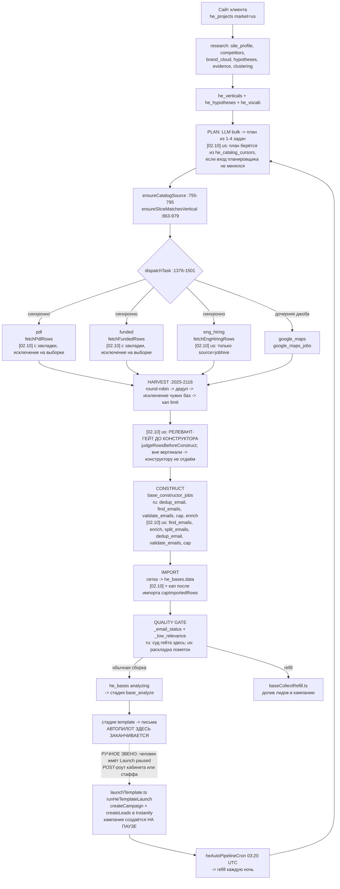

# HANDOFF: английский автоаутрич — источники баз и обработка

> **ОБНОВЛЕНО 2 октября 2026 — прочитай этот блок первым.** Документ написан 21.09, до
> волн 1–7 порта ENG. После него на той же ветке легли ещё 12 коммитов (26–30.09), и они
> переделали большую часть описанного: ENG-каталоги продолжают срез между ночами по
> закладке и исключают уже собранное ещё на выборке; конструктор у `us` разносит адреса
> по строкам, и у каждого адреса свой вердикт; релевант-гейт у `us` стоит ДО
> конструктора; запуск и долив отправляют только вердикт `ok`, у `us` строка без
> вердикта не уходит никуда; чёрный список клиента применяется и на первом запуске;
> у ночного долива появились бронь дневного бюджета, возврат компаний после ночи без
> отправки и пауза по ёмкости. Те места разделов 2–14, которые после этого стали
> неправдой, переписаны по коду коммита `775bd10d7` и помечены **[02.10]**; сводка
> изменений и статус дефектов D1–D20 — в §0.1. Не помеченный текст — снимок 21.09: всё,
> что повторный аудит 30.09 нашёл в нём устаревшим, исправлено и помечено, но номера строк
> в нём могли уехать.

**Дата:** 21 сентября 2026, обновлено 2 октября 2026
**Кому:** разработчику, который берёт на себя **новые источники баз для английского рынка** и **вариации обработки этих баз**.
**Снимок кода (исходный, 21.09):** ветка `claude/eng-wave0-20260920` = `origin/Sergey @ 7d2a016ef`
+ коммит волны 0. После rebase ветки на `ad150cb27` этот коммит называется **`137b88e4d`**;
прежний SHA `f616a8b64` в истории ветки не существует, искать его бесполезно.
**Снимок кода (обновление, 02.10):** ветка `claude/eng-port-20260925`, коммит **`775bd10d7`**
(14 коммитов поверх `ad150cb27`). Номера строк в местах с пометкой [02.10] — из него.
Раунд исправлений по повторному аудиту 30.09 ложится отдельным коммитом поверх
`775bd10d7` и может сдвинуть номера строк ещё раз. Все пути — от корня репозитория.

Коммит `137b88e4d` («seal the client boundary») — волна 0 порта ENG-кабинета: он трогал
только границу клиентского ответа (проекции полей, безопасные ошибки, RLS-lockdown `he_*`)
и **слоя сбора не касался**. Дальше о нём речи не будет.

**Как читать.** Раздел 2 — карта. Разделы 3–4 — то, где ты будешь жить. Раздел 10 —
чеклист, по которому добавляется источник. Раздел 11 — список сломанного; он важнее
остальных, потому что половина «недостающих фич» на самом деле уже написана и
не работает. Раздел 13 — что проверить в первый день.

Всё ниже выведено из чтения кода, миграций и compose. **Production и БД не опрашивались.**
Где утверждение не проверено кодом — это сказано явно. Где два прежних анализа
расходились, я открывал файл и решал; такие места помечены «перепроверено».

**Границы релиза — коротко, чтобы не искать** (полный текст — `AGENTS.md`, раздел
«Release and production boundary»; здесь пересказ, потому что файла у тебя может не быть):

1. Разрешённая точка остановки по умолчанию — **коммит и пуш в свою рабочую ветку**.
   Дальше — отчёт: имя ветки, SHA, результат прогона. Мержи и деплой делает владелец.
2. **Чужие именные ветки, `test` и `main` — запрещены** без явной просьбы именно про эту
   ветку в текущем разговоре. PR в `test`/`main` не создаём и не мержим.
3. **Production не трогаем**: ни `docker pull`/пересоздание контейнеров, ни миграции, ни
   рестарты — без явного разрешения **непосредственно перед** действием. Read-only
   диагностика прода разрешена, если она ничего не меняет.
4. Формулировки вида «почини», «сделай», «доведи до конца» разрешают **реализацию и
   проверку**, но не продвижение за пределы рабочей ветки и не деплой.

---

## 0. Для кого этот документ, что в нём есть и словарь терминов

**Для кого.** Для backend-разработчика, который никогда не видел этот продукт и которому
поручены ровно две вещи: **находить новые источники компаний для английского
авто-аутрича** и **строить вариации того, как собранные базы обрабатываются**. Всё
остальное (письма, интерфейс кабинета, биллинг) описано настолько, насколько нужно,
чтобы понять, куда попадает результат твоей работы, и не сломать его.

**Что внутри.** Раздел 1 — что это за продукт и почему движков два. Раздел 2 — конвейер
целиком, схемой и по абзацу на стадию. Раздел 3 — паспорт каждого источника, который
работает сегодня. Раздел 4 — планирование сбора: как рождается план и как строка плана
превращается в вызов коллектора; **это самый подробный раздел, в нём ты будешь жить**.
Раздел 5 — обработка базы конструктором. Раздел 6 — отбор компаний (релевант-гейт,
анализ базы, каталог идей из соседнего движка). Раздел 7 — контакты и передача в
рассыльщик. Раздел 8 — ночной долив. Раздел 9 — таблицы, формы jsonb, модели и
переменные окружения. Раздел 10 — **чеклист добавления нового источника**. Раздел 11 —
двадцать дефектов с тяжестью; он важнее остальных, потому что половина «недостающих
фич» на самом деле уже написана и не работает. Раздел 12 — что русское и английскому
рынку не годится. Раздел 13 — чего мы не знаем и что проверить в первый день. Раздел 14 —
карта кода: по строке на модуль с тем, зачем туда идти.

**Одно допущение про читателя, из которого всё написано:** у тебя **нет доступа к этому
репозиторию**. Поэтому пути и номера строк здесь — только провенанс («откуда это взято»,
чтобы коллега с доступом мог проверить), а всё, что нужно понять, **напечатано на
странице**: списки, константы со значениями, схемы, примеры JSON и SQL. Если где-то
осталось «см. такой-то файл» без сути рядом — это дефект документа, а не задание сходить
и прочитать.

**Словарь.** Термины ниже используются дальше без пояснений.

| термин | что это в этом продукте |
|---|---|
| **проект** | один клиент = один его сайт; строка `he_projects`, несёт рынок (`market`) и владельца (`created_by`) |
| **рынок** | значение `he_projects.market`: `'us'` — английский клиентский кабинет, `'ru'` — внутренний русский инструмент на том же коде |
| **кабинет** | клиентский веб-интерфейс `/client/eng` на `app.outreachos.xyz`, через который клиент видит проект и нажимает кнопки; всё, что он видит, проходит через слой проекции полей |
| **research** | первые шесть стадий движка: разбор сайта клиента, конкуренты, облако бренда, гипотезы, доказательства, кластеризация |
| **гипотеза** | предположение «кому и почему можно продать» — строка `he_hypotheses` со статусом (`accepted` / `rejected` / без статуса) и оценкой потенциала; план сбора строится по гипотезам |
| **вертикаль** | сегмент рынка после кластеризации гипотез: **один тип компании-клиента + один класс ЛПР**; строка `he_verticals` с именем, кратким описанием и синонимами. Сбор базы всегда идёт под одну вертикаль |
| **вокабуляр** | словарь вертикали (`he_vocab`), из него в планировщик источников уходят «типы компаний» |
| **источник** | одно из мест, откуда можно взять компании: справочная таблица или внешний парсер. Сегодня для английского рынка их четыре (раздел 3) |
| **план сбора** | результат одного вызова LLM: 1–4 **задачи**, каждая — один источник со своими фильтрами. Лежит в `he_bases.collect_info.plan` |
| **задача плана (срез)** | одна строка плана: источник + фильтры + обоснование. «Срез каталога» — задача к справочнику компаний |
| **коллектор** | функция, которая исполняет задачу плана и возвращает сырые строки источника |
| **база** | результат сбора: одна строка `he_bases`, внутри которой в jsonb лежат ВСЕ собранные строки (`data`), заголовки колонок (`columns`) и всё состояние сборки (`collect_info`) |
| **сетка** | двумерный массив строк `string[][]` — то, в каком виде база уезжает в конструктор и возвращается из него. Первая строка — заголовки |
| **конструктор баз** | отдельный общий сервис студии (таблица `base_constructor_jobs`, свой воркер в 12 реплик), который прогоняет сетку через цепочку **шагов обработки**: ищет почты на сайтах, валидирует их, тянет описания |
| **шаг** | одна операция конструктора (`find_emails`, `validate_emails`, …). У каждого свой класс стоимости и свои опции (раздел 5) |
| **релевант-гейт** | дешёвая LLM-проверка «принадлежит ли компания вертикали», которая ставит на строку пометку `_low_relevance` |
| **проба среза** | проверка качества каталожного среза ДО сбора, на выборке в 30 строк. **Написана, но выключена порогами** (§4.4) |
| **анализ базы** | отдельная стадия `base_analyze`: LLM смотрит 30 строк базы и пишет распределения, «заметные сегменты» и «рекомендованные углы» для писем |
| **шаблон** | строка `he_templates`: план писем + маппинг колонок базы в переменные письма (`operator_mapping`) + сведения о запуске (`launch_info`) |
| **цепочка** | последовательность писем вертикали (`he_chains`); к сбору отношения не имеет, но именно ради неё всё собирается |
| **оператор / персонализация** | подстановка значения колонки базы в текст письма; работает только для колонок, доехавших до `he_bases.data` |
| **запуск** | разовая передача базы в рассыльщик: создание кампании и загрузка лидов |
| **рассыльщик (провайдер)** | Instantly — внешний сервис рассылки, куда уезжают лиды. Кампания создаётся **на паузе**, включает её человек |
| **лид** | одна запись получателя в рассыльщике: email + переменные из колонок базы |
| **долив (refill)** | ночной процесс: собрать немного новых компаний и дозагрузить их в **уже запущенную** кампанию |
| **автопилот** | режим проекта, в котором следующая стадия ставится сама: готова цепочка → собираем базу; готов анализ → делаем шаблон |
| **harvest** | сырые строки одной задачи плана, сложенные в состояние сборки до слияния |
| **«сжечь рынок»** | сохранить компанию в базе проекта, не отправив ей письмо: она навсегда попадает в ключи исключения и больше никогда не будет собрана (D2) |

### 0.1 Что изменилось после 21.09 **[02.10]**

Коммиты ветки после этого документа, в порядке появления. В третьей колонке — только то,
что касается источников и обработки баз.

| коммит | дата | что изменилось для твоей темы |
|---|---|---|
| `8b469355a` | 26.09 | Колонка `website` больше не теряется после конструктора (D3). Долив, упавший до первой строки у провайдера, возвращает компании базы в пул (база → `failed`), но только первому отказу в серии. Долив зовёт провайдера с `entitlementMode='managed_contract'`: объём режет дневной кап проекта, а не self-serve тариф клиента |
| `cceec7f4c` | 27.09 | У `us` конструктор разносит адреса по строкам (`split_emails`), у каждого адреса свой вердикт; глубокий обход сайта (до 4 страниц, до `кап+1` адресов, 30 с на сайт). Кап «адресов на компанию» задаёт клиент (`he_projects.max_emails_per_company`, по умолчанию 5) и накладывается ещё раз после импорта. Отправляется только `ok`; у `us` строка без вердикта не отправляется. Чёрный список клиента — и на первом запуске, fail-closed. Окно отправки выбирает клиент (`he_launch_schedule`). Потолок запуска у `us` выбирает сильнейшие адреса вместо отказа 413. Размер ночной сборки считается из дневного капа |
| `970a1fed0` | 28.09 | Релевант-гейт у `us` судит строки ДО конструктора; строкам вне вертикали поиск и проверка адресов не оплачиваются. Частичный запуск (сплит по сегментам) записывается и достраивается повтором без дублей. Предполёт ёмкости воркспейса рассыльщика перед ночной сборкой |
| `659a9418b` | 29.09 | Транспорт провайдеров: честные отказы (биллинг, лимиты), стадия, повисшая без активности, заканчивается сама |
| `7e8d1c250` | 29.09 | Пара «база + джоба анализа» закрывается повтором; база переживает блип БД. Автоподъём баз после транзиентного сбоя — за флагом `HE_AUTO_RESUME_TRANSIENT`, по умолчанию выключен |
| `38da678f3` | 29.09 | Клиент БД стадий (`ctx.supabase`) больше не общий `supabaseAdmin`: у запроса есть срок, и сигнал джобы его обрывает. Записи, фиксирующие уже оплаченное, идут отдельным клиентом без сигнала (`paidCheckpointDb`). Тик ожидания конструктора выходит до DISPATCH/HARVEST (D13). `tasks[].harvest` снимается на каждой терминальной записи базы |
| `623ecef4f` | 29.09 | Причина остановки автопилота записывается; ночной проход примирения — за флагом `HE_AUTOPILOT_RECONCILE`, по умолчанию выключен |
| `ca5897b2e` | 29.09 | **Закладка каталога между ночами** (таблица `he_catalog_cursors`), исключение уже собранного на выборке, переиспользование плана источников (D1, D7). `eng_hiring` у `us` читает только `source='jobhive'`. Порог размера (`sizes`, `min_funding_usd`), которого не требуют гипотезы, снимается с плана после ответа модели |
| `6f01ebdf5` | 29.09 | Внутри задачи строки с сайтом/почтой идут первыми. Лестница расширения исчерпанного среза — за флагом `HE_COLLECT_WIDEN`, по умолчанию выключена. Правило «сухой вертикали» — за флагом `HE_VERTICAL_DRY_STOP`, по умолчанию выключено |
| `4f5edef6b` | 30.09 | Бронь дневного бюджета долива в SQL (`he_reserve_refill_daily_budget`), возврат компаний после ночи без отправки, durable-пауза ночного долива проекта по ёмкости (`he_auto_pipeline_configs.refill_paused_at`) |
| `db1ec2793` | 30.09 | Гейт видит у EN-строки рубрику и описание до 200 символов; невалидный или усечённый ответ модели дробится 50 → 10 → 1 в пределах бюджета вызовов |
| `775bd10d7` | 30.09 | У `us` сайт клиента читается с `Accept-Language: en-US,en` и обратным порядком групп прокси; шаги конструктора EN-джобы пропускают каталоги, карточки профилей, ATS и соцсети в колонке сайта; досье вертикали `us` не опрашивает российские источники. В раунде исправлений 02.10 к этому добавлено: шаг описаний EN-джобы читает сайт тем же `Accept-Language`, что и поиск почт, снова читает статьи Википедии и не пишет в колонку описания русских подписей (§5.3) |

**Статус дефектов D1–D20 на `775bd10d7`.** Сама таблица §11 оставлена как была 21.09 —
это история; читай её вместе с этой.

| # | статус | чем и что осталось |
|---|---|---|
| D1 | **исправлен для `us`** | `ca5897b2e`: закладка в `he_catalog_cursors`, исключение на выборке, план переиспользуется. Оговорка в §8.2 |
| D2 | **частично** | После ночи без отправки компании возвращаются в пул, но только первой в серии отказов. Компании, отрезанные дневным капом, чёрным списком или отсевом Instantly у успешной ночи, по-прежнему остаются в `data` базы и исключены навсегда. §8.2 |
| D3 | **исправлен** | `8b469355a`: ключ `website` в `CONSTRUCT_HEADER_MAP` |
| D4 | **исправлен для `us`** | `cceec7f4c`: у `us` строка без вердикта не уходит ни запуском, ни доливом. RU-инструмент отправляет такую строку, как и раньше, и считает её в предупреждении |
| D5 | **не дефект — решение** | fail-open гейта — осознанный выбор, записанный в шапке `relevanceGate.ts`. Состав путей fail-open изменился, см. §6.1. Переделывать его в fail-closed — решение владельца, не правка |
| D6 | открыт | метки фильтров по-прежнему не сверяются с `pdl_facets()` |
| D7 | **исправлен для ENG-каталогов** | `ca5897b2e`: `exhausted` / `continued` / `partial` / `hit_ceiling`, причина «Сегмент исчерпан» достижима |
| D8 | открыт | рыночного гейта на коды источников так и нет |
| D9 | **исправлен** | `cceec7f4c`: чёрный список на первом запуске в ОБОИХ контурах, fail-closed: не прочитался — запуск не состоялся |
| D10 | **исправлен для `us`** | `cceec7f4c`: одна строка = один адрес = свой вердикт. RU-путь без изменений |
| D11 | открыт, но безвреден для отправки | `unknown`/`error` не перепроверяются, но и не отправляются: допускается только `ok` |
| D12 | **частично** | `db1ec2793`: у EN-строки гейт видит сайт, рубрику и описание до 200 символов. Гипотезу гейт по-прежнему не видит |
| D13 | **исправлен** | `38da678f3`: ранний выход тика ожидания конструктора |
| D14 | мина осталась, последствие стало безопасным | импорт по-прежнему ищет `'email статус'`; если колонка не найдётся, у `us` строки останутся без вердикта и не уйдут никуда (fail-closed) |
| D15 | неактуален для `us` | голый `.gte('published_at', …)` остался, но `us` читает только `jobhive`, а не досок без даты |
| D16 | **исправлен для `us`** | `cceec7f4c`: `split_emails` + кап после импорта (`capImportedRows`) |
| D17 | открыт | долив по-прежнему не запускает `base_analyze` |
| D18 | открыт | пороги пробы по умолчанию `0`; но при переиспользованном плане проба не оплачивается вовсе |
| D19 | открыт | страница каталога всегда 1000 строк |
| D20 | **перевернулся** | у `us` после разноса адресов `row_count` (строки = адреса) обычно БОЛЬШЕ `stats.rows_total` (компании до конструктора). Число компаний готовой базы — `stats.companies_total`, клиенту не проецируется |

### 0.2 Поверх `775bd10d7`: раунд исправлений 02.10 **[02.10]**

Повторный аудит ветки 30.09 закончился раундом исправлений, который ляжет одним коммитом
поверх `775bd10d7` и уйдёт вместе с этим документом. Разделы с пометкой [02.10] описывают
`775bd10d7`; ниже — места, где раунд меняет то, что там написано. Список собран по рабочему
дереву раунда до коммита: сверяй его с итоговым коммитом.

| что | на `775bd10d7` (так описано в разделах) | после раунда |
|---|---|---|
| закладка `funded` и `eng_hiring` (§3, §8.2) | keyset `(created_at, id)`, закладка между ночами в `he_catalog_cursors` | закладку между сборками держит **только `pdl`** (замороженный дамп, строки на месте не переписываются). `funded` и `eng_hiring` читаются с первой строки среза каждую сборку: их строки переписываются на месте, и закладка по времени вставки теряла бы их. Уже собранные компании по-прежнему отсеиваются на выборке и `limit` не тратят, так что ночь всё равно получает новые компании; цена — бесплатный скан до потолка страниц |
| чтение `eng_hiring` у `us` (§3.3) | keyset `(created_at, id)` | самые свежие первыми: `order by published_at desc, id`, офсетные страницы, потолок 20 страниц; плюс фильтр `last_seen_at` не старше 3 суток (`ENG_HIRING_FEED_FRESH_DAYS`): если ночной инжест jobhive молчит дольше трёх суток, источник честно отдаёт ноль строк |
| EN-промпт плана про `eng_hiring` (§4.2) | «любые английские роли, кэш ATS-досок» | «только коммерческие роли: продажи, business development, partnerships, revenue»; гипотеза о найме других ролей задачи `eng_hiring` не получает |
| релевант-гейт `ru` (§6.1) | общий с `us` поток волны 7: дробление, повторы, остановки прохода | вернулся к поведению до ветки: батч 50, один вызов, сбой снимает только этот батч |
| релевант-гейт `us`, исходы сбоя (§6.1) | `permanent` останавливает проход | `permanent` пропускает только сегмент; проход останавливается после трёх сегментов подряд без ответа модели (`MAX_UNANSWERED_IN_A_ROW`) и когда суммарное время неудачных транспортных попыток дошло до 30 минут (`MAX_TRANSPORT_LOSS_MS`) |
| размер ночной сборки (§8.2) | пересчитывается на тиках сборки | считается один раз, на тике, который строит план, и дальше заморожен в `collect_info.limit` |
| `he_bases.contact_cap_applied` (§9.1) | пишется финальной записью базы | больше не пишется (читателя не было); кап базы — `collect_info.construct.contact_cap`. Колонку миграция `20260926_0001` по-прежнему заводит |
| шаг описаний EN-джобы конструктора (§5.3) | русский `Accept-Language`, русские подписи склейки и заглушка в колонке `Description`, Википедия пропускается | `Accept-Language: en-US,en` (как у поиска почт той же джобы), английские подписи, заглушка «страница ответила, текста нет» в ячейку не пишется, статьи Википедии читаются |
| перевёрнутый порядок прокси при чтении сайта клиента `us` | без «другой» ноды молча сводился к обычному маршруту | то же, но со строкой в лог воркера (не чаще раза в 10 минут) с причиной: группа вне приоритетной не настроена или все её ноды выбыли |
| запись о запуске и достройка (§7) | `launch_info` пишется один раз, после всего цикла; достройка заново зовёт платный классификатор сегментов и собирает долг только из его групп этой попытки, поэтому сегмент, не получивший группы, молча пропадал | запись идёт по ходу запуска: сразу после id новой кампании, после каждого подтверждённого чанка (по 1000 адресов) и после сбоя группы. Каждый элемент `pending` несёт `emails` — ещё не отправленные адреса, и достройка шлёт ровно их, без классификатора. Аренда `running_until` (15 мин) отвечает второму запросу 409, а не запускает параллельно. Достройка идёт через пресет самой записи, удалённую у рассыльщика кампанию заменяет новой (`skip_if_in_campaign` включён). `pending` есть и у идущего запуска, поэтому кабинет пишет «has not gone out yet», а не «did not go out» |
| возврат компаний упавшего долива (§8.2) | любой нулевой исход брони и любой отказ до провайдера уводят базу в `failed`, только первому отказу в серии | `cap_exhausted` (кап проекта занят другими бронями) возвращает компании всегда и в серию отказов не идёт. `already_reserved` (бронь держит прошлый прогон этой же базы, который мог уже отправить) компании НЕ возвращает: база `analyzed` без `error`. Отмена клиентом без доставки — `failed` с текстом `Cancelled by user` и `stats.cancelled`, в серию тоже не идёт. Строки, которые рассыльщик явно отклонил по ёмкости, доставкой не считаются. Серия (`refillFailStreak`) теперь видит и зависшие `collecting`-строки — по статусу их базы. **Не закрыто:** таймаут конструктора 6 ч и финальный ремонт воркера возвращают refill-базу, не спрашивая серию, и задачу конструктора не отменяют — при затяжной очереди конструктора тот же срез покупается каждую ночь |
| кап-отрез долива (§8.2) | `kept.slice(0, granted)`: весь кап уходит нескольким первым компаниям по всем их адресам, остальные оплаченные компании выжигаются без письма | отрез по компаниям, как у ручного запуска (`selectLeadsWithinLaunchCap`): сначала по одному адресу каждой компании, потом вторые; сколько компаний осталось без письма — `stats.capped_companies` |

Что из этого важно для новых источников: шаг 9 §10 (точки регистрации) остаётся в силе, но
закладку между сборками после раунда получит только источник, который, как `pdl`, никогда
не переписывает строки на месте; живой фид будет читаться с начала среза каждую сборку.

---

## 1. Что это за продукт и где он живёт

`app/src/lib/hypothesisEngine` (таблицы `he_*`, воркер `app/worker/hypothesisEngine.ts`,
ночной крон `app/worker/heAutoPipelineCron.ts`) — production-бэкенд **английского
клиентского кабинета** `/client/eng` на `app.outreachos.xyz`. Проекты кабинета несут
`he_projects.market = 'us'`.

Продуктовая логика: сайт клиента → research → гипотезы о целевых аудиториях →
вертикали → **сбор базы под вертикаль** → цепочка писем → запуск в рассыльщик (Instantly) →
ночной долив новых контактов в уже запущенную кампанию.

Тот же код обслуживает **легаси-инструмент внутренней команды** `/tools/hypothesis-engine`
с `market = 'ru'`. Один движок, два рынка. Переключатель ровно один —
колонка `he_projects.market` (`app/src/lib/hypothesisEngine/market.ts:9-26`), воркер кладёт
её в `ctx.market` (`app/worker/hypothesisEngine.ts:191-199`). Большинство веток ветвятся
по нему, поэтому **любое утверждение о поведении обязано называть рынок**. Ниже
помечено **[us]** и **[ru]**; без пометки — общее.

Рядом живёт `app/src/lib/verticalEngineV2` (таблицы `ve_*`) — **отдельный** внутренний
движок для русского рынка, отпочкованный отсюда 21.08.2026 и с тех пор сильно ушедший
вперёд. Архитектурное правило (`docs/design/2026-08-20-vertical-engine-v2-isolation.md`):
движки **не импортируют бизнес-код друг друга**, это проверяет
`app/tests/architecture/verticalEngineV2Isolation.test.ts:93-141`. Для тебя V2 —
**источник идей и предупреждений, не библиотека**. Скопировать чистую функцию можно,
импортировать — нельзя, сборка упадёт.

---

## 2. Схема конвейера end to end



> **Пунктирная стрелка — единственное ручное звено во всём «авто-аутриче».** Автопилот
> доводит проект до готового шаблона и **останавливается**: `enqueueAutopilotFollowups`
> реагирует только на стадии `chain` и `base_analyze`, комментарий в коде прямо говорит
> «`base_collect` сама ставит `base_analyze`, `template` — терминальная»
> (`autopilotNext.ts:133-139`). `runHeTemplateLaunch` вызывается **только** из двух
> POST-роутов: кабинет (`api/client/eng/templates/[id]/launch/route.ts:134,161`) и стафф
> (`api/tools/hypothesis-engine/templates/[id]/launch/route.ts:77,99`). Ночной долив
> (`O`) существует только для вертикалей, у которых кампания уже создана этим ручным
> нажатием, — см. §8.1.

Стадии по порядку — по одному абзацу.

**PLAN.** Один вызов LLM роли `bulk` превращает вертикаль + её гипотезы + вокабуляр в
план из 1–4 задач, каждая — один источник с параметрами (`baseCollect.ts:626-735`).
План кэшируется в `he_bases.collect_info.plan` и при self-requeue заново не строится
(`:1914`). Дальше две страховки: `ensureCatalogSource` дорисовывает каталожный срез,
если модель его пропустила (`:755-795`), и `ensureSliceMatchesVertical` пробует срез на
30 строках (`:863-979`) — **при дефолтных порогах проба ничего не решает, см. §4.4**.
**[02.10]** У `us` перед вызовом модели считается хеш входа планировщика (имя и описание
вертикали, синонимы, отобранные гипотезы, типы компаний, рынок, ревизия промпта
`HE_SOURCE_PLAN_REVISION`); совпал с сохранённым в `he_catalog_cursors` — план берётся
оттуда, и ни планировщик, ни проба среза не оплачиваются (`ca5897b2e`).

**DISPATCH.** Цикл по задачам плана, строго последовательно (`:1971-1987`).
`dispatchTask` (`:1376-1501`) разводит по трём веткам: RU-реестр, ENG-справочники
(синхронное чтение таблицы прямо здесь) и дочерние джобы парсеров. `collect_info`
персистится **после каждой задачи** (`:1986`) — сборка переживает падение воркера.
Ошибка одной задачи не валит сбор: задача уходит в `failed`, остальные продолжаются.
**[02.10]** ENG-справочники у `us` читаются с закладки среза и пропускают компании других
баз проекта ещё на выборке; оборванное чтение сохраняет разобранный префикс
(`partial`), а не роняет задачу — подробности в §8.2.

**WAIT.** Только для дочерних джоб (`:1989-2023`). Опрос статуса, таймаут 3 ч от
`dispatched_at` (`:984`, `:1996-2004`), иначе self-requeue с паузой 30 с (`:1586`).
Для чисто английской сборки без `google_maps` этой фазы фактически нет.

**HARVEST** (`:2025-2116`). Выброс строк с пустым нормализованным именем → round-robin
слияние задач (`interleaveTaskHarvests`, `:416-428`) → дедуп по ключу
`имя|хост` (`dedupUnifiedRows`, `:368-404`) → исключение компаний **из других баз этого
проекта** (`:2041-2046`) → кап `limit` (`:2049`). **[02.10]** У `us` внутри каждой
задачи строки с сайтом или почтой поднимаются наверх до round-robin (`contactableFirst`).
Тик чистого ожидания конструктора до HARVEST больше не доходит: он опрашивает
BC-джобу и уходит в self-requeue (`38da678f3`, D13 закрыт).

**CONSTRUCT** (`:2118-2229`). Вся база одной джобой уезжает в общий конструктор баз
(`base_constructor_jobs`, воркер `app/worker/baseConstructor.ts`, 12 реплик на проде).
Там ищутся и валидируются почты. Ожидание — тики по 60 с, таймаут 6 ч (`:1713`).
Импорт обратно — `importConstructRows` (`:1807-1866`).

**QUALITY GATE** (`:2231-2273`). Две пометки прямо в jsonb-строках базы:
`_email_status` (вердикт валидации) и `_low_relevance` (LLM-гейт релевантности).
В `columns` их нет. Сами пометки `_low_relevance` не видит никто, кроме запуска и
долива; `_email_status` **проходит в кабинет** и рисуется отдельной колонкой превью —
это единственное исключение из default-deny (§6.1). **[02.10]** У `us` гейт судит строки
раньше, ДО конструктора, и здесь только раскладывает свои пометки; судит здесь он только
RU-сборку и ENG-базу, у которой суд до конструктора не состоялся. Число помеченных строк
`stats.low_relevance` клиенту теперь проецируется (§6.1).

**Финал.** Обычная сборка: `he_bases → analyzing` + постановка стадии `base_analyze`
(`:2293-2313`). Refill-режим: вместо этого `runHeRefillAppend` — долив лидов в
запущенную кампанию (`:2279-2291`).

---

## 3. Источники сегодня

Английский план знает ровно **четыре** источника, и они перечислены только в EN-промпте
(`app/src/lib/hypothesisEngine/prompts/sourcePlan.en.ts:28-31`).

| код | что физически | чем опознаёт компанию | какие поля отдаёт в базу | чего стоит | практический потолок | как узнаём об исчерпании |
|---|---|---|---|---|---|---|
| `pdl` | таблица `pdl_companies` — замороженный снимок People Data Labs | `id` каталога PDL; де-факто идентичность — домен из `website` (заполнен у 100% строк) | `company`, `website`, `address` (город+регион+страна), `category` (метка индустрии), `employees` (бакет штата) | 0 внешних денег; цена — время БД: холодный кэш **209 с** на первое касание среза против 1.1 с на повторном (замер 12.08, `baseCollect.ts:1093-1106`) | размер справочника минус фильтр; расхождение в цифре — см. ниже. **[02.10]** за задачу просматривается не больше 60 страниц × 1000 (`ENG_CATALOG_MAX_PAGES`) | **[02.10]** флаги задачи `exhausted` + `continued` (выдача за закладкой кончилась), `hit_ceiling`, `partial` — §8.2 |
| `funded` | таблица `funded_companies` — YC + SEC Form D + PDL-обогащение | `id` вида `'<источник>:<натуральный ключ>'` | `company`, `website`, `address`, `category`, `source_detail='funded:<yc\|sec_formd\|pdl>'` | 0 | ~6k строк YC + раунды SEC (только США); **[02.10]** те же 60 страниц × 1000 | **[02.10]** как у `pdl` |
| `eng_hiring` | таблица `eng_hiring_cache`. **[02.10]** У `us` читается ТОЛЬКО слой `source='jobhive'` — ночной bulk-фид, отфильтрованный до B2B-sales-вакансий (`ca5897b2e`). Строки нативно сканированных ATS-досок (greenhouse, lever, ashby…) в кэше лежат, но в ENG-базу не попадают (§3.3) | `company_name` (строка!); у jobhive одна строка на компанию и страну (`source_job_id = 'jh:<компания>:<страна>'`), и вакансия в ней переписывается ингестом на месте | `company`, `website` (у jobhive пуст ВСЕГДА — дособирается из PDL, до 300 строк на задачу), **`vacancy_title` — крючок персонализации**, `address`, `category` ← `company_description` (у jobhive сегодня тоже пусто) | 0 | 20 страниц × 1000 = **20 000 просканированных строк на задачу** | **[02.10]** как у `pdl` |
| `google_maps` | живой парсер через `services/googleparsers` | имя места в выдаче карт | `company`, `website`, **`email`**, **`phone`**, `address`, `category` | прокси-трафик и время (задержки 1200–2800 мс между запросами) | 100 мест на запрос; в плане не больше 4 задач | **никак** |

Три из четырёх — это чтение локальных справочников. Живой парсинг в ENG-сборе ровно
один, и он требует рабочего пула прокси.

**Ни один ENG-источник не отдаёт email** — кроме карт. Для `pdl`, `funded` и `eng_hiring`
колонка `email` пуста у 100% строк, и все адреса добывает конструктор скрапом сайта (§7.1).
Отсюда простое правило: **строка без `website` почти наверняка не станет контактом.**

**Serper в стадии сбора не используется вообще.** Перепроверено:
`stages/baseCollect.ts` не импортирует `resolveSearch`; единственные потребители —
research-стадии (`stages/evidence.ts:90`, `brandCloud.ts:70`, `vocab.ts:84`,
`competitors.ts:64`). Гео для них — `serperGeoForMarket` (`market.ts:14-16`),
для `us` это `{gl:'us', hl:'en'}`. То есть платный discovery-поиск **на этапе сбора** —
чистое поле, его нет.

Признаков `exhausted` / `hit_ceiling` ни один ENG-источник не выставляет — они есть
только в ветке RU-реестра (`baseCollect.ts:1401-1414`). Последствие в D7.
**[02.10] Больше не так.** С `ca5897b2e` все три ENG-каталога у `us` ставят задаче
`exhausted` (выдача кончилась на короткой странице), `continued` (чтение стартовало с
сохранённой закладки), `hit_ceiling` (стоп по потолку страниц — НЕ исчерпание) и `partial`
(чтение оборвалось, разобранный префикс сохранён). Причина «Сегмент исчерпан» у ENG
достижима; правило — в §8.2.

### 3.1 `pdl` — каталог компаний

| | |
|---|---|
| таблица | `public.pdl_companies`, миграция `supabase/migrations/20260609_0001_create_pdl_companies.sql` |
| идентификатор | `id text primary key` — id компании в PDL |
| чтение | RPC `search_pdl_companies`, `fetchPdlRows` (`baseCollect.ts:1126-1168`) |
| фильтры | `industry` / `size` / `country` — **точное равенство** элементу массива; `name` — `ilike '%…%'` |
| пагинация | keyset по `id` (`p_after_id`), страница `ENG_CATALOG_PAGE_SIZE = 1000` (`:1065`). **[02.10]** У `us` — с закладки среза из `he_catalog_cursors` (ключ — только `id`: bulk-дамп, вставок между ночами нет), компании других баз проекта пропускаются на выборке и `limit` не тратят, потолок 60 страниц |
| поля RPC | `id, name, website, industry, size, country, region, locality, description` |
| в базу доезжает | `mapPdlRow` (`:279-288`): `company`, `website`, `address`←`locality, region, country`, `category`←industry, `employees`←size, `source_detail='pdl'` |
| ретраи | паузы `3000,20000,60000` мс, env `HE_PDL_READ_RETRY_DELAYS_MS` (`:1107-1114`) |

Два свойства, важных для конструктора: у каждой строки **гарантированно есть website**
(инжест отбрасывает пустые, `app/scripts/pdl/ingest-pdl.sql:36`), и **нет ни почты,
ни телефона** — таких колонок в таблице нет. Всю почту для pdl-строк добывает конструктор.

**Что именно читает коллектор.** RPC возвращает ровно девять колонок:
`id, name, website, industry, size, country, region, locality, description`. Из них
`mapPdlRow` берёт пять (`name`, `website`, `industry`, `size` и тройку
`locality/region/country` в один `address`); `id` используется только как курсор
пагинации, `description` каталога **выбрасывается** — в базу доезжает не он, а описание,
которое конструктор отдельно скрапит с сайта шагом `enrich_descriptions` (§5.3).

**Почему RPC, а не плоский PostgREST.** Миграция `20260812_0001_search_pdl_companies.sql:1-18`
объясняет: на широких фильтрах планировщик уходил в pkey-scan, 58 с+, Kong отдавал 504.
Внутри RPC — `with m as materialized (…)`, то есть принудительный план «фильтр по индексу
`(country, industry, size)` → сортировка». Актуальная версия функции —
`20260901_0001_pdl_company_catalog_search.sql` (добавлен `description`, клэмп `p_limit`
до 100000, `statement_timeout = '120s'`).

**Размер справочника — расхождение ТРОЙНОЕ, и это открытый вопрос, а не опечатка.**
В дереве лежат три несовместимых числа, каждое написано в своё время и своим автором:

| число | где написано | контекст |
|---|---|---|
| **~6–9M строк, 19 стран** | `app/scripts/pdl/README.md:4` + список стран в `app/scripts/pdl/ingest-pdl.sql:38-42` (`united states, united kingdom, germany, france, netherlands, spain, italy, ireland, sweden, poland, belgium, switzerland, austria, denmark, norway, finland, portugal, canada, australia`) | что **залил бы** скрипт из репозитория: «~22M companies → ~6–9M после фильтра EU/US + has-website» |
| **~19.5M строк, 249 стран** | `supabase/migrations/20260612_0001_pdl_stats_target.sql:3,5`; та же цифра независимо повторена в `20260812_0001_search_pdl_companies.sql:5` («на 19.5M строк») | зачем поднят `statistics target` до 1000: «With the whole-world dataset (~19.5M companies across 249 countries)…» — то есть автор миграции видел на проде **весь мир**, а не 19 стран |
| **~13M строк с сайтом** | `app/scripts/funded/README.md:79` («One pass over `pdl_companies` (~13M rows with website)») и комментарий схемы `app/src/lib/hypothesisEngine/schemas.ts:297` («нефильтрованный срез 13M-строкового справочника») | замер/оценка людей, которые реально ходили по таблице в августе |

Все три могут быть правдой в разные моменты времени, и ни одно не проверено. Практически
это значит: **список стран, доступных ENG-плану, по репозиторию не выводится**, и пока
не сделан `select count(*), count(distinct country) from pdl_companies`, любая работа
«добавим Индию/ОАЭ/Бразилию» — гадание. Это открытый вопрос №1 (§13.1).

**Снимок заморожен.** README прямо: «The HF mirror is a frozen 2025 snapshot»; обновление =
`DELETE` + полный реинжест вручную, крона нет. Доля мёртвых доменов со временем будет
только расти — это самый недооценённый риск английской части.

### 3.2 `funded` — стартапы и раунды

| | |
|---|---|
| таблица | `public.funded_companies`, `supabase/migrations/20260609_0004_create_funded_companies.sql` |
| идентификатор | `id text primary key` вида `'<source>:<natural_key>'` |
| чтение | `fetchFundedRows` (`baseCollect.ts:1175-1207`) — прямой PostgREST, без RPC, без ретраев |
| колонки, которые читает коллектор | ровно 13, `select` на `:1186`: `id, name, website, industry, country, region, locality, total_funding_usd, last_funding_usd, last_funding_type, last_funding_date, batch, source`. Маппер использует шесть (`name`, `website`, `industry`, `source` + `locality/region/country` в `address`), `id` — курсор; **шесть денежных/раундовых колонок читаются и тут же выбрасываются** |
| пагинация | keyset по `id` (`.gt('id', lastId).order('id')`), страница та же `ENG_CATALOG_PAGE_SIZE = 1000`. **[02.10]** У `us` — keyset по ВРЕМЕНИ ВСТАВКИ `(created_at, id)` с закладки среза: живой фид, и `id` вида `<источник>:<ключ>` с порядком вставки не связан, так что закладка по `id` отправила бы за курсор ровно свежие раунды. К `select` добавлен `created_at` |
| фильтры | `applyFundedFilters` (`app/src/lib/funded/queryFilters.ts:30-44`): `industry`/`country` через `in`, `minFunding` → `or(last_funding_usd.gte.X, total_funding_usd.gte.X)`, `fundedSince` → `gte(last_funding_date)` |
| в базу доезжает | `mapFundedRow` (`:291-299`). **Суммы, даты раундов, batch, инвесторы, описание отбрасываются** — их некуда положить, см. §9.2 |

Таблица источник-агностична, один `source`-тег на строку:

| тег | что даёт | как обновляется |
|---|---|---|
| `yc` | ~6k компаний YC: имя, сайт, описание, batch, stage, теги | скрипт `ingest-yc.mjs`; README прямо: **крон на проде НЕ установлен**, строки освежаются только ручным прогоном |
| `sec_formd` | раунды частного финансирования США: сумма, дата, тип | квартальный bulk вручную + **ежедневный поллер `poll-sec-daily.mjs`, крон установлен на прод-сервере** (`40 6 * * *`, по README) |
| `pdl` | обогащение SEC-строк сайтом/индустрией по нормализованному имени | `enrich-sec-from-pdl.sql` вручную; даёт сайт ~28% безсайтовых SEC-строк (замер 2026-08-02) |

Практические потолки, которые надо знать **до** того, как предлагать funded как рабочую лошадку:

1. Свежесть финансирования — **только США** (SEC). Глобального покрытия раундов нет.
2. У SEC-строк часто **нет сайта** до PDL-обогащения. Строка без сайта почти наверняка
   вылетит из базы на конструкторе (§5.3).
3. `industry` у YC — своя таксономия, у SEC — часто NULL. Общий словарь с `pdl`
   **не гарантирован**, а промпт просит «same format as pdl» (`sourcePlan.en.ts:29`).
   Значит `industries`, подобранные моделью под PDL, на funded дадут ноль.
4. Зафиксированный инцидент (`queryFilters.ts:1-6`): строки с `industry='b2b'` — все YC,
   и у них нет `last_funding_date`; приблизительный счётчик показывал ≈1700 там, где
   строгий поиск возвращал 0.

Пути расширения уже описаны в `app/scripts/funded/README.md`, раздел «Adding sources later»:
**Wikidata** (CC0, ~108K+ компаний с официальным сайтом P856 — самая чистая для
клиентской перепродажи) и **Bright Data Crunchbase** (платно, ~$2.50/1k). Обе — один
скрипт инжеста с новым `source`-тегом, **без изменений UI, API и стадии сбора**.
Это самый дешёвый способ добавить объём английскому рынку.

### 3.3 `eng_hiring` — сигнал найма из ATS

| | |
|---|---|
| таблица | `public.eng_hiring_cache`, `supabase/migrations/20260612_0001_create_eng_hiring_parser_tables.sql` |
| идентификатор компании | `company_name` (строка); уникальность строки — `(source, source_job_id)` |
| чтение | `fetchEngHiringRows` (`baseCollect.ts:1321-1374`; **[02.10]** на `775bd10d7` — `:2714-2876`) |
| колонки, которые читает коллектор | **[02.10]** 11, `select`: `id, created_at, company_name, company_site_url, company_description, vacancy_title, location, country, country_code, source, published_at`. `id, created_at` — ключ закладки; `company_description` уезжает в `category` строки (обрезка до 200 символов по границе слова); маппер использует ещё `company_name`, `company_site_url`, `vacancy_title`, `location`‖`country`, `source`. **`vacancy_description`, `salary_*`, `vacancy_url`, `source_job_id` не читаются вовсе** |
| фильтры SQL | **[02.10]** у `us` первым стоит `source = 'jobhive'`; дальше как было: `country_code in (…)`, `published_at >= cutoff`, `or(…)` по `vacancy_title ilike` |
| фильтр JS | точный `buildRolesRegex` по `vacancy_title` (`:1348`) |
| пагинация | **[02.10]** у `us` — keyset `(created_at, id)` с закладки среза, `order by created_at, id`, потолок `ENG_HIRING_MAX_PAGES = 20`. Офсетная `range(…)` с `order by published_at desc` осталась только в ветке без закладки — у `us` она не исполняется |
| строки мутабельны | **[02.10]** ингест jobhive делает upsert по `(source, source_job_id)`, а `source_job_id` — `jh:<компания>:<страна>`: одна строка на компанию и страну, вакансия в ней переписывается, `created_at` остаётся от первой вставки. Поэтому закладка через строку с несовпавшей ролью НЕ переносится: завтра в ней может стоять подходящая вакансия |
| дедуп внутри задачи | по нормализованному имени компании, выживает самая свежая вакансия (`:1354-1364`); **[02.10]** в режиме закладки дедуп потоковый, победитель тот же |
| в базу доезжает | `mapEngHiringRow` (`:302-310`): `company`, `website`←`company_site_url`, **`vacancy_title` — крючок персонализации**, `address`, `source_detail='eng_hiring:<source>'`; **[02.10]** плюс `category`←`company_description` |

**SQL-предфильтр роли** — `buildRolesIlikeFilter` (`:1234-1250`). Контракт жёсткий:
выражение обязано быть **надмножеством** regex-совпадений, иначе предфильтр молча срежет
валидные строки. Отсюда два правила: терм с `b2b` раскрывается regex'ом в ~30 альтернатив
(часть — regex-фрагменты, ilike их не выразит) → **предфильтр отключается целиком**,
`return null` (`:1244`); любой другой терм обрезается по первому символу, ломающему
синтаксис `or=(…)`. Зачем он появился (`:1221-1226`): 12.08 на проде под фильтры
«страна + 90 дней» подходило 336k строк, сканировались первые 20k (5.9%), из 78
franchise-вакансий в окно попадала одна — **все девять ENG-сборок получили от
`eng_hiring` ровно 0 строк**.

**Досбор сайта из локального PDL** — `fillMissingCompanySites` (`:1278-1310`), единственное
место, где источники пересекаются. У ATS-фида `company_site_url` заполнен только у **~13%**
строк (замер 15.08: greenhouse 26%, smartrecruiters 2.8%, workable 0.5% — комментарий
`:1263-1264`). **[02.10] Эти 13% — замер на нативно сканированных досках, а у `us` они больше
не читаются.** Ингест jobhive пишет `company_site_url = null` и `company_description = null`
у каждой строки (`app/src/lib/parsers/jobhiveIngest.ts`), поэтому на главном пути ENG сайт
есть только у тех строк `eng_hiring`, которые нашёл этот резолвер, — не больше 300 на
задачу. Резолвер — `resolveCompanyDomainViaPdl`
(`app/src/lib/parsers/companyDomainResolver.ts:38-63`): префиксный `ilike` по
`pdl_companies.name`, уточнение по стране, и **отказ угадывать при коллизии** — если после
дедупа больше одного домена, возвращается пусто (`:61-62`). Clearbit-фолбэк сознательно
не используется (рейтлимитит и шеллится в `curl`). Потолок — 300 строк на задачу,
параллельность 8 (`baseCollect.ts:1257-1258`), never-throw, идёт **после** дедупа.

**Чем наполняется кэш — и это главное ограничение источника.** `base_collect` кэш
**только читает** и никогда не обновляет. Наполнителей два:

1. **Нативный скан ATS-досок** — воркер `portal-worker-eng-hiring`
   (`docker-compose.prod.yml:130-141`, `app/worker/engHiring.ts`). Запускается **только**
   когда человек руками создаёт `parser_jobs` с `parser_type='eng_hiring'`.
2. **Ночной bulk-инжест jobhive** — `app/worker/jobhiveIngestCron.ts`, фид
   `storage.stapply.ai/jobhive/v1/all.parquet` (MIT), ~4.3M постингов по 47 ATS-платформам,
   включая закрытые enterprise-ATS (iCIMS, Oracle, Phenom, SuccessFactors, ~729k одних
   только workday-постингов).

**Что УЖЕ покрыто — выписываю целиком, чтобы ты не предложил как «новый источник» то,
что интегрировано год назад.** `ENG_HIRING_SOURCES`
(`app/src/lib/parsers/engHiring.ts:9-11`) — список из **11 значений**, и это **не
11 досок**: десять из них — ATS-доски, одиннадцатое (`jobhive`) — тот самый bulk-фид,
у которого своего сканера нет.

| # | значение `source` | что это | сканируется нативно |
|---|---|---|---|
| 1 | `greenhouse` | ATS-доска | да |
| 2 | `lever` | ATS-доска | да |
| 3 | `ashby` | ATS-доска | да |
| 4 | `workable` | ATS-доска | да |
| 5 | `bamboohr` | ATS-доска; **её list-эндпоинт не отдаёт дату постинга вовсе** (`DATELESS_SOURCES`, `engHiring.ts:26`) — отсюда мина D15 | да |
| 6 | `recruitee` | ATS-доска | да |
| 7 | `breezy` | ATS-доска | да |
| 8 | `workday` | ATS-доска | **нет — исключена из дефолта** |
| 9 | `smartrecruiters` | ATS-доска | да |
| 10 | `teamtailor` | ATS-доска | да |
| 11 | `jobhive` | bulk-фид (47 платформ), только ночной инжест | — |

Итого: **девять нативно сканируемых досок + jobhive**. `DEFAULT_ENG_HIRING_SOURCES`
(`engHiring.ts:21`) — это `ENG_HIRING_SOURCES` минус `workday`: его WAF отдаёт HTTP 200
с пустым телом при сканировании — 3530 досок → 0 вакансий, ~66 минут впустую
(замер 2026-08-02, комментарий `:12-20`). Покрытие workday идёт **только** через jobhive.
Сам `workday` остаётся валидным значением для явного opt-in (например, если появится
прокси-egress).

**[02.10] «Покрыто» здесь значит «есть в кэше», а не «доходит до английских баз».** С
`ca5897b2e` ENG-сборка читает из этого списка только строку 11 (`jobhive`). Доски 1–10
сканируются в кэш для других потребителей (ENG-парсер специалиста), а в ENG-базу их
строки не попадают. Значит Greenhouse/Lever/Ashby как **источник для английского рынка**
не подключены: подключить их — это решение снять фильтр `source='jobhive'` (одна строка в
`fetchEngHiringRows`) вместе с расписанием, которое держало бы их строки свежими. Без
расписания фильтр и стоит.

**Крон jobhive — реальная строка.** В шапке `app/worker/jobhiveIngestCron.ts:27`:

```
30 16 * * * cd <путь-к-репозиторию>/app && /usr/bin/node --env-file=../.env dist/workers/jobhiveIngestCron.js >> <лог> 2>&1
```

То есть **16:30 UTC**, раз в сутки, сразу после того как фид перегенерируется
(~14:30 UTC), и **до** `heAutoPipelineCron` в 03:20 UTC следующих суток. Ручки через env:
`JOBHIVE_FEED_URL`, `JOBHIVE_RECENCY_DAYS` (дефолт 90 — покрывает опции запроса 7/30/90),
`JOBHIVE_INGEST_CHUNK` (300), `JOBHIVE_LIMIT`, `JOBHIVE_DRY_RUN=1`, `DUCKDB_BIN` (`:29-33`).
**Установлен ли этот crontab на прод-сервере — по репозиторию проверить нельзя**, в файле
только инструкция.

> **Критично и перепроверено по коду: jobhive-слой отфильтрован до B2B-sales-вакансий.**
> `processJobhiveRows` применяет `isHighIntentB2BSalesTitle`
> (`app/src/lib/parsers/jobhiveIngest.ts:248`, реализация
> `app/src/lib/parsers/engHiring.ts:493-501`, словарь `B2B_TITLE_STRONG_RE` `:117-118`,
> исключения `:120-121`) плюс грубый предфильтр в DuckDB (`jobhiveIngest.ts:41-57`).
> То есть **весь bulk-объём кэша — только продажники**. План вида
> `roles: ["franchise development"]` или `roles: ["head of marketing"]` найдёт что-то
> только среди нативно-сканированных досок. Это надо понимать при любых экспериментах
> с ролями: «сигнал найма» здесь на практике означает «сигнал найма продавцов».
>
> **[02.10] Жёстче, чем написано выше.** С `ca5897b2e` ENG-сборка (`market='us'`) читает
> ТОЛЬКО `source='jobhive'`, и нативно сканированные доски в неё не попадают вообще. Значит
> задача `eng_hiring` с ролью вне B2B-sales (`head of marketing`, `franchise development`)
> у `us` возвращает **ноль строк**. Причина фильтра — свежесть: поштучный ATS-скан по
> расписанию не идёт, его строки живут с последнего ручного запуска ENG-парсера, и «нанимают
> прямо сейчас» по ним неправда. EN-промпт плана при этом всё ещё описывает `eng_hiring`
> как «cache of ATS job boards: Greenhouse/Lever/Ashby/…» для любых английских ролей —
> учитывай это расхождение, если меряешь выход этого источника. Раунд 02.10 переписывает
> этот пункт промпта на «только коммерческие роли» (§0.2).

**`country_code`** заполняется `inferCountryCode`
(`app/src/lib/parsers/engHiring.ts:463-470`) — она склеивает `country` и `location` в одну
строку и прогоняет по ней регулярки из таблицы `ATS_COUNTRIES`
(`app/src/lib/parsers/atsFilters.ts:34-83`), **первое совпадение выигрывает**; не совпало
ничего — `null`. Список кодов — `us,gb,ca,de,fr,nl,ie,es,au,sg,remote`
(`ATS_COUNTRY_CODES`, `atsFilters.ts:103`). **`remote` — отдельный код, а не признак**: запрос `countries:['us']`
**исключает** вакансии, размеченные как remote. Матч US построен «точность важнее полноты»:
намеренно исключены города-омонимы (london, boston, portland, san jose, washington…),
они засчитываются только со штатом/страной (`atsFilters.ts:19-27`).

### 3.4 `google_maps` — локальный бизнес

| | |
|---|---|
| исполнитель | дочерняя джоба в `google_maps_jobs` (`baseCollect.ts:599-603`, `:1472-1496`), воркер `portal-worker-googleparsers` (`docker-compose.prod.yml:344-362`), парсер — `services/googleparsers` |
| вход | `buildGoogleInputLines` (`:458-460`) — `geo` доклеивается к каждому запросу |
| локаль | `language:'en', region:'US'` при `market='us'` (`:1476-1480`) |
| параметры | `limitPerQuery: 100`, `enrichContacts: true`, `minDelayMs: 1200`, `maxDelayMs: 2800` (`:1487-1493`) |
| колонки, которые читает коллектор | результат лежит **не в справочнике, а в таблице дочерней джобы**: `readChildRows` (`:1506-1542`) делает `select` шести колонок из `google_maps_places` по `job_id` — `name, website, emails, phone, address, category`. Всё остальное, что записал парсер (рейтинг, отзывы, часы работы, координаты), не читается |
| в базу доезжает | `mapGoogleRow` (`:261-271`): `company`, `website`, **`email`←`emails[0]`**, `phone`, `address`, `category`, `source_detail='google maps'` |
| статусы | джоба создаётся со `status:'queued'` (воркер клеймит именно `queued`); harvest читается **только** при `status === 'completed'` (`:1564`); неуспех — `failed` **или `stopped`** (`isChildFailed`, `:606-610`) |

Единственный источник, который **приносит email и телефон прямо из коллектора**.
Следствие для §5.2: если бы карты давали больше половины строк базы, конструктор
перестал бы включать `find_emails`.

**Операционное ограничение:** без прокси Google ловит капчу почти мгновенно
(`app/lib/parsers/googleParsersWorker.ts:235-237`). Пул берётся из per-job
`proxy_encrypted`, иначе из общего `PROXY_URLS`. `base_collect` персональный пул
**никогда не задаёт** → ENG-сборка полностью зависит от общего пула. Работает ли он
для US-гео — по репозиторию проверить нельзя.

---

## 4. Планирование сбора

Это раздел, в котором ты будешь жить.

### 4.1 Кто и с каким лимитом запускает

Постановка всегда через один модуль — `enqueueHeBaseCollect`
(`app/src/lib/hypothesisEngine/baseCollectEnqueue.ts:57-167`), который создаёт пару
«строка `he_bases` (`source='auto'`, `status='collecting'`)» + «джоба `he_jobs`
(`stage='base_collect'`)».

| точка входа | файл | лимит строк | гипотезы | refill? |
|---|---|---|---|---|
| кнопка «Collect base» в ENG-кабинете **[us]** | `app/src/app/api/client/eng/verticals/[id]/collect/route.ts:18-19` | `2000` (дефолт) или `10000`, иначе 400 | из UI или все неотклонённые | нет |
| staff-роут `/tools/hypothesis-engine` | `app/src/app/api/tools/hypothesis-engine/verticals/[id]/collect/route.ts:32-33` | `2000` / `10000` / `50000`, дефолт `10000` | то же | нет |
| автопилот (после `chain done`) **[us]** | `app/src/lib/hypothesisEngine/autopilotNext.ts:37,80-86` | `AUTOPILOT_BASE_LIMIT = 2000` | только `accepted`; пустой список → все | нет |
| ночной крон **[us]** | `app/src/lib/hypothesisEngine/autoPipeline.ts:32,157-165` | `HE_AUTO_REFILL_ROWS_LIMIT = 200` в payload; **[02.10]** стадия уменьшает его до `min(200, max(100, ⌈остаток дневного капа / 2⌉))` компаний — §8.1 | всегда `null` | **да** |

Три уровня дедупа постановки (`baseCollectEnqueue.ts:63-100` + partial unique
`he_bases_one_collecting_per_vertical`, `supabase/migrations/20260730_0005`): уже
собирающаяся auto-база вертикали, активная `base_collect`-джоба, гонка двух POST.
`failed`-база осознанно **не** блокирует повтор (`:93-96`).

> **`limit` — одно число в трёх ролях** (`baseCollect.ts:172-181`): кап чтения каждого
> источника, кап чтения дочерней джобы и общий кап базы после дедупа. То есть при плане
> из 4 задач в память набирается до `4 × limit` строк, а до базы доживает `limit`.
> И это **лимит строк-кандидатов, а не готовых контактов**: из комментария самого кода —
> 833 строки дали 557 валидных почт, 67% (`:845`).
>
> **[02.10] Четвёртая роль и смена единицы.** С `cceec7f4c` `limit` — это число
> **КОМПАНИЙ**, и после конструктора оно накладывается ещё раз (`capImportedRows`), вместе
> с капом «адресов на компанию» (`he_projects.max_emails_per_company`, по умолчанию 5,
> допустимо 1–100; штампуется на базу при постановке как `he_bases.max_emails_per_company`).
> Строк у готовой `us`-базы поэтому БОЛЬШЕ, чем `limit`: строка = адрес, компания даёт до
> «капа» строк. Сколько срезал пост-импортный кап, видно в
> `stats.dropped_over_contact_cap` / `dropped_over_company_cap`. Цифра 67% выше снята при
> `stop_at_first=true` и без разноса адресов — для нынешнего `us`-конструктора она не
> переносится (§10, рецепт).

### 4.2 Как рождается план

`buildPlan` (`baseCollect.ts:626-735`). Вход:

1. **Гипотезы вертикали** (`:641-648`): все из `he_hypotheses`, кроме `status='rejected'`,
   сортировка по `potential_pct desc`.
2. **Сужение по выбору** (`:667-681`): непустой `payload.hypothesis_ids` → только эти id,
   пустое пересечение → джоба падает; иначе если есть хоть одна `accepted` — план
   строится **только по принятым**.
3. **Типы компаний из вокабуляра** (`:684-698`): последняя строка `he_vocab.company_types`;
   отсутствие вокабуляра — не ошибка.
4. Плюс `vertical.name`, `vertical.summary`, `vertical.synonyms` (`:700-706`).

Провенанс «по каким гипотезам реально строили» пишется в `collect_info.hypotheses` (`:733`).

Промпт выбирается тернарником по рынку (`:710`):

```
market === 'us'  →  buildSourcePlanMessagesEn   prompts/sourcePlan.en.ts:86
market === 'ru'  →  buildSourcePlanMessages     prompts/sourcePlan.ts:77
```

Модель — роль `bulk` (`:712`). В прод-compose `HE_MODEL_BULK=openai/gpt-5.5`
(`docker-compose.prod.yml:690`); дефолт кода — `anthropic/claude-sonnet-4-6`
(`app/src/lib/hypothesisEngine/llm.ts:69-72`).

**EN-системный промпт — `prompts/sourcePlan.en.ts:25-40`.** Это единственное место,
где модель узнаёт формат фильтров, поэтому цитирую построчно:

| строка | источник | что промпт говорит модели про формат |
|---|---|---|
| `:28` | `pdl` | «источник ПО УМОЛЧАНИЮ»; `industries` — lowercase-метки LinkedIn-индустрий; `sizes` — бакеты `1-10 / 11-50 / 51-200 / 201-500 / 501-1000 / 1001-5000 / 5001-10000 / 10001+`; `countries` — lowercase английские названия стран; `name` — подстрока имени, «только для охоты на именованные аккаунты» |
| `:29` | `funded` | YC + SEC Form D; `industries`, `countries` («same format as pdl»), `min_funding_usd`, `funded_since` (YYYY-MM-DD) |
| `:30` | `eng_hiring` | кэш ATS; `roles` — английские ключевые слова по названию вакансии; `countries` — **коды ATS** `us,gb,ca,de,fr,nl,ie,es,au,sg,remote`; `posted_within_days`. **[02.10]** Промпт по-прежнему обещает модели «cache of ATS job boards: Greenhouse/Lever/Ashby/…» и любые английские роли, а читатель у `us` берёт только `jobhive`, то есть B2B-sales-вакансии (§3.3): задача с ролью вне продаж вернёт ноль строк. Раунд 02.10 переписывает пункт на «только коммерческие роли» (§0.2) |
| `:31` | `google_maps` | локальный/geo-бизнес; запросы — КОРОТКИЕ рубричные строки, не проза |

Правила (`:33-40`): 1–4 задачи, не дублировать источники с пересекающимися целями,
`rationale` — одна конкретная строка, **«никогда не выдумывай отраслевые метки,
в которых не уверен»**.

RU-сибling (`prompts/sourcePlan.ts:48-65`) — другой набор источников целиком. Общий у
них только TypeScript-тип `HeCollectTask` (`prompts/sourcePlan.ts:20-42`) и zod-схема.

### 4.3 Схема и валидация плана

`app/src/lib/hypothesisEngine/schemas.ts`:

| что | строки | суть |
|---|---|---|
| `HePdlFiltersSchema` | `:299-306` | все поля optional + `.refine` «хотя бы один фильтр» (пустой `{}` = нефильтрованный срез каталога — запрещён) |
| `HeFundedFiltersSchema` | `:313-320` | то же; `min_funding_usd` — positive number, `funded_since` — дата |
| `HeEngHiringQuerySchema` | `:327-331` | `roles` — массив min(1), строки 1..300; `countries` optional; `posted_within_days` — positive int |
| `HeMapsQuerySchema` | `:286-289` | `queries` min(1); `geo` optional |
| `HeCollectTaskSchema` | `:333-372` | enum из **семи** кодов (`:335`, включая RU) + `superRefine`, который по коду источника требует свой под-объект |
| `HeSourcePlanSchema` | `:375-377` | `tasks: min(1).max(4)` |
| `HeCatalogRepairSchema` | `:385-388` | только `rationale` + `pdl_filters` |

Перепроверено: enum на `schemas.ts:335` (в одном из прежних отчётов стояло `:334`).
Вызов — `callLLMWithSchema` (`baseCollect.ts:708-713`), невалидный JSON/схема →
исключение → джоба падает и ретраится воркером.

> **Схема валидирует только ФОРМУ.** Совпадение `industries`/`countries` с реальным
> словарём каталога не проверяется нигде — выдуманная метка тихо даёт ноль строк, потому
> что RPC сравнивает точным равенством
> (`supabase/migrations/20260901_0001_pdl_company_catalog_search.sql:25-28`).
> Это D6 и одна из самых дешёвых улучшающих правок.

**Словарь каталога есть, он бесплатный, и им никто не пользуется.** RPC `pdl_facets()`
(`supabase/migrations/20260609_0001_create_pdl_companies.sql:42-62`, `grant execute … to
authenticated` — `:64`) отдаёт полный
перечень допустимых значений трёх фильтров **вместе со счётчиками**, отсортированный по
убыванию. Форма ответа — один jsonb:

```json
{
  "industries": [ { "value": "information technology and services", "count": 412877 },
                  { "value": "staffing and recruiting",             "count":  58120 }, … ],
  "countries":  [ { "value": "united states", "count": 3900121 }, … ],
  "sizes":      [ { "value": "1-10", "count": 4120009 }, { "value": "11-50", "count": 1233450 }, … ]
}
```

(числа в примере условные — реальные зависят от того, чем залит прод, §3.1; форма точная).

Как позвать:

```ts
// service_role или authenticated — grant execute есть у authenticated
const { data } = await supabase.rpc('pdl_facets');   // без аргументов
const industries = new Set(data.industries.map((f) => f.value));
```

Ограничения, которые надо знать до того, как встраивать: функция делает три полных
`group by` по `pdl_companies`, поэтому единственный сегодняшний потребитель — UI-роут
`app/src/app/api/company-base/facets/route.ts:28` — держит её за in-memory кэшем с
`TTL_MS = 60 × 60 × 1000`, то есть **один вызов в час на воркер** (`:9-11`). Для стадии
сбора это значит: кэшировать на своей стороне, а не звать на каждую задачу плана. Масштаб
словаря индустрий — **~147 enum'ов LinkedIn** (`app/scripts/pdl/README.md:11`), то есть проверка «модель
выдумала метку» — это одно сравнение со множеством, а не поход в LLM.

**Три способа применить это, от дешёвого к дорогому:** (а) после валидации схемы отбросить
неизвестные метки и записать выброшенные в `collect_info` — задача перестаёт молча
возвращать ноль; (б) подставить в EN-промпт топ-N реальных меток вместо общего «lowercase
LinkedIn industry labels» — модель перестаёт угадывать; (в) при нулевом пересечении
меток со словарём звать починку каталога (`ensureCatalogSource`), которая сегодня
срабатывает только когда каталожной задачи **нет вовсе** (`:763`).

**Как план выглядит буквально.** Вот правдоподобный ответ модели для вертикали
«US staffing agencies hiring sales reps» — ровно то, что ложится в
`he_bases.collect_info.plan` и что твой новый источник должен уметь появиться внутри:

```json
{
  "tasks": [
    {
      "source": "pdl",
      "rationale": "Core slice: staffing and recruiting firms in the US, 11-200 headcount — the profile described by hypothesis 1.",
      "pdl_filters": {
        "industries": ["staffing and recruiting"],
        "sizes": ["11-50", "51-200"],
        "countries": ["united states"]
      }
    },
    {
      "source": "eng_hiring",
      "rationale": "Hiring signal: agencies posting sales roles right now — the vacancy title becomes the personalization hook.",
      "eng_hiring_query": {
        "roles": ["account executive", "business development manager", "sales manager"],
        "countries": ["us"],
        "posted_within_days": 30
      }
    },
    {
      "source": "funded",
      "rationale": "Recently funded HR-tech and staffing startups that will scale their sales team.",
      "funded_filters": {
        "industries": ["staffing and recruiting", "human resources"],
        "countries": ["united states"],
        "min_funding_usd": 2000000,
        "funded_since": "2026-01-01"
      }
    },
    {
      "source": "google_maps",
      "rationale": "Local staffing offices that are absent from the catalogs.",
      "maps_query": {
        "queries": ["staffing agency", "employment agency"],
        "geo": "Chicago, IL"
      }
    }
  ]
}
```

Читать это надо так:

- **`rationale` никуда не исполняется** — это одна строка провенанса для человека;
- каждое значение фильтра уходит в SQL **как есть**. `industries` и `countries` у `pdl`
  сравниваются **точным равенством** в нижнем регистре (код сам делает lowercase,
  `baseCollect.ts:1135-1137`), `name` — подстрокой через `ilike '%…%'` с вырезанными
  `%` и `_` (`:1138`);
- `countries` у `eng_hiring` — это **не те же значения**, что у `pdl`: там коды ATS
  (`us`, `gb`, `remote`), а не названия стран. Перепутать их — гарантированный ноль строк;
- пустой объект фильтров запрещён схемой; отсутствующий под-объект под свой источник —
  тоже (`superRefine`);
- после сохранения план **не перестраивается**: при self-requeue стадия берёт его из
  jsonb (`:1914`). Поэтому каждая задача хранит рядом снапшот самой себя (`state.task`).

### 4.4 Две страховки плана

**`ensureCatalogSource`** (`:755-795`). Срабатывает только при `market='us'` (`:762`) и
только когда в плане **нет ни одной** задачи `pdl` или `funded` (`:763`). Тогда — второй
LLM-вызов на той же `bulk`-модели с узким промптом `buildCatalogRepairMessagesEn`
(`prompts/sourcePlan.en.ts:63-84`, система `:42-56`). Модель отвечает **только фильтрами**,
код сам ставит `source: 'pdl'` (`:777-781`). Если в плане уже 4 задачи — каталожный срез
**вытесняет последнюю** (`:785`). Провал починки сбор не валит, причина ложится в
`collect_info.plan_repair`. Повод: боевая сборка «Franchise Brands» 12.08 дала базу
на 6 строк при лимите 2000 (комментарий `:737-753`).

Промпт починки учит выбирать между `industries` и `name`-подстрокой и содержит правило,
прямо относящееся к твоей теме: *«Prefer a precise slice over a big one: a broad industry
that mostly misses the vertical is worse than a narrow name match, because the relevance
gate will discard the bulk of it anyway»* (`prompts/sourcePlan.en.ts:53`).

**`ensureSliceMatchesVertical`** (`:863-979`) + `app/src/lib/hypothesisEngine/sliceProbe.ts`.
Задумано: взять `HE_SLICE_PROBE_SAMPLE` (дефолт 30) строк поровну со всех каталожных
задач (`sampleCatalogTasks`, `:827-837`), задать gate-модели **обратный** вопрос
(«какие из этих компаний ПРИНАДЛЕЖАТ вертикали», дефолт при сомнении — «нет»,
`sliceProbe.ts:88-106`), и ниже порогов либо перепланировать каталог, либо **вообще
не строить базу**.

> **Как работает при дефолтной конфигурации: проба ничего не решает.** Перепроверено по
> коду — оба порога по умолчанию `0` (`sliceProbe.ts:64-65`). При нуле условие
> `hitRate < 0` ложно всегда → ветка `:892-901` возвращает `outcome:'passed'` при любом
> результате, а исходы `repaired` / `rejected` / `repair_failed` и «право отказаться
> строить базу» (`:1924-1946`) становятся недостижимы.
>
> **Чего я НЕ знаю и что надо проверить на проде.** Пороги читаются из `process.env`
> **на каждом вызове** (`envNum`, `sliceProbe.ts:30-35`) — это сделано намеренно, чтобы
> включать предохранитель без пересборки образа (`:62-63`). В `docker-compose.prod.yml`
> переменных `HE_SLICE_PROBE_*` в блоке `environment` воркера нет (`:675-693`), **но это
> ничего не доказывает**: тот же сервис подключает весь прод-`.env` целиком через
> `env_file: - .env` (`:673-674`), а `.env` в репозитории нет и быть не должно. Поэтому
> честная формулировка: *«в compose не заданы; значение на проде не проверено»*.
> Проверка — одна команда на прод-хосте: посмотреть переменные окружения запущенного
> контейнера воркера движка и поискать `HE_SLICE_PROBE_REPAIR_BELOW` /
> `HE_SLICE_PROBE_REJECT_BELOW` (и заодно `HE_MODEL_GATE`, `HE_RELEVANCE_MAX_ROWS` —
> у них та же неопределённость, §13.9). Пока это не сделано, читай весь абзац ниже и
> D18 как «при дефолтах», а не как факт о production.

Причина отключения честно задокументирована (`sliceProbe.ts:40-61`) — калибровка 18.08
на боевых срезах:

| срез | gpt-4o-mini | gpt-5.5 |
|---|---|---|
| Healthcare (эталон, база сдана) | 23% | 0% |
| Franchise, широкие индустрии (брак) | 0% | 3% |
| Franchise по названию (рабочий) | 27% | 30% |
| Legal (отказ был верным) | 0% | 0% |
| Industrial Suppliers | 80% | 0% |

При пороге 0.3 машина забраковала бы **оба** рабочих среза, включая Healthcare — лучшую
базу проекта; Industrial переворачивается с 80% на 0% при смене модели. Вывод авторов:
«измерение, переворачивающееся от смены модели, измерением не является».
Пороги сделаны функциями, а не константами, специально чтобы включаться env-ом без
пересборки контейнера (`:62-63`).

При этом проба **продолжает стоить денег и времени на каждой сборке и на каждом refill**:
один вызов gate-модели плюс чтение каталога, причём чтение не маленькое (D19).
**[02.10]** Платится она теперь только вместе с новым планом: если вход планировщика не
менялся и план взят из `he_catalog_cursors`, пробы в этой сборке нет вовсе
(`collect_info.slice_probe` отсутствует — провенанс лежит у той базы, что за неё заплатила).
Провенанс всё равно пишется в `collect_info.slice_probe` и проецируется клиенту
(`clientEngProjection.ts:302-309`).

### 4.5 Путь «строка плана → вызов коллектора»

Это место, куда придётся встраивать новый источник. Порядок ровно такой:

1. **План сохраняется** (`:1947-1955`): каждая задача превращается в `HeCollectTaskState`
   (`:468-493`) со `status:'pending'`, `rows:0`, `child_job_id:null` и **снапшотом самой
   задачи в поле `task`** — снапшот нужен на harvest, потому что план перечитывается из jsonb.
2. **Цикл DISPATCH** (`:1971-1987`), строго последовательно, persist после каждой задачи.
3. **`dispatchTask`** (`:1376-1501`) — три ветки:

| ветка | строки | поведение |
|---|---|---|
| `companies_directory` **[ru]** | `:1388-1416` | синхронно, **с исключением чужих баз на выборке**, выставляет `exhausted`/`hit_ceiling` |
| `pdl` / `funded` / `eng_hiring` **[us]** | `:1421-1435` | **синхронно**, прямое чтение справочника, `harvest` заполняется сразу, `status='done'`. Исключения чужих баз на выборке **нет** — только на мёрдже. **[02.10] Уже есть** (`ca5897b2e`): у `us` задача получает слот закладки (`catalog.slotFor(task)`), ключи чужих баз (`getExcludedKeys`) и режим расширения; читает с закладки, пропускает уже собранное на выборке, ставит `exhausted`/`continued`/`hit_ceiling`/`partial`. Сдвиг закладки пишется в `he_catalog_cursors` строго ПОСЛЕ записи префикса строк в `collect_info` |
| `hh_live` / `yandex_maps` / `google_maps` | `:1443-1496` | insert дочерней джобы, `status='dispatched'`, `dispatched_at` |

   Ветка дочерних джоб требует `project.created_by` (`:1438-1441`). **[02.10]** Синхронную
   ветку это тоже не освобождает: любая база со строками идёт в конструктор, а
   `dispatchConstructJob` без владельца бросает «he_projects.created_by пуст — джобе
   конструктора некому принадлежать». Без `created_by` ENG-сборка не доживает до
   базы ни на одном источнике.
   **Последний `else` — это google_maps** (`:1476`): источник без своей ветки
   молча попадёт туда и упадёт на «google_maps: в задаче нет maps_query.queries».

4. **Ошибка задачи не валит сбор** (`:1981-1985`): `status='failed'` + текст в `state.error`.
5. **WAIT** (`:1989-2023`), **HARVEST** (`:2025-2116`), **CONSTRUCT** (`:2118-2229`) —
   как в §2.

**Трассировка одной задачи целиком, по шагам и с настоящими значениями.** Берём первую
задачу из примера плана в §4.3 и сборку с `limit = 2000`:

1. Задача сохранена как `HeCollectTaskState` со `status:'pending'`, `rows:0`,
   `child_job_id:null` и снапшотом `task`.
2. Цикл DISPATCH видит `status==='pending'` и зовёт `dispatchTask(ctx, state, project, 2000, getExcludedKeys)`.
3. `task.source === 'pdl'` → ветка `:1421-1435`, вызов `fetchPdlRows(ctx, task.pdl_filters, 2000)`.
   **Ключевая деталь: `getExcludedKeys` в эту ветку не передаётся вообще** — уже собранные
   компании на выборке не отсекаются (корень D1).
   **[02.10] На `775bd10d7` вызов другой:** `fetchPdlRows(ctx, task.pdl_filters, 2000,
   excludedKeys, slot, widen, seen)` → `HeCatalogFetch` (контракт — §10, шаг 6). Строка,
   компания которой уже лежит в другой базе проекта, пропускается и `limit` не тратит.
4. `fetchPdlRows` (`:1126-1168`) ставит `lastId = ''` и в цикле вызывает
   `supabase.rpc('search_pdl_companies', …)` с параметрами (**[02.10]** у `us` `lastId`
   стартует с `id` закладки среза, если она есть):

   ```js
   {
     p_industries: ["staffing and recruiting"],   // lowerList(filters.industries)
     p_sizes:      ["11-50", "51-200"],
     p_countries:  ["united states"],
     p_name:       null,                           // был бы filters.name без % и _
     p_after_id:   null,                           // первая страница; дальше — id последней строки
     p_limit:      1000                            // ENG_CATALOG_PAGE_SIZE, НЕ limit задачи (D19)
   }
   ```

5. Если RPC вернул ошибку — до **четырёх** попыток с паузами `3000`, `20000`, `60000` мс
   (`HE_PDL_READ_RETRY_DELAYS_MS`), то есть до ~83 с сна на одну страницу. Паузы растут
   намеренно: неудачная попытка прогревает кэш каталога. HTML-простыня от шлюза в тексте
   ошибки чистится (`cleanPdlReadError`, `:1117-1122`).
6. Строки копятся до `limit`; выход из цикла — `rows.length >= 2000` **или** короткая
   страница (`page.length < 1000`). Курсор `lastId` берётся из `id` последней строки
   страницы; строка без `id` — тоже выход (защита от зацикливания). **[02.10]** Плюс потолок
   60 страниц (`hitCeiling`), а отказ страницы после всех повторов возвращает уже
   разобранный префикс с `error` вместо исключения (задача станет `partial`).
7. Полученные сырые строки прогоняются через `mapPdlRow` (`:279-288`) — каждая
   превращается в унифицированную строку из 11 полей. Всё, чего нет в этих 11 полях
   (`founded`, `linkedin_url`, `description` каталога), **теряется здесь**.
8. Результат ложится в `state.harvest`, `state.rows = harvest.length`,
   `state.status = 'done'`, `state.child_job_id = null`.
9. `persistCollectInfo` пишет всё это в `he_bases.collect_info` — **сразу, после этой
   задачи**, до того как начнётся следующая (`:1986`).
10. Когда все задачи прошли, HARVEST сливает их round-robin'ом (по одной строке из каждой
    по кругу), дедуплицирует, вычитает компании других баз проекта и режет до `limit`.

Для источника с дочерней джобой (как `google_maps`) шаги 3–8 другие: вместо чтения —
`insertChildJob` в свою таблицу, `status='dispatched'`, `dispatched_at = now()`, и стадия
уходит в self-requeue на 30 с, пока `pollTask` не увидит терминальный статус дочерней
джобы; тогда `readChildRows` прочитает её результат и превратит в `harvest`.

### 4.6 Квоты и лимиты сводно

| что | значение | где |
|---|---|---|
| лимит строк, кабинет | `2000` / `10000` | `api/client/eng/verticals/[id]/collect/route.ts:18-19` |
| лимит строк, staff | `2000` / `10000` / `50000` | `api/tools/hypothesis-engine/verticals/[id]/collect/route.ts:32-33` |
| лимит автопилота | `2000` | `autopilotNext.ts:37` |
| лимит одной refill-сборки | `200` | `autoPipeline.ts:32`; **[02.10]** стадия режет до `min(200, max(100, ⌈остаток капа / 2⌉))` компаний (`resolveHeRefillCollectCompanies`, `baseCollectRefill.ts`) |
| клэмп лимита в стадии | `[100, 50000]`, дефолт `10000` | `baseCollect.ts:137-140,178-181` |
| вертикалей за тик крона | `verticals_per_run`, дефолт `3` | `autoPipeline.ts:34,144` |
| дневной кап лидов на проект | `daily_leads_cap`, дефолт `50` (UTC-сутки) | `baseCollectRefill.ts:47,407-425` |
| задач в плане | `1..4` | `schemas.ts:375-377` |
| страница pdl/funded | 1000 | `baseCollect.ts:1065` |
| **[02.10]** страниц pdl/funded за задачу | 60 × 1000 | `ENG_CATALOG_MAX_PAGES` |
| **[02.10]** адресов на компанию | `he_projects.max_emails_per_company`, по умолчанию 5, допустимо 1–100 | `baseCollectEnqueue.ts` (`HE_MAX_EMAILS_PER_COMPANY_*`) |
| страниц eng_hiring | 20 × 1000 | `baseCollect.ts:1067,1075` |
| досбор сайтов eng_hiring | 300 строк, параллельность 8 | `baseCollect.ts:1257-1258` |
| выборка пробы среза | 30 | `sliceProbe.ts:38` |
| строк релевант-гейта | 3000 | `relevanceGate.ts:19` |
| `sample_rows` базы | 30 | `baseCollect.ts:150` |
| таймаут дочерней джобы | 3 ч | `baseCollect.ts:984` |
| таймаут конструктора | 6 ч | `baseCollect.ts:1713` |
| максимум лидов на первичный запуск | 2000 | `launchHandoff.ts:35`; **[02.10]** у `us` сверх потолка не 413, а отбор сильнейших адресов (§7.3) |

---

## 5. Обработка базы: конструктор

### 5.1 Что и когда запускается

Конструктор нужен **всегда**, когда есть строки (`needsConstruct`, `:1748-1750`):
валидация почт обязательна для любых источников — базы реестра и карт несли протухшие
`info@`, и баунсы ложились на домен клиента (комментарий `:1683-1692`).

Шаги выбирает `constructStepsFor` (`:1700-1708`) — перепроверено:

```
dedup_email
  + find_emails            — только если email есть у ≤50% строк («бедная база»)
  + validate_emails        — ВСЕГДА
  + cap_emails_per_company — ВСЕГДА
  + enrich_descriptions    — если строк ≤ CONSTRUCT_ENRICH_MAX_ROWS (5000, :1698)
```

**[02.10] Это теперь список только для `ru`.** С `cceec7f4c` у `us` свой список и свой
порядок (`constructStepsFor`, на `775bd10d7` — `baseCollect.ts:3633-3649`):

```
[us]
find_emails            — только если email есть у ≤50% строк (сетки ИЛИ всего харвеста)
  + enrich_descriptions    — если строк сетки ≤ 5000
  + split_emails           — ВСЕГДА: каждый адрес становится своей строкой
  + dedup_email            — ВСЕГДА
  + validate_emails        — ВСЕГДА: свой вердикт у каждого адреса
  + cap_emails_per_company — ВСЕГДА: не больше N строк-адресов на компанию
```

Сетка `us` — это строки, которые релевант-гейт оставил (§6.1); вычеркнутые гейтом
конструктору не отдаются и дописываются в базу после импорта без вердикта. ENG-джоба без
`split_emails` в `selected_steps` (поставленная старым кодом) не импортируется: база один
раз пересобирается по новому контракту, второй такой исход — `failed` с причиной.

**[us]** у `pdl`/`funded`/`eng_hiring` колонка `email` пуста у 100% строк (мапперы
`:279-310` её не заполняют) ⇒ `find_emails` включается практически всегда.

**Шаги исполняются строго в том порядке, в каком перечислены в `selected_steps`**
(цикл `baseConstructorWorker.ts:776-777`). В конструкторе есть функция сортировки по
«оптимальному приоритету» (`sortStepsByOptimalOrder`, `processingSteps.ts:2641`), но
воркер её **не вызывает** — перепроверено grep'ом по `app/src` и `app/worker`. То есть
порядок, который собрал `constructStepsFor`, и есть порядок исполнения, и ответственность
за него на стороне движка.

### 5.1.1 Полный список шагов конструктора — что доступно и что берёт ENG

Реестр — `AVAILABLE_STEPS` (`app/src/lib/tools/processingSteps.ts:2492-2633`, **ровно
тринадцать элементов**), исполнители — `STEP_RUNNERS`
(`app/src/lib/tools/baseConstructorWorker.ts:447-498`). Классы стоимости — тип `CostTier`
и комментарий над ним (`processingSteps.ts:2461-2468`): **free** — без внешних вызовов;
**cheap** — только HTTP (скрап сайтов); **api** — внешний сервис на каждую строку;
**ai** — вызовы LLM пачками.

| шаг | класс | что делает | опции (`step_config`) | берёт ли ENG-сборка |
|---|---|---|---|---|
| `remove_empty` | free | убирает пустые строки и колонки | — | **нет**: сетка приходит из кода, пустых строк в ней не бывает (компании с пустым именем отсеяны ещё на HARVEST, `:2034`) |
| `dedup_full` | free | удаляет полностью совпадающие строки | — | **нет**: дедуп уже сделан на HARVEST по ключу «имя\|хост» (`dedupUnifiedRows`, `:368-404`), и он умнее — понимает юрформы и пустые сайты |
| `check_sites` | cheap | удаляет строки с недоступными сайтами | — | **нет**. Формально просится перед `find_emails` (`recommendedAfter`), но это второй обход тех же сайтов: `find_emails` и так молча пропускает мёртвый хост. **Кандидат в эксперименты, если научиться переиспользовать ответ** |
| `find_emails` | cheap | скрапит сайт компании и достаёт адреса | `find_emails_target` (`separate`\|`same`), `find_emails.stop_at_first`, `.max_per_site`, `.max_pages`, `.site_timeout_ms`, `.reuse_website_description`, `.merge_mode` | **да** — если email есть у ≤50% строк. Для ENG это всегда. **[02.10]** у `us` с глубоким обходом, §5.2 |
| `split_emails` | free | каждый адрес — отдельная строка; ячейку с несколькими адресами разбивает | — | **нет — и это главный структурный пробел** (D10, D16). Без него нельзя ни поднять глубину скрапа, ни включить кап на компанию. **[02.10] У `us` — да, всегда** (`cceec7f4c`); у `ru` по-прежнему нет |
| `remove_support_emails` | free | выбрасывает строки с почтами поддержки (`support@`, `help@`, `billing@`…), `info@`/`sales@` оставляет | локаль | **нет**. Дешёвый способ поднять качество получателей; имеет смысл только вместе со `split_emails`, иначе выбросит всю компанию вместе с рабочим адресом |
| `dedup_email` | free | оставляет одну строку на уникальный адрес | — | **да**, первым. При пустой колонке почт — фактически no-op: строки без email не удаляются, а лишь переупорядочиваются (`dfybUtils.ts:106-134`) |
| `validate_emails` | **api** | проверяет доставляемость, пишет колонки «Email Статус» / «Email Провайдер», **удаляет строки** без рабочего адреса | `validate_target` (`original`\|`separate`), локаль | **да, всегда** — самый дорогой шаг цепочки и единственный, который реально режет базу |
| `cap_emails_per_company` | free | оставляет не больше N **строк** на компанию, приоритет — статус `ok`, затем `catch_all` | `cap_emails_per_company.max` (ENG ставит `5`) | **да**, но **no-op** без `split_emails` (D16). **[02.10]** У `us` работает: N = `he_projects.max_emails_per_company` (по умолчанию 5), и тот же кап стадия накладывает ещё раз после импорта (`capImportedRows`) — на случай, если джоба оборвалась до этого шага |
| `clean_names` | **ai** | LLM чистит названия компаний от юрформ | — | **нет**. При этом в письмо уходит сырое название из каталога («ACME HOLDINGS LLC») — см. §7.4 п.4. Осознанного решения в коде не зафиксировано |
| `enrich_descriptions` | cheap | вытягивает описание компании с сайта в колонку `Description` | локаль, чекпоинт | **да**, если строк ≤5000 (`:1698`). Описание доезжает в базу, **но релевант-гейту не показывается** (D12). **[02.10]** У `us` гейт стоит ДО конструктора и описания не видит по построению; у `us` шаг идёт вторым и обходит только строки, где `find_emails` не оставил описания главной страницы (`reuse_website_description`) |
| `ta_scoring` | **ai** | LLM оценивает релевантность компании по брифу, 0–10 | `brief`, `keepAllScored` | **нет — сознательно**: «AI-шагов нет, генерация и скоринг остаются в Движке» (комментарий `baseCollect.ts:1683-1692`). Свой отбор у движка — релевант-гейт (§6.1) |
| `personalization` | **ai** | LLM генерирует персонализированное предложение на строку | `prompt` | **нет — сознательно**, по той же причине: письма пишет стадия `template` |

Практический вывод: **из тринадцати шагов ENG-сборка использует пять**, и **три
незадействованных шага стоят ноль** (`split_emails`, `remove_support_emails`,
`dedup_full`). Самая дешёвая вариация обработки начинается именно здесь, а не в новых
источниках.

**[02.10]** Эта вариация уже сделана: у `us` шагов шесть (добавился `split_emails`), и
глубокий обход включён (§5.2). Незадействованными и бесплатными остались
`remove_support_emails` и `dedup_full`; `remove_support_emails` теперь имеет смысл — после
разноса по строкам он выбрасывает адрес, а не компанию.

### 5.2 Что конкретно настраивается, а что зашито

**[02.10] Таблица ниже — состояние 21.09 и сегодня верна только для `ru`.** С `cceec7f4c`
у `us` в BC-джобу уходят два ключа (`dispatchConstructJob`, на `775bd10d7` —
`baseCollect.ts:3828-3907`):

```js
step_config: {
  cap_emails_per_company: { max: contactCap },   // he_bases.max_emails_per_company, по умолчанию 5
  find_emails: {                                  // только market='us'
    reuse_website_description: true,  // описание главной страницы берётся из того же обхода
    site_timeout_ms: 30000,           // срок на сайт; найденное до срока сохраняется
    stop_at_first: false,             // глубокий обход: второй адрес компании существует
    max_per_site: min(10, contactCap + 1), // каждый адрес дальше оплачивается SMTP-пробой
    max_pages: 4,
  },
}
```

`merge_mode` не задаётся сознательно: дефолтный `'all'` склеивает исходный адрес с
найденными, а `split_emails` их потом разносит. У `ru` в `step_config` по-прежнему только
`cap_emails_per_company` (`max` — тот же кап проекта, по умолчанию 5), и всё, что ниже, для
него верно как было:

| параметр | значение у ENG-сборки | где дефолт | что это значит |
|---|---|---|---|
| `find_emails_target` | `'separate'` | `baseConstructorWorker.ts:457` | скрап пишется в колонку «Found Email», потом сливается в «Email» |
| `stop_at_first` | **`true`** | `baseConstructorWorker.ts:465`, `processingSteps.ts:596` | обход сайта обрывается на первом пригодном адресе |
| `max_per_site` | 8 | `processingSteps.ts:597` | при `stop_at_first=true` практически не срабатывает |
| `max_pages` | 5 | `processingSteps.ts:665` | не больше 5 страниц сайта |
| `site_timeout_ms` | **не задан** | `processingSteps.ts:653-678` | дедлайна на сайт нет |
| `validate_target` | `'original'` | `baseConstructorWorker.ts:479` | валидируется колонка «Email» после слияния |
| `locale` | `'en'` **[us]** | `baseCollect.ts:2138` | «Found Email», EN-блоклист хостов, `Accept-Language: en-US,en` |
| таймаут одного fetch | 15 с | `processingSteps.ts:664` | |

> **Это первая и самая дешёвая точка «вариаций».** `step_config` уже принимает
> `find_emails.{stop_at_first, max_per_site, max_pages, site_timeout_ms, merge_mode}` —
> общий конструктор их поддерживает (`baseConstructorWorker.ts:452-473`), просто V1 их
> не передаёт. Для сравнения, V2 задаёт явно: `stop_at_first:false`, `max_per_site:null`,
> `max_pages:12`, `site_timeout_ms:60_000`, `merge_mode:'prefer_found_validated'`
> (`app/src/lib/verticalEngineV2/stages/baseCollect.ts:2320-2329`).
> **Но поднимать глубину скрапа без `split_emails` нельзя — см. D10.**
>
> **[02.10]** У `us` V1 их теперь передаёт (блок выше), вместе с `split_emails`. Цена
> глубины для оценки источника: на каждый живой сайт — до 4 страниц и до `кап + 1` адресов,
> и **каждый** найденный адрес оплачивается SMTP-пробой в `validate_emails` до того, как
> кап отрежет лишние.

### 5.3 Что реально делает конструктор с ENG-сеткой

**[02.10]** Порядок ниже — `ru`. У `us`: `normalizeEnHeaders` → `find_emails` (глубокий
обход, описание главной страницы сразу в `Description`) → eager-merge `Found Email` в
`Email` (перед следующим шагом) → `enrich_descriptions` (только строки без описания) →
`split_emails` (адрес = строка)
→ `dedup_email` → `validate_emails` (вердикт у каждой строки свой; строки без адреса и с
`invalid`/`disposable` удаляются, как и у `ru`) → `cap_emails_per_company`. Шаги
`find_emails` и `enrich_descriptions` у EN-джобы не ходят на хосты из EN-блок-листа
(job-борды, каталоги и карточки профилей, ATS, соцсети и link-in-bio): компания там — путь
на чужом origin, и обход снял бы почту и описание самого каталога. Исключение — шаг
описаний читает статьи Википедии. Шаг описаний EN-джобы запрашивает сайт с тем же
`Accept-Language: en-US,en`, что и поиск почт, и пишет английские служебные подписи; ответ
«страница есть, текста нет» в ячейку не попадает (оба пункта — раунд исправлений 02.10).

Порядок (`app/src/lib/tools/baseConstructorWorker.ts:776-1007`):

1. `applyColumnMapping` (no-op, HE не шлёт `column_mapping`), затем **[us]**
   `normalizeEnHeaders` (`:733`, реализация `:308-327`) — см. D3;
2. **`dedup_email`** → `deduplicateByEmail` (`app/src/lib/tools/dfybUtils.ts:106-134`).
   Строки без email не удаляются, но переупорядочиваются. **[us]** email пуст у всех ⇒
   порядок round-robin сохраняется;
3. **`find_emails`** (`processingSteps.ts:573-720`). Адреса пишутся в новую колонку
   `Found Email`; скрап со `stop_at_first=true`, `max_pages=5`, конкуррентность
   `BASE_EMAIL_SCRAPE_CONCURRENCY` (прод: 10);
4. **eager-merge**: перед СЛЕДУЮЩИМ шагом `Found Email` сливается в `Email` и удаляется
   (`baseConstructorWorker.ts:956-973`). `merge_mode` у V1 не задан → режим `'all'`:
   исходные адреса впереди, найденные следом, склейка через `', '`;
5. **`validate_emails`** (`processingSteps.ts:1876-2356`). Добавляет пару колонок
   `«Email Статус»` / `«Email Провайдер»` — **суффиксы русские при любой локали**
   (`:1920-1937`), поэтому импорт и ищет `header.indexOf('email статус')`
   (`baseCollect.ts:1823`). Совпадает, но это случайность, а не контракт (мина D14).
   **Шаг фильтрует строки**: `dropRowsWithoutEmail` по умолчанию `true` (`:1882`),
   `keepUnverifiable` — `true` (`:1883`) ⇒ строка выживает, если хотя бы один адрес
   `ok`/`catch_all`/`unknown`/`error`; строки без email вообще и строки только с
   `invalid`/`disposable` **удаляются**;
6. **`cap_emails_per_company`** — практически no-op, см. §7.3;
7. **`enrich_descriptions`** — добавляет колонку `Description`, скрап по сайту.

**Главное следствие для понимания воронки:** число строк на выходе конструктора заметно
меньше `merged.length`, и разница почти целиком — «сайт не отдал ни одного адреса» +
«единственный адрес мёртв».

### 5.4 Контракт сетки

`buildConstructGrid` (`:1753-1762`) кладёт **позиционно** 11 значений под заголовки:

| # | `HE_AUTO_COLLECT_COLUMNS` (`:186-198`) | `CONSTRUCT_HEADERS_RU` (`:1710`) | `CONSTRUCT_HEADERS_EN` (`:1711`) |
|---|---|---|---|
| 0 | `company` | Компания | Company |
| 1 | `website` | Сайт | **Site** |
| 2 | `email` | Email | Email |
| 3 | `phone` | Телефон | Phone |
| 4 | `vacancy_title` | Вакансия | Vacancy |
| 5 | `address` | Адрес | Address |
| 6 | `category` | Категория | Category |
| 7 | `employees` | Сотрудники | Employees |
| 8 | `revenue` | Выручка | Revenue |
| 9 | `inn` | ИНН | INN |
| 10 | `source_detail` | Источник | Source |

Обратный разбор — по **имени** заголовка через `CONSTRUCT_HEADER_MAP` (`:1718-1742`),
lowercase. `description` добавляется в конец `columns` (`:2178`). Колонки шагов
(`Email Статус`, `Email Провайдер`, `Found Email`) в базу не переносятся.

Очередь конструктора: воркер `app/worker/baseConstructor.ts`, на проде **12 реплик**
(`docker-compose.prod.yml:1026-1148`). Реплики 2 и 3 обслуживают очередь `manual` и
**automation-джобы не берут** (`baseConstructorQueue.ts:32,49-54`), остальные десять —
`shared`. HE ставит `workload_origin: 'automation'`, что выводит джобу из-под per-user
лимита ручных загрузок.

---

## 6. Отбор компаний

### 6.1 Релевант-гейт — как он есть **[02.10]: раздел переписан по `775bd10d7` целиком**

Текст 21.09 описывал гейт до волн 2 и 7 и для `us` перестал быть правдой почти в каждой
строке, поэтому он заменён, а не дополнен. Код — `app/src/lib/hypothesisEngine/relevanceGate.ts`
(экспорты `findIrrelevantRows`, `findOffTargetRows`, `heOffTargetMarkersFor`,
`companyPartOfSummaryEn`) и фаза CONSTRUCT в `stages/baseCollect.ts`.

**Где стоит.**

| рынок | когда судит | по каким строкам |
|---|---|---|
| `us` | **ДО конструктора** (`judgeRowsBeforeConstruct`, `baseCollect.ts:4185-4260`; вызов — `:4964`), с `970a1fed0` | merged-строки после HARVEST: одна компания = одна строка, описания ещё нет |
| `us`, запасной путь | после импорта, прежним способом | только когда суд до конструктора не состоялся (`ran=false`) или фаза CONSTRUCT этой базы началась до переноса гейта (28.09) |
| `ru` | после импорта, как было 21.09 | импортированные строки |

Строки, которые гейт `us` вычеркнул, **конструктору не отдаются**: поиск адресов и
SMTP-проба по ним не оплачиваются. После импорта они дописываются в конец базы с пометкой
`_low_relevance: true` и без вердикта почты — клиент видит, что именно исключено.

**Память об оплате.** Итог суда `us` пишется в `collect_info.relevance_gate` ДО постановки
джобы конструктора, клиентом без сигнала джобы (`paidCheckpointDb` — запись должна
долететь и после аборта):

```
relevance_gate = {
  ran,           // true — строки действительно судились; такой суд не повторяется ни на одном тике
  error?,        // только при ran=false: почему суда не было (текст для staff)
  checked,       // строк отдано модели (кап MAX_ROWS_TO_CHECK)
  judged,        // строк получило вердикт (батчи без ответа не считаются)
  off_target,    // строк снял детерминированный префильтр до модели (сегодня всегда 0, см. ниже)
  flagged_keys,  // ключи «компания|домен» вычеркнутых; на терминальной записи базы → []
  tokens_used, cost_usd, judged_at,
}
```

`ran=false` (провайдер не дал ни одного вердикта, у вертикали пустое имя, гейт бросил) —
не доказательство суда: следующий тик судит заново, а база, дошедшая до импорта, судится
запасным путём. Число вычеркнутых строк готовой базы — `stats.low_relevance`.

**Что видит модель.** Роль `gate` (по умолчанию `openai/gpt-4o-mini`), батч до 50 строк.

| поле | `us` (EN-строка) | `ru` (как 21.09) |
|---|---|---|
| `company` | ≤ 120 | ≤ 120 |
| `website` | ≤ 80 — **есть** (D3 закрыт в `8b469355a`) | ≤ 80 |
| `category` | ≤ 200, пробелы схлопнуты, многоточие на обрезке (`EN_TEXT_FIELD_CHARS`); у `eng_hiring` сюда положено описание компании из кэша | ≤ 80 |
| `vacancy_title` | ≤ 80 | ≤ 80 |
| `description` | ≤ 200, **только если непусто**; на основном пути `us` пусто у всех строк — суд идёт до конструктора, описания ещё нет | не передаётся |

У EN-батча второй потолок — 22 000 символов JSON (`MAX_BATCH_CHARS`). Цель отбора —
имя вертикали плюс та часть её `summary`, что описывает КОМПАНИЮ (мотив покупки
отрезается, `companyPartOfSummaryEn`). Гипотезу гейт по-прежнему не видит. EN-промпт:
судить только вид деятельности и тип компании; всё остальное (кто подписывает, боли, ПО,
найм…) — контекст, не требование; пустое поле — не довод против строки;
**«When in doubt — keep the row»** осталось.

**Что делает сбой — весь перечень (шапка `relevanceGate.ts`)** — на `775bd10d7`; раунд
02.10 меняет здесь две вещи и возвращает `ru` к прежнему поведению, см. §0.2:

| исход | что происходит |
|---|---|
| невалидный ответ (не прошёл схему дважды, усечён, собран ремонтом усечённого JSON) | сегмент **дробится 50 → 10 → 1** (`SPLIT_LADDER`) в пределах `MAX_SPLIT_CALLS = 200` добавочных вызовов на проход (`db1ec2793`) |
| таймаут, 5xx, обрыв, 429 | один повтор того же сегмента, общий бюджет `MAX_TRANSPORT_RETRIES = 6` на проход |
| провайдер просит ждать дольше 30 с | проход останавливается |
| биллинг / авторизация / permanent | проход останавливается |
| прерывание джобы (отмена, сторож, рестарт) | проход останавливается |
| всё прочее | сегмент пропускается |

**Fail-open — это решение, а не дефект.** Строка без вердикта остаётся в базе и уходит в
запуск: «один отказ провайдера не имеет права превратиться в пустой запуск» — так записано
в шапке `relevanceGate.ts`. Пометки «не проверено» нет и не будет; разрыв покрытия виден
одним числом, `judged < checked`. Поэтому D5 из §11 переквалифицирован: это не HIGH-дефект,
а осознанный выбор владельца, и переделывать гейт в fail-closed — решение владельца, а не
правка. Пути, по которым строка остаётся без вердикта, на `775bd10d7`:

| путь | где |
|---|---|
| строк больше `HE_RELEVANCE_MAX_ROWS` (по умолчанию 3000) — хвост не судится | `findIrrelevantRows` |
| пустое имя вертикали — суда нет (`ran=false`), запасной путь тоже ничего не судит | `findIrrelevantRows` |
| сегмент пропущен после повтора, проход остановлен, бюджет дробления исчерпан | таблица выше |
| исключение вокруг запасного пути после импорта — «релевант-гейт пропущен» | фаза QUALITY GATE |

**Терминал «вне вертикали все».** Если гейт `us` вычеркнул ВСЕ строки и джоба
конструктора ещё не стоит, конструктор не запускается. Обычная сборка уходит в
`failed` с причиной «Вертикаль … не покрывается каталогом…» (кабинет показывает код
`audience_mismatch`); строки и воронка пишутся так же, как у любой сборки
(`stats.all_off_target: true`). Ночной долив вместо этого идёт своим терминалом — база
`analyzed`, компании остаются исключёнными, иначе крон пересобирал бы их каждую ночь.

**Префильтр без модели** (`findOffTargetRows`) существует, но маркеров у него нет:
`heOffTargetMarkersFor` сегодня всегда возвращает пустой набор, а откуда их брать
(текущие клиенты, конкуренты из брифа) — решение владельца.

**Кто читает пометку `_low_relevance`:** запуск (`launchTemplate.ts`, для баз
`source='auto'`) и ночной долив (`selectRefillLeadRows`). Кто ещё что видит:

- **кабинет `_low_relevance` на строке не видит**: служебные ключи с префиксом `_` режутся
  правилом default-deny (`clientEngProjection.ts`); исключение ровно одно — `_email_status`,
  он проходит наружу как две свои константы (§9.2);
- **число `stats.low_relevance` кабинету проецируется** (`COLLECT_STATS_FIELDS`:
  `tasks_total, tasks_done, tasks_failed, rows_total, low_relevance`) — без него карточка
  базы обещала бы объём, которого запуск не отправит. Утверждение 21.09 «счётчик отсева не
  видит никто» больше не верно.

### 6.2 Анализ базы (`base_analyze`)

Отдельная джоба после сборки (`app/src/lib/hypothesisEngine/stages/baseAnalyze.ts:36-92`):
берёт `columns` + первые **30** `sample_rows` (ячейка ≤120 символов), один вызов
`bulk`-модели с EN-промптом при `market='us'` (`:73`), пишет `he_bases.analysis`.

Контракт (`schemas.ts:178-187`): четыре распределения (geo / industry / company_type /
title), `notable_segments`, `data_quality_notes`, `recommended_angles`.

Куда это идёт: **только в стадию `template`**. Битый или отсутствующий анализ **роняет**
стадию шаблона (`stages/template.ts:396-400`); сам анализ целиком уезжает в промпт плана
писем (`prompts/template.ts:153-154`) и в промпт писем (`:386-387`). Клиенту показываются
только два списка (`clientEngProjection.ts:253`).

Два ограничения, о которых надо знать:

- `share_pct` считается **по 30 строкам сэмпла, а не по базе**, и нигде не помечен как оценка;
- **в ежедневном доливе `base_analyze` не выполняется вообще** — refill-ветка возвращается
  на `:2279-2291` до постановки джобы (`:2307-2313`). Профиль базы замораживается на
  первом дне, письма не переписываются.

**Связи между анализом базы и решением «компания релевантна» нет никакой.**

### 6.3 Идеи из V2 — **импортировать нельзя**

> Правило изоляции: `docs/design/2026-08-20-vertical-engine-v2-isolation.md`,
> тест `app/tests/architecture/verticalEngineV2Isolation.test.ts:125-141` заваливает сборку
> при любом `import … from '…verticalEngineV2…'` внутри `app/src/lib/hypothesisEngine/**`
> и `app/worker/hypothesisEngine.ts`. **Скопировать чистую функцию можно, импортировать — нет.**
>
> Дополнительно: **V2 откалиброван на русских данных.** Пороги, примеры в промптах и
> калибровка triage измерены на RU-выборках RU-рынка. Ни одно число ниже не переносится
> на ENG без собственного эталона. Часть механик (ИНН как идентичность, поиск
> «официальный сайт», `gl:'ru'`) на английском рынке аналога не имеет.

| идея | где в V2 | почему интересна для ENG |
|---|---|---|
| **Решение с доказательством вместо булева флага** | `relevanceDecision.ts:7-34`: `{status: relevant/irrelevant/needs_review/error, reason, evidence[{field,quote}], context_hash}` | три состояния вместо булева; смена политики не переиспользует старые вердикты (хеш контекста) |
| **Fail-closed** | `stages/baseCollect.ts:2913-2949`, `stages/baseCollectRefill.ts:329-352` | самая ценная и дешёвая идея: сегодня сбой гейта в V1 **открывает** рассылку. **[02.10] Не брать без решения владельца:** fail-open гейта V1 записан в шапке `relevanceGate.ts` как осознанный выбор («один отказ провайдера не имеет права превратиться в пустой запуск»), §6.1. Перенос этой идеи — смена продуктового правила, а не правка дефекта |
| **Область проверки — гипотеза, а не вертикаль** | `relevanceReview.ts:15-21` (`VE_RELEVANCE_TARGET_RULES`, текст уже английский и рыночно-нейтральный) | прямое лекарство от того, что гейт не видит гипотезу (§6.1, «Что видит модель»): отделяет «КТО покупатель» от «ПОЧЕМУ наш продукт поможет» |
| **Группировка по компании + широкие поля** | `relevanceGate.ts:57-89`: лимиты `company 240 / website 400 / category 600 / description 2000 / vacancy 400` | сравни с V1: 120/80/80/80 и **без description**; плюс вердикт распространяется на все строки компании. **[02.10]** У `us` V1 теперь судит до конструктора по одной строке на компанию (вердикт ключом «компания\|домен» ложится на все её адреса) и видит `category`/`description` до 200 символов; `ru` — как было |
| **Дословные цитаты и ремонт цитат кодом** | `relevanceGate.ts:105-186` | код режет факты на пронумерованные выдержки, модель возвращает только `evidence_ids` — просьба «перепиши цитату» давала склейки |
| **Второй независимый судья** | `relevanceReview.ts:40-64` — видит только выдержки, не видит вердикт и имя компании; может только **подтвердить** | |
| **Резерв `needs_review`** | `relevanceReserve.ts:8-136` — неготовые строки живут отдельно, `base.data` остаётся проекцией готовых | |
| **Калиброванный triage (Jev)** | `relevanceTriage.ts` — внешний классификатор, только вероятности; **решение принимает код** чистой функцией по порогам (`decideVeTriage`, `relevanceTriage.ts:137-154`) | **выключен по умолчанию, в бою не обкатан даже в V2**; пороги и чек-лист откалиброваны на русских фактах |
| **SSRF-безопасный reader сайта** | `relevanceEvidence.ts:39-63` — только http/https, порты 80/443, без IP и localhost, закрепление IP в undici Agent, лимиты 1 MiB / 5 с / 120 с / 10 страниц | механику брать можно, список директорий (`DIRECTORY_HOST`: rusprofile, list-org, 2gis, hh, zoon) — RU-специфика, для ENG нужен свой (linkedin, crunchbase, zoominfo, yelp, glassdoor, indeed, bloomberg, dnb) |

**Чего копировать не надо.** `findIrrelevantRows` в V2 — одна функция на ~860 строк
(`relevanceGate.ts:203-1066`) с десятком флагов состояния; следы инцидентных правок видны
прямо в комментариях (`:28-35`, `:392-400`). Чекпоинт живёт внутри `ve_jobs.result` /
`collect_info` и разрастается.

**Предупреждение по объёму.** Строгость V2 даёт огромный резерв `needs_review`. У ENG
объёмы маленькие (база ≤2000, долив 200/сутки — **[02.10]** теперь 100–200 компаний за ночь,
§8.2 —, кап 50 лидов/сутки), поэтому перенос
строгости V2 **без** резерва и автодопроверки уронит суточный долив в ноль.

---

## 7. Контакты и запуск

### 7.1 Откуда берутся email

Ни один ENG-источник почт не несёт (`mapPdlRow`/`mapFundedRow`/`mapEngHiringRow`,
`:279-310`), кроме `google_maps` (`:261-271`, `email ← emails[0]`). Значит **единственный
источник адресов для английского рынка — скрап сайта компании шагом `find_emails`**.
Отсюда две вещи определяют весь выход контактов: (а) есть ли у строки `website`,
(б) как глубоко ходит скрапер.

### 7.2 Валидация

`app/src/lib/emailValidation/validator.ts:486-720`, порядок на один адрес:
IDN → punycode → синтаксис → disposable-домен (локальный список) → MX-lookup →
SMTP-проба через прокси-пул (`SMTP_PROXY_URLS`, таймаут 25 с) → greylisting / catch-all /
freemail-белый список → вердикт.

Вердикты и ранг (`processingSteps.ts:518-534`):
`ok 5 > catch_all 4 > unknown 3 > error 2 > invalid 1 > disposable 0`.
Ячейка с несколькими адресами валидируется поадресно, **но в колонку «Email Статус»
пишется вердикт лучшего адреса** (`:2123-2138`). **[02.10]** У `us` это больше не
случается: после `split_emails` в ячейке один адрес, и вердикт принадлежит ему (D10).

**Практический риск:** когда SMTP-прокси недоступны, пакет возвращает сотни `unknown`
вместо вердиктов. На RU-стороне это был реальный инцидент, и в V2 под него сделан
отдельный механизм перепроверки (`savedEmailRecovery.ts`); **в ENG такого механизма нет**,
`unknown` остаётся в базе навсегда, а компания при этом уже попала в исключения (D11).
**[02.10]** Так и осталось, но такой адрес теперь и не отправляется: допускается только `ok`.

Какие статусы допускаются дальше:

| путь | условие | `null`/пустой статус |
|---|---|---|
| первичный запуск | `status && status !== 'ok'` → отбросить (`launchTemplate.ts:226-239`) | **проходит** |
| ночной долив | `if (status !== null && status !== 'ok') continue;` (`baseCollectRefill.ts:278-281`) | **проходит** |

То есть допускается только `ok` — **и всё, у чего статуса нет** (D4). `catch_all`
сознательно не шлётся, TODO прямо в коде (`baseCollectRefill.ts:279`).

**[02.10] Таблица выше — 21.09. На `775bd10d7`:**

| путь | что допускается | `null`/пустой статус |
|---|---|---|
| первичный запуск, `us` | только `ok` (`heLaunchEmailVerdict`, `launchTemplate.ts:597-640`) | **не проходит**: строка снимается и считается; если сняты все — запуск отвечает «база не проверена» |
| первичный запуск, `ru` | только `ok` | проходит, как раньше, но считается в предупреждении запуска |
| ночной долив (только `us`) | только `ok` (тот же `heLaunchEmailVerdict`, `selectRefillLeadRows`) | **не проходит** (`stats.unverified`); если вердикта нет ни у одной строки — прогон `failed` с причиной, а не `no_new` |

Список допускаемых вердиктов — одна константа на оба контура:
`HE_LAUNCH_ACCEPTED_EMAIL_STATUSES = ['ok']` (`launchHandoff.ts:365`). `catch_all` не шлётся
по **решению, а не по TODO**: такой домен подтверждает на SMTP любой ящик, несуществующий
адрес превращается в поздний hard bounce по домену отправителя, а обратной связи по
баунсам у движка нет. Строка без адреса у запуска не считается «без вердикта» — её, как и
раньше, молча отбрасывает маппинг лидов.

### 7.3 Капы: что реально ограничивает

| кап | значение | что реально ограничивает |
|---|---|---|
| `stop_at_first` | `true` | **фактический кап адресов на компанию = 1** |
| `max_per_site` | 8 | при `stop_at_first=true` почти никогда не срабатывает |
| `cap_emails_per_company` | 5 | **no-op** (ниже) |
| `HE_LAUNCH_MAX_LEADS` | 2000 | жёсткий 413 на первичный запуск (`launchHandoff.ts:35`, `launchTemplate.ts:250-252`) |

**[02.10] Первые четыре строки таблицы — `ru` и снимок 21.09. У `us` на `775bd10d7`:**

| кап | значение у `us` | что реально ограничивает |
|---|---|---|
| `stop_at_first` | `false` | обход не обрывается на первом адресе |
| `max_per_site` | `min(10, кап + 1)` | адресов с одного сайта; каждый оплачивается SMTP-пробой |
| `max_pages` / `site_timeout_ms` | 4 / 30 000 мс | цена обхода одного сайта |
| `cap_emails_per_company` | `he_projects.max_emails_per_company`, по умолчанию 5 | **работает**: после `split_emails` строка = адрес, оставляются лучшие N (`ok` впереди `catch_all`); стадия накладывает тот же кап ещё раз после импорта (`capImportedRows`) |
| `limit` сборки | число **компаний** | накладывается и до конструктора, и после импорта |
| `HE_LAUNCH_MAX_LEADS` | 2000 | **не 413**: запуск берёт сначала по одному сильнейшему адресу каждой компании, потом вторые, пока не наберёт 2000 (`selectLeadsWithinLaunchCap`); остальные адреса остаются в базе, а сколько снято — в предупреждении и аудите. У `ru` по-прежнему 413 |
| чанк провайдера | 1000 | размер одного POST в Instantly (`appendLeads.ts:110,311`) |
| тарифный остаток клиента | из тарифа | режет партию в доливе, не роняет её (`appendLeads.ts:257-267`) |

**Почему `cap_emails_per_company: 5` — no-op.** Шаг режет **строки** на компанию, а не
адреса в ячейке (`processingSteps.ts:2412-2428`). Его смысл — «после `split_emails` одна
компания занимает десяток строк, оставим топ-5». В V1 шага `split_emails` нет, а
`dedupUnifiedRows` ещё на харвесте схлопывает компанию в одну строку. Итог: каждая
компания = одна строка, `slice(0, 5)` ничего не отбрасывает. **[02.10]** Это теперь верно
только для `ru`; у `us` `split_emails` есть, и кап работает (D16 закрыт в `cceec7f4c`).

> **Жёсткая связка для вариаций.** «Скрапить глубже» и «разносить адреса по строкам» —
> **одна задача, не две**. Без `split_emails` ячейка «Email» может держать несколько
> адресов; статус ячейки — лучший из них (`processingSteps.ts:2129`), а в лид уходит
> **первый** (`extractEmail`, `baseCollect.ts:1845`). При ячейке `unknown-адрес, ok-адрес`
> в кампанию уедет **`unknown`-адрес со статусом `ok`**. Сейчас риск смягчён только тем,
> что `stop_at_first=true` даёт один адрес. Порядок обязателен: сначала `split_emails`,
> потом `stop_at_first: false`.
>
> **[02.10]** Для `us` сделано ровно в этом порядке (`cceec7f4c`). Сетку ENG-джобы без
> `split_emails` стадия больше не импортирует (§5.1), а запуск отказывает базе `us`,
> собранной до обязательного разноса адресов.

### 7.4 Передача в рассыльщик

> **Сначала главное: запуск НЕ автоматический, и это единственное ручное звено
> конвейера.** Автопилот терминируется на стадии `template`: `enqueueAutopilotFollowups`
> обрабатывает только `chain` и `base_analyze`, и комментарий в коде говорит прямо —
> «`base_collect` сама ставит `base_analyze`, `template` — терминальная»
> (`autopilotNext.ts:133-139`). Никакой крон, никакая стадия и никакая джоба
> `runHeTemplateLaunch` не зовут. Единственные вызовы — два POST-роута, оба за нажатием
> кнопки «Launch (paused)» живым человеком:
> `api/client/eng/templates/[id]/launch/route.ts:134,161` (кабинет клиента) и
> `api/tools/hypothesis-engine/templates/[id]/launch/route.ts:77,99` (стафф).
> Практическое следствие для тебя: **ночной долив (§8) физически невозможен, пока кто-то
> не нажал эту кнопку** — карта «вертикаль → кампания» строится по
> `he_templates.launch_info`, которого до запуска просто нет.

Первичный запуск — `app/src/lib/hypothesisEngine/launchTemplate.ts:144-466`:
шаблон должен быть `ready` → читаются `he_bases.data`/`columns` → пресет
`client_campaign_presets` → фильтр качества (только для `source='auto'`) →
`mapBaseRowsToLeads` → опциональный сплит по сегментам через LLM → на каждую группу
`createCampaign` → `createLeads` (`:334-372`) → `launch_info` в `he_templates`.

**[02.10]** На `775bd10d7` между маппингом и рассыльщиком стоят три предохранителя, все
fail-closed и все до первого вызова рассыльщика: (1) у `us` — отказ базе, собранной до
обязательного разноса адресов; (2) у `us` — строка без вердикта не становится лидом; (3) в
ОБОИХ контурах — чёрный список контактов клиента (не прочитался — запуск не состоялся,
500). Потом потолок 2000 (у `us` — отбор, у `ru` — 413). Каждая созданная кампания
записывается в `launch_info` сразу, как узнан её id, недоехавшие сегменты — в
`launch_info.pending`; повтор без `force` достраивает именно их и ничего не дублирует
(`970a1fed0`). Отказ рассыльщика по ёмкости останавливает цикл, а остальные сегменты уходят
в `pending`. Окно отправки (часовой пояс, часы, дни недели) выбирает клиент при запуске;
оно хранится в `he_launch_schedule`, одна строка на шаблон (`cceec7f4c`).

Что важно знать:

1. **Кампания создаётся на паузе и никогда не активируется автоматически**
   (`launchHandoff.ts:14-15`) — активирует человек в Instantly.
2. **Blocklist клиента при первичном запуске НЕ применяется** — перепроверено, в
   `launchTemplate.ts` нет импорта `clientBlocklist`. В доливе применяется
   (`baseCollectRefill.ts:35,403-405`). Это расхождение, а не дизайн (D9).
   **[02.10] Исправлено в `cceec7f4c`:** `getBlockedEmailSet` + `filterBlockedLeads` на
   первом запуске в обоих контурах, fail-closed.
3. Тарифного гейта и журнала `client_campaign_launches` при запуске тоже нет — сознательно
   (`launchTemplate.ts:17-18`).
4. **В письмо уходит сырое `company`** — «Acme, Inc.», «ACME HOLDINGS LLC» как есть из
   каталога. Очистки названий в V1 нет (`normalizeCompanyForDedup` — только ключ дедупа,
   значение не меняет).
5. Ошибка первой группы = провал всего запуска; ошибка поздней группы — частичный успех
   с warning (`:377-388`). **[02.10]** Частичный запуск теперь записан и возобновляем:
   созданные кампании — в `launch_info`, недоехавшие сегменты — в `launch_info.pending`,
   повтор достраивает их без вторых кампаний (`970a1fed0`).

Лид из строки — `launchHandoff.ts:280-342`: email-колонка ищется по имени
(`/e-?mail|почта|емейл/i`), остальные колонки уезжают в `custom_variables`,
`operator_mapping` шаблона переименовывает колонку в имя оператора письма.

---

## 8. Ежедневный долив

### 8.1 Как задумано

One-shot крон `app/worker/heAutoPipelineCron.ts`, строка хостового crontab — **только
комментарий в коде** (`:24`):

```
20 3 * * * docker exec <контейнер-воркера-движка> node /app/workers/heAutoPipelineCron.js >> <лог> 2>&1
```

(плейсхолдерами заменены **только** имя контейнера и путь лога — остальное дословно.)
Что из этой строки надо понимать без открытия файла:

| элемент | значение | почему так |
|---|---|---|
| расписание | `20 3 * * *` — **03:20 UTC, раз в сутки** | 06:20 МСК: после ночного jobhive-инжеста и до утренней рассылки |
| где исполняется | `docker exec <контейнер> node /app/workers/heAutoPipelineCron.js` — **ВНУТРИ контейнера воркера движка** | у контейнера уже подключён прод-`.env` с доступом и к portal-, и к instantly-БД; отдельная обвязка не нужна |
| вывод | `>> <лог> 2>&1` — дозапись в файл на хосте | |
| код возврата | `0` — все конфиги отработали; **`1` — был хотя бы один fail** (постановка или обход конфига) | сделано специально, чтобы крон-алерт это увидел |
| ручной прогон | та же команда без расписания; локально — `cd app && node --env-file=../.env dist/workers/heAutoPipelineCron.js` | |
| как попадает в образ | `app/package.json:25` (`build:workers`, esbuild) → `dist/workers/heAutoPipelineCron.js` → `Dockerfile.worker:43` | |

**Расписание всего ENG-контура целиком** (два host-crontab'а, оба — только инструкции
в шапках файлов; установлены ли они на проде, по репозиторию не проверить, §13.2):

| UTC | что | файл |
|---|---|---|
| ~14:30 | *(внешнее)* фид jobhive перегенерируется на своей стороне | — |
| `30 16 * * *` | инжест jobhive в `eng_hiring_cache` | `app/worker/jobhiveIngestCron.ts:27` |
| `20 3 * * *` | постановка refill-сборок ENG | `app/worker/heAutoPipelineCron.ts:24` |

Один тик (`runHeAutoPipelineTick`, `autoPipeline.ts:213-274`):
конфиги `he_auto_pipeline_configs` с `enabled=true` → оставить только проекты
`he_projects.market='us'` (`:246-256`) → вертикали проекта → карта «вертикаль → кампания»
по `he_templates.launch_info`; при сплите по сегментам берётся **только основная кампания**
(`segment===null`), сплит без основной — вертикаль пропускается (`:80-102`) → до
`verticals_per_run` постановок `enqueueHeBaseCollect` с `limit=200` и `refill={campaignId}`.

**[02.10]** На `775bd10d7` тик длиннее: проект с durable-паузой по ёмкости
(`refill_paused_at`) пропускается целиком; проект, у которого дневной бюджет на сегодня уже
занят бронями, не получает сборок; вертикаль, дошедшая до серии «сухих» ночей, пропускается
(только при `HE_VERTICAL_DRY_STOP`); перед постановкой — предполёт ёмкости рассыльщика
(доказанный 0 — не ставим и ставим паузу). `limit=200` в payload остаётся, но стадия
уменьшает его до `min(200, max(100, ⌈остаток дневного капа / 2⌉))` **компаний** — подробно
в §8.2.

**Предусловие, без которого этот тик не делает ничего:** карта «вертикаль → кампания»
строится по `he_templates.launch_info`, а `launch_info` появляется **только** после
ручного нажатия «Launch (paused)» (§7.4). Вертикаль без запущенной кампании крон просто
пропускает. То есть «ежедневный автоматический долив» начинается с ручного действия
человека и доливает ровно в ту кампанию, которую этот человек создал.

Дальше джоба идёт **обычным путём стадии** и расходится только на финале
(`baseCollect.ts:2279-2291`): вместо `analyzing + base_analyze` вызывается
`runHeRefillAppend` (`baseCollectRefill.ts:329-483`) — отбор кандидатов, маппинг в лиды,
blocklist владельца, дневной кап, `appendLeadsToClientCampaign`, запись прогона в
`he_auto_pipeline_runs`.

Воронка прогона (`HeRefillStats`, `baseCollectRefill.ts:50-65`):
`collected → with_email → valid → skipped_blocklist → capped → appended / skipped_instantly`.
Показывается клиенту в дашборде (`api/client/eng/dashboard/route.ts:158-162,306-311`).

**[02.10]** `HeRefillStats` на `775bd10d7` (`baseCollectRefill.ts:381` и ниже): `collected,
with_email, valid, unverified, appended, skipped_blocklist, skipped_instantly, capped,
daily_cap, company_target, company_limit` и необязательные `skip_probe` (замер флага
`skipIfInCampaign`, по умолчанию выключен), `deferred` + `deferred_reason` (отложено из-за
ёмкости рассыльщика), `error_kind='instantly_capacity'`, `capped_reason`
(`daily_leads_cap` | `repeat_run`), `budget_outcome`, `reserved`, `daily_remaining`. Итог
прогона (`refill_result`) несёт ещё `delivery_attempted`, `companies_released`,
`fail_streak`, `scan_complete`.

### 8.2 Каково реальное состояние

**Это самая сломанная часть продукта. Здесь три независимые проблемы.** **[02.10]** Из
четырёх пунктов ниже открытым целиком остался только (1); (2) и (4) закрыты волной 6a,
(3) закрыт частично.

**(1) Конфиги никто не создаёт.** Перепроверено: роутов, пишущих
`he_auto_pipeline_configs`, в коде нет — только чтения и обновление `last_run_at`.
Конфиги заводятся руками SQL-вставкой, так и написано в шапке крона
(`heAutoPipelineCron.ts:18-19`), и чек-лист прелонча фиксирует это как известное
ограничение (`docs/client-portal-prelaunch-checklist.md:480`: «Ежедневный долив не
включается из кабинета… проверяем только, что карточка Auto-refill честно показывает off»).
Прежний анализ утверждает, что обе таблицы на проде пустые
(`~/.codex/handoffs/ve2-to-eng-port-20260920/gaps.json`) — **я этого не проверял**.

**(2) Даже включённый, долив структурно холостой — [02.10] исправлено в `ca5897b2e`.**
21.09 это было так: курсор каталога жил только внутри одного вызова, исключение уже
собранного работало только на мёрдже, план строился заново каждую ночь — и при стабильном
плане вторая и все следующие ночи читали те же первые строки среза и получали `no_new`.
На `775bd10d7` у `us`:

- **Закладка вне базы.** Таблица `he_catalog_cursors`, одна строка на вертикаль:
  переиспользуемый план (`plan`, `plan_key`, `plan_at`), отметка безрезультатного платного
  расширения (`widen_failed_at`) и карта закладок `bookmarks`
  (`"<источник>:<хеш фильтров>[:w<ступень>]" → {id, inserted_at?, at}`, не больше 16 ключей).
  Ключ закладки — хеш именно того под-объекта фильтров, который управляет выдачей, а не
  всей задачи: `rationale` модели меняется от прогона к прогону.
- **Чей ключ сортировки.** `pdl` — `id` (bulk-дамп, вставок между ночами нет). `funded` и
  `eng_hiring` — `(created_at, id)`: живые фиды, и их `id` с порядком вставки не связан
  (у `eng_hiring` это uuid), так что закладка по `id` отправила бы за курсор свежие строки.
  Миграция `20260930_0002` заводит под этот keyset индексы `funded_companies (created_at, id)`
  и `eng_hiring_cache (source, created_at, id)`.
- **Куда встаёт закладка.** На конец ПРЕФИКСА РАЗОБРАННЫХ И ЗАКРЫТЫХ строк: подряд идущих
  строк, чья компания уже лежит в другой базе проекта или у которых пустое имя. На первой
  строке, взятой в сборку, префикс закрывается. Не «по всем прочитанным» — иначе закладка
  перешагивала бы строки, которые мёрдж отрезал по `limit`, и они не были бы собраны
  никогда. У `eng_hiring` строка с несовпавшей ролью тоже останавливает закладку: строки
  jobhive переписываются на месте, и завтра в ней может стоять нужная вакансия.
- **Исключение на выборке.** Строка, чья компания уже есть в другой не-`failed` базе
  проекта, пропускается при чтении и `limit` не тратит (`excluded_during_fetch`).
- **Обрыв не выбрасывает разобранное.** Отказ страницы возвращает уже собранный префикс,
  задача получает `partial`; падает задача, только если не собралось ни строки и закладка
  не сдвинулась.
- **Порядок записи.** Сдвиг закладки пишется в `he_catalog_cursors` строго ПОСЛЕ записи
  строк в `collect_info`: потерянный сдвиг стоит одного лишнего скана, потерянный префикс
  при уехавшем сдвиге стоил бы компаний.
- **Без таблицы** (миграция не применена, чтение отказало) — закладок нет, но режим чтения
  выбирается рынком, а не наличием стора: `us` читает тем же keyset'ом с первой строки и
  ничего не пишет. Поэтому миграцию применяют ДО кода — иначе keyset идёт без индекса.
- **План переиспользуется**, пока совпадает хеш входа планировщика (вход промпта + рынок +
  `HE_SOURCE_PLAN_REVISION`): ни вызова планировщика, ни пробы среза. Новый план выбрасывает
  закладки чужих срезов той же записью.
- **Признаки исчерпания** — `exhausted` (короткая страница), `continued` (чтение начато с
  закладки), `hit_ceiling` (потолок страниц — НЕ исчерпание), `partial`. «Сегмент исчерпан»
  ставится, когда база пуста, упавших задач нет, ни одна задача не `partial`, каждая
  исчерпана или пуста без потолка, и есть доказательство, что срез уже отрабатывали:
  пропуски на выборке ИЛИ (`continued` + `exhausted` и у проекта есть компании в других базах).
  Флаг `exhausted` живёт в `collect_info` одной базы и источник не закрывает: строки, которые
  ингест вставит ночью, окажутся впереди закладки.

**Оговорки, которые надо знать до работы с закладкой.**

- Ключ — время ВСТАВКИ. Строку, которая уже позади закладки и снова стала нужной
  (компания лежала в базе, которая потом ушла в `failed`; источник переписал строку на месте
  после её прохода закладкой), закладка повторно не прочитает.
- Расширение исчерпанного среза (`HE_COLLECT_WIDEN`: `off` по умолчанию, `free` — две
  бесплатные ступени ослабления порога размера, `replan` — плюс один платный срез от
  модели с недельным остыванием после безрезультатной покупки) выключено. У каждой ступени
  своя закладка (`…:w1`, `…:w2`), так что выключение флага возвращает ровно прежнее чтение.

| источник | закладка между ночами | ключ сортировки | даст ли новое на 2-ю ночь |
|---|---|---|---|
| `pdl` | **[02.10] да** | `id` | да, пока срез не дочитан; дальше `exhausted` |
| `funded` | **[02.10] да** | `(created_at, id)` | да; свежие раунды встают впереди закладки |
| `eng_hiring` | **[02.10] да**, только `source='jobhive'` | `(created_at, id)` | да, если ночной инжест jobhive установлен на проде (§13.2) |

**После раунда 02.10 (§0.2)** в этой таблице меняются строки `funded` и `eng_hiring`:
закладки между сборками у них нет, срез читается с начала, а новизну ночи даёт исключение
на выборке; `eng_hiring` читается от самых свежих вакансий и только по строкам, которые фид
видел за последние трое суток.
| `companies_directory` **[ru]** | нет, но исключение на выборке двигает `offset` | — | да |

**(3) Долив сжигает рынок — [02.10] частично исправлено.** 21.09: `persistRefillBase` писал
в `data` весь харвест, и все его компании становились ключами исключения, включая
отрезанные капом, чёрным списком, тарифом и всю партию упавшего долива. На `775bd10d7`:

- **Ночь, не отдавшая провайдеру ни строки, возвращает компании.** Отказ до первой строки у
  провайдера (`8b469355a`) и любой нулевой исход брони бюджета (`4f5edef6b`) уводят базу в
  `failed`, а `failed`-база выпадает из межбазового исключения. Только первому отказу в
  серии: со второго подряд (`REFILL_RELEASE_FAIL_STREAK_LIMIT = 1`) база снова `analyzed`,
  иначе крон собирал бы тот же срез каждую ночь. Решение пишется в
  `refill_result.companies_released` / `fail_streak`.
- **Размер сборки — из остатка дневного капа**, а не флэтовые 200: `min(200, max(100,
  ⌈остаток / 2⌉))` компаний (`resolveHeRefillCollectCompanies`, 2 — ожидаемых допущенных
  адресов на компанию; пол 100 — минимум стадии). При дефолтном капе 50 это 100 компаний.
- **Что осталось.** У ночи, которая отправила хоть что-то, база `analyzed` с ВСЕМ харвестом
  в `data`: компании, отрезанные дневным капом, чёрным списком или отсеянные Instantly, как и
  раньше, исключены навсегда. Строки, отложенные из-за ёмкости рассыльщика
  (`stats.deferred`), не сохраняются и не досылаются.

**Новые механизмы ночного долива (все — `us`):**

| механизм | что делает | где |
|---|---|---|
| бронь дневного бюджета | `he_reserve_refill_daily_budget(project, base, requested)` под advisory-локом «проект + UTC-день» замораживает кап дня, считает занятое другими бронями и выдаёт остаток ДО первого запроса к рассыльщику; после долива бронь закрывается фактическим расходом (`he_finalize_refill_daily_budget`). Незакрытая бронь держит свой объём до конца суток — упавший воркер даёт недоотправку, а не отправку поверх капа. Одна бронь на (базу, сутки); свою же бронь старше двух часов новый прогон той же базы забирает себе | миграция `20260930_0004`, `baseCollectRefill.ts` |
| пауза по ёмкости | отказ рассыльщика «нет места под контакты» или доказанный ноль предполёта ставит `he_auto_pipeline_configs.refill_paused_at`; следующие тики пропускают проект целиком, пока сотрудник не снимет паузу кнопкой staff-инструмента | миграция `20260930_0005`, `autoPipeline.ts` |
| предполёт ёмкости | до постановки сборки тик спрашивает у рассыльщика остаток контактов; 0 — сборка не ставится ни одной вертикали проекта, `null` («не знаем») — работаем как раньше | `autoPipeline.ts` |
| проверка дневного бюджета в тике | остаток проекта 0 — сборку не получает ни одна вертикаль; не прочиталось — fail-open | `autoPipeline.ts` |
| сухая вертикаль | серия ночей без единого добавленного контакта ≥ `he_auto_pipeline_configs.dry_nights_limit` (по умолчанию 7) — слот не выдаётся, вертикаль помечается `he_verticals.refill_dry_*`. **Выключено** флагом `HE_VERTICAL_DRY_STOP`; без флага серия только считается в лог | миграция `20260930_0003`, `autoPipeline.ts` |
| тариф | долив зовёт провайдера с `entitlementMode='managed_contract'`: объём режет `daily_leads_cap`, а не self-serve тариф клиента | `baseCollectRefill.ts` |
| автоподъём / примирение | `HE_AUTO_RESUME_TRANSIENT` и `HE_AUTOPILOT_RECONCILE` — оба **выключены** по умолчанию | `7e8d1c250`, `623ecef4f` |

**(4) Каждая холостая ночь платная — [02.10] в основном закрыто.** 21.09: план, починка
каталога, проба среза и гейт оплачивались каждую ночь, даже при `no_new`. На `775bd10d7`
при неизменном входе планировщика план берётся из `he_catalog_cursors` — ни планировщика,
ни пробы. Гейт `us` судит только собранные строки, то есть у ночи с пустым мёрджем его нет.
Платное расширение плана (только при `HE_COLLECT_WIDEN=replan`) — не чаще раза в неделю на
вертикаль после безрезультатной покупки.

---

## 9. Данные и контракты

### 9.1 Таблицы

12 таблиц `he_*`, 15 миграций (все в `supabase/migrations/`). Ключевые для сбора:

**[02.10]** На `775bd10d7` таблиц `he_*` **16**: к двенадцати добавились `he_launch_schedule`,
`he_catalog_cursors`, `he_refill_daily_budgets`, `he_refill_daily_reservations`. Ветка несёт
девять новых миграций `he_*` (`20260926_0001`, `20260926_0002`, `20260929_0001`,
`20260929_0002`, `20260930_0001`…`0005`); на 02.10 ни одна из них на проде не применена, и
по сообщениям коммитов их применяют ДО кода. Новые таблицы и колонки — во второй таблице
ниже.

| таблица | что в ней | что важно |
|---|---|---|
| `he_projects` | проект = один сайт клиента | `market` ('ru'/'us', `20260804_0002`) — **единственный переключатель ENG-ветвлений**; `autopilot`; `created_by` **nullable** — без него нельзя ставить дочерние джобы (`baseCollect.ts:1438-1441,2135-2137`). **[02.10]** И джобу конструктора тоже, а через неё — любую базу со строками: без `created_by` ENG-сборка не доживает до базы ни на одном источнике |
| `he_jobs` | очередь стадий | `stage` CHECK (добавление стадии = пересоздание constraint); `run_after` + partial index; таблица в publication `supabase_realtime` |
| `he_verticals` | вертикали после кластеризации | `name`/`summary`/`synonyms` — вход промпта плана и пробы среза |
| `he_hypotheses` | гипотезы | вход планировщика; `rejected` в план не идёт |
| `he_vocab` | вокабуляр | `company_types[].term` подаётся в промпт плана |
| **`he_bases`** | **вся собранная база в одной строке** | `data` jsonb (все строки), `columns`, `sample_rows` (30), `status`, `source`, **`collect_info` jsonb — всё состояние сборки**, `analysis`, `error` |
| `he_auto_pipeline_configs` | **ENG-only**: конфиг ночного долива, 1:1 к проекту | `enabled`, `daily_leads_cap` (50), `verticals_per_run` (3), `last_run_at` |
| `he_auto_pipeline_runs` | журнал прогонов долива | `status` (`collecting/appended/no_new/failed`), `stats` jsonb — **единственный в `he_*` журнал выхода источников по дням** |

**[02.10] Новое на ветке** (таблицы и колонки; миграции не применены):

| что | миграция | зачем |
|---|---|---|
| `he_projects.max_emails_per_company`; `he_bases.max_emails_per_company`, `he_bases.contact_cap_applied` | `20260926_0001` | кап «адресов на компанию» клиента и штамп капа, реально применённого к базе |
| таблица `he_launch_schedule` (1:1 к `he_templates`: пояс, часы, дни недели) | `20260926_0002` | окно отправки, выбранное клиентом при запуске |
| `he_bases.auto_resumes`, `he_bases.auto_resumed_at`; функции `he_transient_collect_error(text)`, `he_auto_resume_transient_bases(…)` | `20260929_0001` | автоподъём базы после транзиентного сбоя (код за флагом `HE_AUTO_RESUME_TRANSIENT`, выключен) |
| уникальный индекс `he_jobs_one_active_site_profile` | `20260929_0002` | не больше одной активной `site_profile` на проект; миграция остановится, если дубли уже есть |
| `he_projects.autopilot_error`, `he_projects.autopilot_error_at` | `20260930_0001` | почему автопилот остановился |
| таблица `he_catalog_cursors` (1:1 к вертикали) + индексы `funded_companies (created_at, id)`, `eng_hiring_cache (source, created_at, id)` | `20260930_0002` | закладки срезов и переиспользуемый план (§8.2) |
| `he_verticals.refill_dry_since`, `refill_dry_nights`, `refill_resumed_at`; `he_auto_pipeline_configs.dry_nights_limit` (по умолчанию 7) | `20260930_0003` | правило сухой вертикали (за флагом `HE_VERTICAL_DRY_STOP`, выключено) |
| таблицы `he_refill_daily_budgets`, `he_refill_daily_reservations`; функции `he_reserve_refill_daily_budget(…)`, `he_finalize_refill_daily_budget(…)` | `20260930_0004` | бронь дневного бюджета долива — **она гейтит каждую ночную отправку** |
| `he_auto_pipeline_configs.refill_paused_at`, `refill_pause_reason`, `refill_resumed_at` | `20260930_0005` | durable-пауза долива по ёмкости |

Свойства схемы, о которых надо знать заранее:

- **Ни одной SQL-функции и ни одного триггера на `he_*`.** Все инварианты — в приложении.
  Единственные инварианты уровня БД — CHECK'и на статусы и partial unique
  `he_bases_one_collecting_per_vertical`. **[02.10] Больше не так:** на ветке четыре
  SQL-функции `he_*` (`he_reserve_refill_daily_budget`, `he_finalize_refill_daily_budget`,
  `he_auto_resume_transient_bases`, `he_transient_collect_error`) и уникальный индекс
  `he_jobs_one_active_site_profile`. Самый важный инвариант уровня БД — бронь дневного
  бюджета: ночная отправка без неё не идёт (fail-closed), и любой новый путь отправки
  долива обязан брать её тоже. Триггеров на `he_*` по-прежнему нет.
- Изоляция арендаторов — **только в приложении** (`created_by = userId` в
  `app/src/lib/hypothesisEngine/apiGuards.ts`).

Справочники, из которых ENG берёт строки, — **не** `he_*`, а общие таблицы Portal:
`pdl_companies`, `funded_companies`, `eng_hiring_cache` (§3). У них своя модель доступа:
`grant select … to authenticated` + RLS «любой authenticated читает» — сознательно,
это справочники, а не данные аренды.

### 9.2 Унифицированная строка — жёсткий контракт из 11 колонок

`HE_AUTO_COLLECT_COLUMNS` (`baseCollect.ts:186-198`):

```
company, website, email, phone, vacancy_title, address,
category, employees, revenue, inn, source_detail
```

Порядок — контракт `he_bases.columns` и порядок колонок сетки конструктора.
Все значения — строки.

> **Это узкое место для любого нового источника.** Любое поле, которого нет в этих
> 11 колонках, **до базы не доедет** и не попадёт ни в персонализацию письма, ни в анализ
> базы. Сегодня так теряются: суммы и даты раундов + batch + инвесторы у `funded`;
> `founded` / `linkedin_url` / `description` у `pdl`; `vacancy_description` / `salary_*` /
> `vacancy_url` у `eng_hiring`. Колонки заточены под RU (`inn`, `revenue`), для ENG
> `inn` пуст всегда.

Служебные ключи, которых **нет** в `columns`, но которые лежат в строках `data`:
`_email_status` (`:2240-2245`) и `_low_relevance` (`:2263-2267`). Наружу из них проходит
**только `_email_status`** — превью в кабинете рисует его отдельной колонкой (§6.1);
`_low_relevance` режется правилом default-deny по префиксу `_`.

**Как строка базы выглядит буквально** (**[02.10]** пример заменён: в версии 21.09 стояла
строка `eng_hiring:greenhouse` с `category` и `employees`, а `mapEngHiringRow` этих полей не
заполняет никогда, и дедуп поля разных источников не сливает — такой строки не бывает).
Готовая ENG-строка из `pdl` после конструктора на `775bd10d7`; `he_bases.columns` при этом —
`[…11 колонок…, "description"]`:

```json
{
  "company": "Bright Path Staffing LLC",
  "website": "brightpathstaffing.com",
  "email": "hello@brightpathstaffing.com",
  "phone": "",
  "vacancy_title": "",
  "address": "austin, texas, united states",
  "category": "staffing and recruiting",
  "employees": "51-200",
  "revenue": "",
  "inn": "",
  "source_detail": "pdl",
  "description": "Bright Path Staffing places contract and permanent talent for mid-market technology companies across the US.",
  "_email_status": "ok"
}
```

Что в этом примере не опечатки, а реальное поведение:

1. **`website` на месте** (**[02.10]**; 21.09 он был пуст у всех английских баз — D3, закрыт
   в `8b469355a`). Значение — то, что отдал источник; регистр и форма адреса не
   нормализуются.
2. **`revenue` и `inn` пусты всегда** — колонки унаследованы от русского рынка.
   `vacancy_title` у `pdl` и `funded` пуст, `employees` заполняет только `pdl`. Строка
   `eng_hiring` (у `us` — только `source_detail: "eng_hiring:jobhive"`) несёт `company`,
   `vacancy_title`, `address`, `category` (описание компании из кэша; у jobhive сегодня
   пусто) и `website` — только если его нашёл резолвер по PDL.
3. **Обе служебные пометки — «только если есть».** `_email_status` пишется, лишь когда
   вердикт непустой (`:2240-2245`), `_low_relevance: true` — только на отмеченные гейтом
   строки (`:2263-2267`). Значения `false` в базе **не бывает никогда**, и именно поэтому
   «пометки нет» неотличимо от «проверка не выполнялась» — корень D4 и D5. **[02.10]** У `us`
   отсутствие `_email_status` теперь значит «не отправлять» (D4 закрыт), а у строк,
   вычеркнутых гейтом до конструктора, вердикта нет по построению — за их проверку не
   платили. У `us`-базы после разноса адресов одна компания занимает до «капа» таких строк,
   отличающихся только `email` и `_email_status`.
4. **Все значения — строки**, даже `employees`; числовых типов в базе нет (`unifiedRow`,
   `:202-217`).

### 9.3 `he_bases.collect_info` — состояние сборки **[02.10]: контракт и примеры переписаны по `775bd10d7`**

Контракт — `HeCollectInfo`, `HeCollectTaskState`, `HeConstructInfo`,
`HeRelevanceGateInfo` в `stages/baseCollect.ts` (на `775bd10d7` — `:686-972`). Пишется
целиком одним UPDATE без CAS (`persistCollectInfo`) и только пока база в `'collecting'`:
после каждой задачи DISPATCH, на тиках WAIT, при постановке конструктора. Записи,
фиксирующие уже оплаченное (`relevance_gate`, `construct.bc_job_id`, оплаченное расширение
плана, финальная запись базы), идут клиентом без сигнала джобы — `paidCheckpointDb`.

```
collect_info = {
  limit?, refill?, campaign_id?, refill_result?,   // у refill limit — уже уменьшенный под дневной кап
  plan?:          { tasks: HeCollectTask[] },
  plan_repair?:   { reason:'no_catalog_source', outcome:'repaired'|'failed', pdl_filters?, error? },
  slice_probe?:   { outcome, hit_rate, sampled, first_hit_rate?, off_target_examples?, pdl_filters?, replaced_tasks?, error? },
  plan_widening?: { outcome:'added'|'failed', pdl_filters?, error?, at },   // только HE_COLLECT_WIDEN=replan
  hypotheses?:    [{ id, title, status }],
  tasks?:         HeCollectTaskState[],
  construct?:     { bc_job_id, status, dispatched_at?, emails_found?, valid_count?,
                    contact_cap?, resplit_of?, note? },
  relevance_gate?: { ran, error?, checked, judged, off_target, flagged_keys,
                     tokens_used, cost_usd, judged_at },                      // только us, §6.1
  stats?:         { tasks_total, tasks_done, tasks_failed, rows_total,
                    excluded_existing_bases, excluded_during_fetch, finished_at,
                    low_relevance?, companies_total?, ok_contacts?,
                    dropped_over_contact_cap?, dropped_over_company_cap?, all_off_target? }
}
```

`HeCollectTaskState` — одна запись на задачу: `source`, `status`, `child_job_id`, `rows`,
**`task` (снапшот задачи)**, `harvest?` (строки задачи до мёржа), `dispatched_at?`, `error?`,
`excluded_during_fetch?`, `exhausted?`, `continued?`, `hit_ceiling?`, `partial?`, `note?`.

Чего в `collect_info` НЕТ и быть не должно: закладок каталога и переиспользуемого плана —
они живут в `he_catalog_cursors` (§8.2), потому что каждая ночь заводит новую базу с пустым
`collect_info`.

Буквально это выглядит так (успешная ENG-сборка `us`, момент ожидания конструктора; гейт
уже отработал, `stats` ещё нет — `stats` пишется только терминальной записью базы):

```json
{
  "limit": 2000,
  "plan": { "tasks": [ { "source": "pdl", "rationale": "…", "pdl_filters": { "industries": ["staffing and recruiting"], "countries": ["united states"] } } ] },
  "slice_probe": {
    "outcome": "passed",
    "hit_rate": 0.23,
    "sampled": 30,
    "off_target_examples": ["Riverside Dental Group", "YMCA of Greater Austin"]
  },
  "hypotheses": [ { "id": "…uuid…", "title": "Staffing agencies scaling outbound", "status": "accepted" } ],
  "tasks": [
    {
      "source": "pdl",
      "status": "done",
      "child_job_id": null,
      "rows": 1840,
      "task": { "source": "pdl", "rationale": "…", "pdl_filters": { "…": "…" } },
      "harvest": [ { "company": "…", "website": "…", "…": "…" } ],
      "excluded_during_fetch": 48,
      "continued": true,
      "exhausted": true,
      "note": "каталог дочитан до конца: за закладкой строк под фильтры среза больше нет"
    },
    {
      "source": "eng_hiring",
      "status": "failed",
      "child_job_id": null,
      "rows": 0,
      "task": { "source": "eng_hiring", "rationale": "…", "eng_hiring_query": { "roles": ["account executive"], "countries": ["us"], "posted_within_days": 30 } },
      "error": "eng_hiring: eng_hiring_cache read: canceling statement due to statement timeout"
    }
  ],
  "relevance_gate": {
    "ran": true, "checked": 1840, "judged": 1840, "off_target": 0,
    "flagged_keys": ["riverside dental group|riversidedental.com", "…"],
    "tokens_used": 98211, "cost_usd": 0.0162, "judged_at": "2026-09-30T02:13:51.204Z"
  },
  "construct": {
    "bc_job_id": "…uuid…",
    "status": "dispatched",
    "dispatched_at": "2026-09-30T02:14:08.412Z",
    "contact_cap": 5
  }
}
```

Что здесь важно заметить:

- `harvest` у задачи — это **до `limit` полных строк** прямо внутри `collect_info`; **[02.10]**
  на каждой терминальной записи базы он снимается (`dropCollectWorkState`), а
  `relevance_gate.flagged_keys` превращается в `[]`. Переживает харвест только база, до
  терминальной записи которой стадия не дожила (финальный фейл джобы, отмена клиентом
  чистится отдельной уборкой);
- `slice_probe.outcome` при нынешних порогах может быть **только** `passed` (§4.4); у
  сборки с переиспользованным планом ключа нет вовсе;
- `excluded_during_fetch` у ENG-каталогов `us` теперь бывает ненулевым (исключение на
  выборке, D7 закрыт);
- `stats` у завершённой базы: `rows_total` — компаний **до** конструктора; `row_count` базы
  у `us` после разноса адресов обычно БОЛЬШЕ (строка = адрес); компаний готовой базы —
  `stats.companies_total`, адресов с вердиктом `ok` вне отсева гейтом — `stats.ok_contacts`
  (D20 перевернулся). Кабинету проецируются только `tasks_total, tasks_done, tasks_failed,
  rows_total, low_relevance`.

**Журнал ночного долива** — `he_auto_pipeline_runs.stats` (`HeRefillStats`, поля — §8.1).
Это **единственное место в `he_*`, где по дням видно, что источники реально дали**;
предполётный размер следующей сборки считается по нему, а сам дневной кап с `4f5edef6b`
держит бронь в `he_refill_daily_reservations`. Пример прогона, в котором собрали 100
компаний и 180 строк-адресов, а в кампанию ушло 50:

```json
{
  "collected": 180,
  "with_email": 180,
  "valid": 71,
  "unverified": 0,
  "skipped_blocklist": 4,
  "capped": 17,
  "capped_reason": "daily_leads_cap",
  "appended": 50,
  "skipped_instantly": 0,
  "daily_cap": 50,
  "reserved": 50,
  "company_target": 100,
  "company_limit": 100
}
```

Статус прогона — `collecting` | `appended` | `no_new` | `failed`. **[02.10]** Правило на
`775bd10d7`: пустой харвест — `no_new`; вердикты есть, но ни одного допущенного адреса —
`no_new`; ни одного вердикта при непустых адресах — `failed` («валидация почт не дала
вердиктов»), компании возвращаются в пул; нулевой исход брони бюджета — `failed`, компании
возвращаются (первый отказ в серии); допущенные адреса были, но всех снял чёрный список —
`appended` с `appended: 0`, компании считаются отработанными (это решение владельца
адресов, а не отложенная ночь). Компании, отрезанные капом у прогона, который отправил хоть
что-то, по-прежнему **сожжены** (D2, §8.2).

> **Мина: `tasks[].harvest` никогда не очищается** и переписывается целиком на каждом
> тике. **[02.10]** Снят на терминальной записи (`38da678f3`), тик чистого ожидания
> конструктора `collect_info` больше не переписывает. Правило ниже при этом остаётся в силе:
> **любое состояние источника, которое должно пережить базу, — курсор, счётчики, отложенные
> строки — класть в `collect_info` нельзя.** Образец того, как это сделано, — `he_catalog_cursors`.

### 9.4 Контракт задачи источника

`HeCollectTask` — `prompts/sourcePlan.ts:20-46`, zod — `schemas.ts:333-378`:

```ts
interface HeCollectTask {
  source: 'companies_directory'|'hh_live'|'yandex_maps'|'google_maps'|'pdl'|'funded'|'eng_hiring';
  rationale: string;
  directory_filters?: {...}   // RU
  hh_query?: {...}            // RU
  maps_query?:       { queries: string[]; geo?: string }
  pdl_filters?:      { industries?, sizes?, countries?, name? }
  funded_filters?:   { industries?, countries?, min_funding_usd?, funded_since? }
  eng_hiring_query?: { roles: string[], countries?, posted_within_days? }
}
```

### 9.5 Модели и env

`app/src/lib/hypothesisEngine/llm.ts:67-89` — четыре роли:

| роль | env | дефолт кода | прод (`docker-compose.prod.yml:688-690`) | кто использует в сборе |
|---|---|---|---|---|
| `research` | `HE_MODEL_RESEARCH` | `anthropic/claude-opus-5` | `openai/gpt-5.5` | research-стадии |
| `chain` | `HE_MODEL_CHAIN` | `anthropic/claude-opus-5` | `google/gemini-3.1-pro-preview` | письма |
| `bulk` | `HE_MODEL_BULK` | `anthropic/claude-sonnet-4-6` | `openai/gpt-5.5` | **план источников `:712`, починка каталога `:768`, перепланирование среза `:911`**, `base_analyze` |
| `gate` | `HE_MODEL_GATE` | `openai/gpt-4o-mini` | **в `environment` не задан; в прод-`.env` — не проверено** (см. ниже) | `relevanceGate.ts:97`, `sliceProbe.ts:144`, `segmentClassify.ts:119` |

> **Почему «не проверено», а не «не задан».** Сервис `worker-hypothesis-engine` в
> `docker-compose.prod.yml` подключает **весь** прод-`.env` целиком
> (`env_file: - .env`, `:673-674`) и **дополнительно** перечисляет часть переменных в
> `environment` (`:675-693`). Значит отсутствие переменной в `environment` не означает,
> что её нет в контейнере: `.env` в репозиторий не коммитится, и по репозиторию
> её наличие не проверить в принципе. Это касается `HE_MODEL_GATE`,
> `HE_RELEVANCE_MAX_ROWS`, `HE_SLICE_PROBE_*` и `HE_PDL_READ_RETRY_DELAYS_MS`.

> **Про значения.** Ниже приведены только дефолты, зашитые в код, и имена моделей из
> compose — это конфигурация маршрутизации, не секреты. **Ни одного значения из `.env`,
> ни одного ключа, пароля, адреса сервера или строки подключения в этом документе нет
> и быть не должно.** Всё, что нужно знать про креды: они лежат в `.env` прод-сервера,
> доступ к ним отдельным порядком.

Транспорт — Requesty (`llm.ts:19`), ключ `OPENROUTER_HYPOTHESIS_ENGINE_API_KEY`.
Стоимость считается по таблице `MODEL_PRICES` (`:27-48`) — **цена оценочная, а не
фактическая**; журнала попыток провайдера в `he_*` нет.

> Для сравнения: у V2 есть пятая роль `collection` (`VE_MODEL_COLLECTION`, дефолт
> `deepinfra/deepseek-v4-flash-0731`) специально для плана источников. В `he_*` план
> по-прежнему идёт на `bulk` = gpt-5.5, то есть **каждая сборка и каждый refill платят
> за план премиум-моделью**.

Env, относящиеся к сбору:

| переменная | где | дефолт | смысл |
|---|---|---|---|
| `HE_RELEVANCE_MAX_ROWS` | `relevanceGate.ts:19` | 3000 | сколько первых строк проверяет гейт |
| `HE_SLICE_PROBE_SAMPLE` | `sliceProbe.ts:38` | 30 | размер выборки пробы |
| `HE_SLICE_PROBE_REPAIR_BELOW` | `sliceProbe.ts:64` | **0** | ниже — перепланировать каталог |
| `HE_SLICE_PROBE_REJECT_BELOW` | `sliceProbe.ts:65` | **0** | ниже — отказаться строить базу |
| `HE_PDL_READ_RETRY_DELAYS_MS` | `baseCollect.ts:1107-1114` | `3000,20000,60000` | паузы ретраев чтения PDL; `=0` убирает их в тестах |
| `SERPER_API_KEY` | `lib/parsers/serperSearch.ts:40` | — | research-стадии; **в `base_collect` не используется** |
| **[02.10]** `HE_COLLECT_WIDEN` | `stages/baseCollect.ts` (`heWidenMode`) | пусто = `off` | `free` — две бесплатные ступени ослабления порога размера исчерпанного среза; `replan` — плюс один платный срез; нераспознанное значение = `off` со строкой в лог |
| **[02.10]** `HE_VERTICAL_DRY_STOP` | `autoPipeline.ts` | выключено | правило сухой вертикали ночного долива |
| **[02.10]** `HE_AUTO_RESUME_TRANSIENT` | `baseAutoResume.ts` | выключено | автоподъём баз после транзиентного сбоя |
| **[02.10]** `HE_AUTOPILOT_RECONCILE` | `autopilotReconcile.ts` | выключено | ночной проход примирения автопилота |
| **[02.10]** `HE_REFILL_SKIP_PROBE_REQUESTS` | `stages/baseCollectRefill.ts` | пусто = замера нет | замер того, что отсеивает `skipIfInCampaign`; его запросы берут токены общего лимитера воркспейса |
| **[02.10]** `HE_STAGE_DB_TIMEOUT_MS` | `stageDb.ts` | `SUPABASE_FETCH_TIMEOUT_MS`, иначе 120 000 | срок запроса клиента БД стадий (заголовки и пауза между кусками тела) |

Не вынесено в env (менять только кодом + деплоем): `HE_AUTO_REFILL_ROWS_LIMIT=200`,
`HE_AUTO_DEFAULT_VERTICALS_PER_RUN=3`, `HE_AUTO_DEFAULT_DAILY_LEADS_CAP=50`,
`HE_LAUNCH_MAX_LEADS=2000`, лимиты сборки и кламп стадии.

### 9.6 Правила линта миграций

Два правила, обе — jest-тесты (`app/src/lib/migrationLint.ts`, `app/tests/migrations/grants.test.ts`):

1. **GRANT to service_role.** Каждая `create table X` обязана иметь где-то в дереве
   миграций `grant … on X … to service_role` (`migrationLint.ts:266-313`).
   Allowlist заморожен, пополнять нельзя.
2. **Engine revoke** (новое, волна 0). Каждая таблица **и функция** с префиксом `he_`/`ve_`
   обязана иметь поимённый отзыв у `anon` **и** `authenticated`
   (`migrationLint.ts:477-527`). Форма:

```sql
revoke all privileges on table public.<name> from public, anon, authenticated;
grant all on table public.<name> to service_role, postgres;
```

Нюансы: квалификатор `public.` **обязателен в `revoke`** (`:417-425`);
`revoke … from public` в одиночку не считается (`:439`); оптовый
`revoke … on all tables in schema public` сознательно не распознаётся (`:440`).

---

## 10. Как добавить новый источник

Порядок именно такой — каждый следующий шаг опирается на предыдущий.

**Шаг 0. Решить форму.** Справочная таблица в основной БД (как pdl/funded/eng_hiring) или
внешний парсер с дочерней джобой (как google_maps). **Синхронный путь на порядок проще**:
нет дочерней джобы, нет фазы WAIT, нет таймаута от `dispatched_at`. **[02.10]** «Нет
требования `created_by`» из версии 21.09 неверно и было неверно уже тогда: любая база со
строками идёт в конструктор, а джоба конструктора без владельца не ставится, то есть ENG-сборка
**любого** источника требует `he_projects.created_by`. Если источник — платный API поштучно,
сразу планируй учёт расхода: сегодня в `he_*` учитываются **только LLM-вызовы**
(`stages/shared.ts:26-45`), аналога `ve_provider_usage` нет. **[02.10]** И запись такого
расхода — это запись уже оплаченного: она обязана идти клиентом `paidCheckpointDb(ctx)`, а
не `ctx.supabase` — иначе после аборта джобы (отмена, сторож) она будет отвергнута, и повтор
купит те же строки ещё раз.

#### Шаг 0.1. Если у источника есть ключ — как он доходит до прода

Это место, где чаще всего получают `undefined` в рантайме, потому что «в коде же написано
`process.env.MY_SOURCE_API_KEY`». Порядок такой:

1. **Значение кладётся в прод-`.env`** на сервере. В репозиторий `.env` не коммитится
   (правило `CLAUDE.md`), в этом документе значения нет и быть не должно. В коде и в PR
   фигурирует **только имя переменной**.
2. **Убедиться, что переменная доезжает до воркера движка.** Сервис
   `worker-hypothesis-engine` подключает весь `.env` целиком (`env_file: - .env`,
   `docker-compose.prod.yml:673-674`), поэтому формально достаточно пункта 1. Но принятая
   в этом репозитории форма — **объявить переменную ещё и явно** в блоке `environment`
   того же сервиса (`:675-693`), ровно как это сделано для `SERPER_API_KEY` на `:691`:
   строка вида `- MY_SOURCE_API_KEY=${MY_SOURCE_API_KEY}`. Явное объявление документирует
   зависимость сервиса и переживает чистку `.env`.
3. **Пересоздать контейнер.** Это обязательный шаг в обоих случаях, и по двум разным
   причинам: `env_file` читается Docker'ом **в момент `create`**, так что правка `.env`
   сама по себе в работающий контейнер не попадает; а правка `docker-compose*.yml` в этом
   репозитории по отдельному правилу (`CLAUDE.md`, раздел про `--force-recreate`) требует
   **явного** пересоздания — без него compose-диф лежит мёртвым грузом:

   ```bash
   docker compose -p <project> -f docker-compose.prod.yml \
     up -d --force-recreate --no-deps worker-hypothesis-engine
   ```

   Прецедент 23.07.2026, когда пропущенный `--force-recreate` стоил 15 часов сломанного
   healthcheck'а и последующего hang'а сервера, описан в `CLAUDE.md`.
4. **Само пересоздание — production-изменение** и требует явного согласования владельца
   непосредственно перед действием (границы релиза в шапке документа). Разработчик,
   добавляющий источник, готовит правку и просит, а не делает.
5. **Учёт расхода** — отдельно: `he_*` сегодня не хранит ни одного не-LLM расхода
   (`stages/shared.ts:26-45`), так что если источник платный поштучно, счётчик придётся
   заводить самому, и **не в `collect_info`** (§9.3).

**Шаг 1. Данные.** Миграция `supabase/migrations/2026MMDD_000N_<name>.sql`: `create table`,
индексы под будущие фильтры, `grant all … to service_role, postgres` (правило 1 линта), RLS.
Если имя начинается с `he_` — обязателен ещё поимённый revoke (правило 2, §9.6).
Плюс функция-ридер с `set statement_timeout`, если фильтры широкие. Урок PDL: плоский
PostgREST-запрос по большой таблице уходил в pkey-scan на 58 с и получал 504 у Kong.
Образец — `search_pdl_companies` (`20260901_0001_pdl_company_catalog_search.sql:5-40`);
вот его скелет, из которого выкинуто всё специфичное для PDL:

```sql
create or replace function public.search_<name>(
  p_<filter1> text[] default null,
  p_after_id  text   default null,
  p_limit     int    default 1000
) returns jsonb
language plpgsql stable
set statement_timeout = '120s'            -- 1) дедлайн внутри функции, а не у Kong
as $$
begin
  return coalesce((
    select jsonb_agg(row_to_json(sub))
    from (
      with m as materialized (             -- 2) ФОРСИРУЕМ фильтр-первым план
        select t.id, t.<колонки, которые нужны мапперу>
        from public.<table> t
        where (p_<filter1> is null or t.<col> = any(p_<filter1>))
      )
      select * from m
      where (p_after_id is null or m.id > p_after_id)   -- 3) keyset, не offset
      order by m.id
      limit greatest(1, least(coalesce(p_limit, 1000), 100000))  -- 4) клэмп
    ) sub
  ), '[]'::jsonb);
end;
$$;

grant execute on function public.search_<name>(text[], text, int)
  to service_role, authenticated;
```

Четыре вещи в этом скелете не украшения:
`set statement_timeout` даёт **свой** дедлайн вместо 504 от шлюза;
`as materialized` запрещает планировщику «оптимизировать» CTE в pkey-scan — ровно та
регрессия, из-за которой RPC и появился (`20260812_0001_search_pdl_companies.sql:1-18`);
keyset по `id` вместо `offset` держит стоимость страницы постоянной (в отличие от
`eng_hiring`, §3.3); клэмп `p_limit` защищает от «отдай мне всё» при любой ошибке
вызывающей стороны. `grant execute` нужен обоим ролям: `service_role` ходит воркер,
`authenticated` — UI-роуты.

**Шаг 2. Тип задачи.** `prompts/sourcePlan.ts:20-42` — значение в union
`HeCollectTask['source']` (`:21`) и под-объект фильтров.

**Шаг 3. Схема.** `schemas.ts`: новая `HeXxxFiltersSchema` по образцу `:299-306`,
значение в `z.enum` (`:335`), поле в объекте (`:338-343`), ветка в `superRefine`
(`:345-372`). Форма образца дословно — четыре обязательные части:

```ts
// 1) ВСЕ поля optional — модель не обязана заполнять всё
export const HeXxxFiltersSchema = z
  .object({
    industries: z.array(z.string().min(1)).optional(),
    countries:  z.array(z.string().min(1)).optional(),
    since:      HeDateSchema.optional(),
  })
  // 2) …но пустой {} запрещён: это нефильтрованный срез всего справочника
  .refine((f) => Object.values(f).some((v) => v !== undefined), 'укажи хотя бы один фильтр');

// 3) значение в enum источников (сегодня их семь)
source: z.enum([…, 'xxx']),
// и поле рядом с остальными под-объектами
xxx_filters: HeXxxFiltersSchema.optional(),

// 4) ветка в superRefine — связь «код источника ↔ свой под-объект»
if (task.source === 'xxx' && !task.xxx_filters) {
  ctx.addIssue({ code: 'custom', message: 'Для source="xxx" обязателен под-объект "xxx_filters"' });
}
```

Почему `.refine` не косметика: без него модель может вернуть `{}`, схема пропустит, и
коллектор пойдёт читать **весь справочник** без единого условия. Для `pdl` это буквально
многомиллионный скан — комментарий схемы (`:297`) так и говорит: «Пустой `{}` —
нефильтрованный срез 13M-строкового справочника: запрещаем». Обратное правило — в
`HeEngHiringQuerySchema` (`:327-331`), где `roles` наоборот **обязателен** и `min(1)`:
у этого источника фильтр по роли — не уточнение, а смысл запроса.

**Шаг 4. EN-промпт.** `prompts/sourcePlan.en.ts`: пункт в `SYSTEM_EN` (`:27-31`) —
**с ТОЧНЫМ форматом значений** (lowercase, допустимые бакеты), правило в `RULES` (`:33-40`),
строка в JSON-форме (`:100-109`). **В RU-промпт (`prompts/sourcePlan.ts`) не добавлять** —
иначе внутренние RU-проекты начнут планировать англоязычный источник.

**Шаг 5. Маппер строки.** `map<Source>Row(row) → HeUnifiedRow` рядом с `mapPdlRow`
(`:279-288`), обязательно через `unifiedRow()`. Требования: `company` должен быть непустым
после `normalizeCompanyForDedup` (иначе строка выбрасывается дважды: `:2034` до мёрджа и
`:1835` при импорте); `website` крайне желателен (без сайта контакта не будет вовсе);
`source_detail` — осмысленный провенанс. **[02.10]** `website` должен быть сайтом КОМПАНИИ:
если источник кладёт туда карточку каталога, профиль соцсети или страницу ATS, шаги
конструктора EN-джобы такую строку не обходят (EN-блок-лист хостов в
`tools/processingSteps.ts`), и адреса у неё не будет. Длинный текст — через `blurbCell`
(≤ 200 символов, рез по слову), как у `category` строки `eng_hiring`. Маппер вызывается в
ТЕРНАРНИКЕ `dispatchTask` (`state.harvest = rows.map(task.source === 'pdl' ? mapPdlRow : …)`) —
новую ветку надо добавить туда же.

**Шаг 6. Чтение.** `fetch<Source>Rows(ctx, filters, limit)` рядом с `fetchPdlRows`
(`:1126-1168`). Сигнатура:

```ts
async function fetchXRows(
  ctx: HeStageContext,          // ctx.supabase = supabaseAdmin, ctx.market, ctx.log
  filters: HeCollectTask['x_filters'],
  limit: number,                // общий кап сборки (totalRowsCap)
): Promise<Record<string, unknown>[]>
```

Правила: исключение валит задачу, не сборку; нельзя превышать `limit`; пагинация обязана
иметь потолок.

**[02.10] Сигнатура и контракт на `775bd10d7` другие** (образец — `fetchPdlRows` /
`fetchFundedRows`, `baseCollect.ts:2319-2582`):

```ts
async function fetchXRows(
  ctx: HeStageContext,              // ctx.supabase — КЛИЕНТ БД СТАДИЙ (stageDb.ts), а НЕ supabaseAdmin:
                                    // у запроса есть срок, сигнал джобы его обрывает; ctx.market, ctx.log
  filters: HeCollectTask['x_filters'],
  limit: number,                    // сколько строк ещё нужно ЭТОЙ задаче (остаток до limit сборки)
  excludedKeys: HeBaseExclusionKeys | null, // компании других баз проекта; null — исключения на выборке нет
  slot: HeCatalogSlot | null,       // { key, from: закладка | null }; null — не us, закладки нет
  widen?: HeWidenLevel,             // 0/1/2 — ступень ослабления порога (только если у источника он есть)
  seen?: ReadonlySet<string>,       // id строк, уже взятых этой задачей на прошлых ступенях
): Promise<HeCatalogFetch>

interface HeCatalogFetch {
  rows: Record<string, unknown>[];  // РАЗОБРАННЫЙ ПРЕФИКС: при обрыве — то, что успели собрать
  excludedDuringFetch: number;      // строк пропущено как уже собранные в других базах проекта
  exhausted: boolean;               // цикл вышел на КОРОТКОЙ странице — и только так
  hitCeiling: boolean;              // стоп по потолку страниц раньше limit; НЕ исчерпание
  next: HeCatalogBookmark | null;   // закладка после захода: конец префикса закрытых строк
  error?: string;                   // чтение оборвалось; rows — префикс до обрыва. Не бросать!
}
```

Правила поверх прежних: пропущенная на выборке строка `limit` не тратит; закладка (`next`)
двигается ТОЛЬКО по строкам, с которыми у проекта покончено независимо от содержимого строки
(компания уже в другой базе, пустое имя), и останавливается на первой взятой строке
(`catalogPrefix`: `closed()` / `stop()`); отказ страницы возвращается в `error` вместе с
префиксом — задачу роняет `dispatchTask`, и только если нет ни строки, ни сдвига закладки;
`exhausted` ставится только по короткой странице, иначе разбор нулевой сборки скажет клиенту
«новых компаний не осталось» на обрыве или потолке.

**Шаг 7. DISPATCH.** Новая ветка в `dispatchTask` (`:1376-1501`): синхронный справочник —
по образцу `:1421-1435`. **[02.10]** Образец 21.09 — ветка ДО закладки; на `775bd10d7`
синхронный каталог не получает своей ветки, а встаёт в общую каталожную (`dispatchTask`,
`baseCollect.ts:3054-3197`: слот закладки, ключи чужих баз, лестница расширения, флаги
задачи) — список точек регистрации в шаге 9. Для дочерней джобы контракт жёстче, и его надо
знать целиком — это четыре разные точки, забыть можно каждую:

| что | где | что именно требуется |
|---|---|---|
| таблица джобы | `CHILD_JOB_TABLE` (`:599-603`) | это `Record` по **трём литералам** (`hh_live`, `yandex_maps`, `google_maps`) → новый источник **не скомпилируется**, пока тип не расширен. Значение — имя таблицы (`parser_jobs`, `yandex_maps_jobs`, `google_maps_jobs`) |
| постановка | `dispatchTask`, ветка `:1443-1496` | `insert` в свою таблицу, `state.status='dispatched'`, `state.child_job_id`, `state.dispatched_at = now()`. Требуется `project.created_by` (`:1438-1441`) — у ENG-проектов он **nullable** |
| **успех** | `pollTask` (`:1564`) | **harvest читается ТОЛЬКО при `status === 'completed'`** — строковое сравнение, ровно это значение. Тогда вызывается `readChildRows`, `state.status='done'`, `state.rows = harvest.length` |
| **неуспех** | `isChildFailed` (`:606-610`) | по умолчанию неуспех — только `'failed'`; у `google_maps` дополнительно `'stopped'`. Тогда `state.status='failed'` и в `state.error` уходит `error_message` джобы или текст «дочерняя джоба: `<status>`» |
| чтение строк | `readChildRows` (`:1506-1542`) | **отдельная ветка на каждый источник** со своим `select` по своей таблице результатов и своим маппером; фильтр `.eq('job_id', jobId)` + `.limit(limit)` |

**Что произойдёт при любом другом статусе.** Если джоба вернула статус, которого нет ни в
`'completed'`, ни в `isChildFailed` — например `succeeded`, `done`, `finished`,
`completed_with_errors`, — задача **остаётся `dispatched`**, стадия уходит в self-requeue
на 30 с и ждёт дальше. Комментарий в коде перечисляет ожидаемые промежуточные статусы
как `queued/running/pending`. Ждать она будет до **таймаута 3 ч от `dispatched_at`**
(`:984`, `:1996-2004`), после чего задача станет `failed`, а сборка продолжится по
остальным задачам. То есть **опечатка в словаре статусов стоит трёх часов и нуля строк,
и нигде не всплывёт как ошибка** — ни исключения, ни алерта не будет. Сверяй словарь
статусов своего парсера с этими двумя местами до первого прогона.

Дополнительно: `state.child_job_id` без записи в БД бесполезен — `pollTask` выходит сразу,
если `child_job_id` пуст (`:1548`), а если строки джобы по этому id нет, задача сразу
уходит в `failed` с текстом «дочерняя джоба `<id>` не найдена» (`:1556-1560`).

**Шаг 8. Гейт по рынку — поставь явно.** Сегодня его нет ни у одного источника (D8).
Либо проверка `market` в начале `dispatchTask`, либо две разные схемы плана.

**Шаг 9. Каталожная семантика.** Если источник — каталог компаний, внеси его в
`findCatalogTasks` (`:803-807`) и в условие `ensureCatalogSource` (`:763`) — оба места
сегодня жёстко перечисляют `'pdl' | 'funded'`. Иначе починка «нет каталога» будет
добавлять лишний pdl-срез поверх твоего источника. Плюс `sampleCatalogSlice` (`:810-821`),
если он должен участвовать в пробе.

**[02.10] Точки регистрации синхронного каталога на `775bd10d7` — все до одной.** Забудешь
любую из первых пяти — источник у `us` получит `slot = null`: ни исключения на выборке, ни
закладки, каждая ночь читает срез с первой строки и кончается `no_new` (то есть заново D1),
и при этом ничего не упадёт.

| # | где | что сделать |
|---|---|---|
| 1 | `catalogCursor.ts`: тип `HeCatalogSource` и массив `CATALOG_SOURCES` (`:62-64`) | добавить код источника — это «источник имеет закладку» |
| 2 | `catalogCursor.ts`: `heCatalogSliceKey` (`:159-172`) | тернарник выбора под-объекта фильтров перечисляет `pdl`/`funded`, а ВСЁ остальное считает `eng_hiring_query`; без своей ветки ключ возьмётся от `undefined` фильтров → `null` → слота нет |
| 3 | `baseCollect.ts`: `catalogBookmark` (`:2290-2297`) и `catalogCursor.ts`: `usableBookmark` (`:317-326`) | только `pdl` обходится `id`; любой другой источник ОБЯЗАН отдавать `created_at` (время вставки), иначе закладки нет. Ключ сортировки выбирай по природе источника: дамп без вставок — `id`, живой фид — `(created_at, id)` + индекс под него в той же миграции. **После раунда 02.10 (§0.2)** закладку между сборками выдаёт только `pdl` (`slotFor`): живой фид читается с начала среза каждую сборку, и решение «давать ли новому источнику закладку» — это вопрос, переписывает ли он строки на месте |
| 4 | `baseCollect.ts`: `dispatchTask`, условие каталожной ветки и оба тернарника (fetch и `map*Row`) | добавить источник; иначе он уйдёт в ветку дочерних джоб и упадёт на «google_maps: в задаче нет maps_query.queries» |
| 5 | `baseCollect.ts`: контракт `HeCatalogFetch` | вернуть ровно его (блок выше), с `exhausted`/`hitCeiling`/`next`/`error` по правилам |
| 6 | флаги задачи `continued` / `partial` | ставит `dispatchTask` по `HeCatalogFetch`; их читает разбор нулевой сборки (`segmentExhausted`) — кастомный путь мимо `dispatchTask` их потеряет |
| 7 | `schemas.ts`: `HE_*_SIZE_FILTER_KEYS` / `HE_*_SCOPE_FILTER_KEYS` и `baseCollect.ts`: `heWidenThreshold` | только если у источника есть порог размера, который можно ослаблять; иначе `null` — лестницы нет |
| 8 | `findCatalogTasks` / `ensureCatalogSource` / `sampleCatalogSlice` | как в абзаце выше |
| 9 | клиент БД | читать — `ctx.supabase`; записывать уже оплаченное (поштучный расход API, отметку «купили») — `paidCheckpointDb(ctx)` |

**Шаг 10. Продолжение сегмента.** Реши **до** того, как писать `fetchXRows`, как источник
будет продолжать между сборками. Варианты, которые код допускает без миграций:

**[02.10]** Для синхронного каталога это решение уже принято и реализовано: закладка в
`he_catalog_cursors` + исключение на выборке (§8.2). Новой миграции под второй стор курсора
**не нужно** — нужно зарегистрировать источник (шаг 9) и выбрать ключ сортировки. Список
вариантов ниже — история 21.09; актуальны из него только «не сжигать» (D2 закрыт частично,
§8.2) и правило «в `collect_info` курсор класть нельзя».

- «как реестр» — передать `excludedKeys` в коллектор и двигать курсор по **всем**
  просканированным строкам (структурно один в один `fetchDirectoryRows:1029-1046`);
- «курсор в БД» — хранить последний `id` на (вертикаль, срез); требует миграции
  `he_*`, то есть production-изменения ENG; **в `collect_info` курсор класть нельзя** (§9.3);
- «не сжигать» — сохранять в `data` refill-базы только строки, по которым реально
  начался POST. Это отдельная и более дешёвая правка, и она нужна в любом случае.

**Шаг 11. Сигнал исчерпания.** Выставляй `exhausted` / `hit_ceiling` / `note` в
`HeCollectTaskState` (`:484-492`) — иначе диагноз «Сегмент исчерпан» останется недостижим
(D7) и клиент будет видеть общее «Авто-сборка не дала строк». **[02.10]** Для синхронного
каталога это делает `dispatchTask` по полям `HeCatalogFetch` (шаг 6), включая `continued` и
`partial`; самому выставлять нужно только источнику с дочерней джобой.

**Шаг 12. Новые колонки строки (если нужны).** Править **четыре** места плюс порядок
значений: `HE_AUTO_COLLECT_COLUMNS` (`:186-198`), `CONSTRUCT_HEADERS_RU` и `_EN`
(`:1710-1711`), `CONSTRUCT_HEADER_MAP` (`:1718-1742`), `buildConstructGrid` (`:1753-1762`).
Старые базы в БД останутся со старым `columns` — читатели обязаны это переживать.

**Шаг 13. Граница кабинета.** `clientEngProjection.ts:230-238` — карта
`COLLECT_SOURCE_LABELS`. Вот она целиком, как есть сегодня; заодно видно формат подписи
(нейтральное английское словосочетание в нижнем регистре, **без имени вендора**) и то,
что клиент про источники вообще знает:

| код источника | что видит клиент |
|---|---|
| `companies_directory` | `company registry` |
| `hh_live` | `job postings` |
| `yandex_maps` | `local listings` |
| `google_maps` | `local listings` |
| `pdl` | `company database` |
| `funded` | `funded companies` |
| `eng_hiring` | `hiring signals` |
| *всё остальное* | `data source` — `COLLECT_SOURCE_FALLBACK` (`:240`) |

Два следствия. Первое: **две пары кодов намеренно схлопнуты в одну подпись** (`yandex_maps`
и `google_maps` → `local listings`), то есть карта не обязана быть биекцией — она
переводит «чем мы это делали» в «что это за данные». Второе: незнакомый код наружу
**не проходит вообще** — это `Record`-карта, а не allowlist значений, и сделано намеренно
(«новый источник в стадии `base_collect` не должен утечь в кабинет только потому, что про
эту карту забыли», комментарий `:222-228`). Забудешь подпись — ничего не упадёт, клиент
просто увидит `data source`. Подпись всё равно нужна: это единственное место, где
источник вообще называется клиенту.

**Шаг 14. Тестов не заводить по умолчанию.** Правило репозитория (`CLAUDE.md`): новые
`*.test.ts` отклоняются без согласования с владельцем. У `hypothesisEngine` тестов на сбор
сейчас нет вовсе — см. абзац «Про тесты» в конце §11.

### Что упадёт, если забыть

| забыл | что сломается | где поймаешь |
|---|---|---|
| значение в `z.enum` / ветку `superRefine` | план не пройдёт валидацию → `LLMValidationError` → джоба failed | рантайм |
| ветку в `dispatchTask` | задача молча уйдёт в последний `else` = **google_maps** и упадёт на «нет maps_query.queries» | рантайм |
| `grant … to service_role` | `npm test` — `grants.test.ts:99-128` | CI ветки |
| `revoke … from public, anon, authenticated` у `he_*` | `npm test` — `grants.test.ts:189-222` | CI ветки |
| квалификатор `public.` в `revoke` | отзыв не засчитается — то же правило | CI ветки |
| импорт из `verticalEngineV2` | `verticalEngineV2Isolation.test.ts:125-141` | CI ветки |
| `.select()` без списка колонок в `/api/client/eng/**` | `verticalEngineV2Isolation.test.ts:257-273` | CI ветки |
| русский текст в клиентской ошибке | `verticalEngineV2Isolation.test.ts:228-239` | CI ветки |
| подпись в `COLLECT_SOURCE_LABELS` | ничего не упадёт — клиент увидит «data source» | только глазами |
| заголовок в `CONSTRUCT_HEADER_MAP` | **колонка молча теряется при импорте** (ровно так 21.09 терялся `website`, D3; закрыт в `8b469355a`) | только глазами |
| сигнал исчерпания | «сегмент исчерпан» не сработает, refill тихо даёт 0 | только на данных |
| **[02.10]** код в `CATALOG_SOURCES` / ветку в `heCatalogSliceKey` | слота нет: ни закладки, ни исключения на выборке, каждая ночь `no_new` | только на данных |
| **[02.10]** `created_at` в `select` живого фида | закладка не ставится, срез каждую ночь с начала | только на данных |
| **[02.10]** `paidCheckpointDb` для записи расхода | после аборта запись отвергнута, повтор покупает строки снова | только на данных |

Барьер ветки (`.semaphore/semaphore.yml:140-197`): `npm run lint` → `npm run typecheck:strict`
→ `npm test` → `npm run build`. Бюджет — 3 минуты; **на `main` тесты не гоняются вообще**.

### Как пробовать, не тратя деньги и не трогая production

Честный ответ: **готового dry-run у стадии `base_collect` нет**, она пишет в БД с первой фазы.
Что есть:

1. **Чистые функции без БД** — `normalizeCompanyForDedup`, `normalizeWebsiteForDedup`,
   `dedupUnifiedRows`, `interleaveTaskHarvests`, `buildRolesIlikeFilter`, все `map*Row`,
   `totalRowsCap`, `constructStepsFor`. Экспортированы, не трогают ни сеть, ни БД.
2. **Локальные eval-скрипты** в `app/scripts/`: `he-evidence-shootout.mjs` (прямой `pg`-коннект
   read-only + production-промпт + кодовый валидатор) — лучший каркас. **Для промптов сбора
   аналога нет**, придётся писать. Запуск: `cd app && node --env-file=../.env --experimental-strip-types scripts/<name>.mjs`.
3. **Миграции — в PGlite, не в прод.** Образец:
   `app/scripts/vertical-engine-v2/contact-supply-sql-smoke.mjs` — поднимает пустой PGlite,
   создаёт роли, применяет миграции, проверяет границы доступа. Для `he_*` такого скрипта
   **нет** — готовая точка приложения сил.
4. **`HE_PDL_READ_RETRY_DELAYS_MS=0`** убирает реальные паузы 3/20/60 с — переменная
   заведена именно ради этого.
5. **Главная ручная проверка, если трогаешь курсоры:** запустить авто-сборку одной
   вертикали **дважды подряд** и убедиться, что второй прогон даёт >0 новых строк.
   Сегодня даёт 0. **[02.10]** На `775bd10d7` у `us` второй прогон должен дать новые строки
   (закладка + исключение на выборке), пока срез не дочитан; дочитанный срез даёт
   «Сегмент исчерпан» (у ночного долива — прогон `no_new`). Ноль новых строк на
   недочитанном срезе — регрессия.

#### Минимальный рецепт: померить выход источника, НЕ запуская стадию

Это твой основной рабочий инструмент: «сколько контактов даст этот источник» надо уметь
отвечать за минуты и без единой записи в БД. Стадию гонять для этого не нужно — она
читает справочник обычным запросом, и тот же запрос можно сделать руками.

Считаем не строки, а **потенциальные контакты**. Цепочка потерь известна и она короткая:

```
строк под фильтром
  → из них со ЗНАЧАЩИМ website        (§7.1: без сайта конструктору не от чего искать почту)
  → из них сайт отдал хоть один адрес (скрап, stop_at_first=true)
  → из них адрес пережил валидацию    (выживают ok/catch_all/unknown/error)
  → минус компании, уже собранные проектом
```

**[02.10] Воронка на `775bd10d7` у `us` другая, и считать надо по ней:**

```
компаний под фильтром
  → минус уже собранные проектом     (исключение на выборке, limit не тратят)
  → минус вычеркнутые релевант-гейтом (до конструктора; их сайты не обходятся)
  → из них со ЗНАЧАЩИМ website и не на хосте из EN-блок-листа (каталог, соцсеть, ATS)
  → из них сайт отдал хоть один адрес (глубокий обход: до 4 страниц, до кап+1 адресов)
  → адресов с вердиктом ok            (ОТПРАВЛЯЕТСЯ ТОЛЬКО ok; catch_all/unknown/error
                                       остаются в базе, но не уходят никуда)
  → не больше «капа» адресов на компанию
```

Первые два звена измеряются **одним SQL-запросом**, и этого достаточно для решения
«стоит ли источник работы»:

```sql
-- на read-only подключении к проду; ничего не пишет
select count(*)                                              as rows_matched,
       count(*) filter (where website is not null and website <> '') as with_site,
       round(100.0 * count(*) filter (where website is not null and website <> '')
             / nullif(count(*), 0), 1)                        as site_pct
from <твоя_таблица>
where <те самые фильтры, которые поставит план>;
```

Дальше умножай на две переводные величины, **которые уже измерены в этом коде и которые
не надо мерить заново**:

| переход | коэффициент | откуда взят |
|---|---|---|
| строка с сайтом → строка с найденным и валидным адресом | **≈0,67** | **одно** измерение, не среднее: 833 строки → 557 валидных почт на сборке «Franchise Brands» 12.08 (`baseCollect.ts:845`). Строки были каталожные (`pdl`, сайт у 100%). Оговорка из того же комментария: база при этом оказалась **нерелевантной** — 67% там означали качество скрапа, а не качество базы |
| строка ATS-фида → строка с сайтом (если источник сайтов не даёт) | **≈0,13** до досбора | замер 15.08 по `eng_hiring` (`:1263-1264`); после досбора из PDL — выше, но досбор капнут 300 строками на задачу |

То есть грубая, но честная оценка: `контакты ≈ rows_matched × site_pct × 0.67`, капнутое
сверху `limit`'ом задачи. Если получается меньше сотни — источник не окупит интеграцию.

> **[02.10] Обе переводные величины для `us` больше не годятся — формулу выше не применяй.**
> 0,67 снято при `stop_at_first=true`, без разноса адресов по строкам, и «валидными» там
> считались все выжившие валидацию (`ok`, `catch_all`, `unknown`, `error`), а отправляется
> теперь только `ok` — коэффициент завышает отправляемые контакты, и насколько, не
> измерено. Сегодняшний `us`-конструктор берёт до `кап + 1` адресов с сайта, поэтому
> единица меры тоже другая: не «строка → контакт», а «компания → 0…кап адресов `ok`».
> 0,13 — замер на нативно сканированных досках, которые `us` больше не читает; у jobhive
> сайта нет ни у одной строки, и выход `eng_hiring` по сайтам целиком определяет резолвер
> по PDL (до 300 строк на задачу). Новой цифры в коде нет: её даст первая живая
> ENG-сборка — `stats.companies_total` и `stats.ok_contacts` базы (§9.3). До неё честная
> оценка источника — только первые два звена: `rows_matched` и `site_pct`.

Дополнительно, тоже без запуска стадии:

- **Проверить метки фильтров** через `pdl_facets()` (§4.3) — до того как гадать, есть ли
  в каталоге индустрия с таким названием.
- **Померить пересечение с уже собранным**: выгрузить `company` из `he_bases.data` проекта
  и посчитать долю совпадений по нормализованному имени — это то, что вычтет HARVEST.
  Нормализация — экспортированная чистая функция `normalizeCompanyForDedup`, её можно
  вызвать локально без БД.
- **Прогнать фильтры через чистые функции** — `buildRolesIlikeFilter`, `map*Row`,
  `dedupUnifiedRows`, `interleaveTaskHarvests`: они экспортированы и не ходят ни в сеть,
  ни в БД, так что «что именно доедет до 11 колонок» видно локально.
- **Образец режима «посчитай, но не пиши»** в репозитории уже есть, и он не в движке:
  `app/worker/jobhiveIngestCron.ts` умеет `--dry-run` / `JOBHIVE_DRY_RUN=1` — полный
  скан фида и маппинг строк, **без подключения к БД и без записей**, печатает счётчики
  воронки и 5 примерных строк, плюс `JOBHIVE_LIMIT` для ограничения прогона
  (`jobhiveIngestCron.ts:19-22`). Если будешь делать dry-run для стадии сбора — делай
  такой же: считать воронку и печатать примеры, не писать ничего.

**Чего этот рецепт не покрывает честно:** долю `catch_all`/`unknown` в валидации
(зависит от доступности SMTP-прокси, §13.6–13.7) и процент отсева релевант-гейтом.
Оба меряются только на живой сборке. **[02.10]** И долю `ok`: только она и уходит в рассылку.

---

## 11. Что сломано или не доделано

Нумерация D1..D20. Каждое проверено по коду в этом worktree; где проверка была только по
коду и не подтверждена данными прода — сказано. **[02.10]** Таблица — состояние 21.09;
статус на `775bd10d7` дописан в последнюю колонку, подробности — в §0.1. Номера строк в
таблице — снимка 21.09.

| # | дефект | файл:строки | тяжесть |
|---|---|---|---|
| D1 | **Refill каталога не продвигается.** Курсор `pdl`/`funded` всегда стартует с начала, исключение применяется только на мёрдже → **при стабильном плане** со 2-й ночи `no_new`. Оговорка: план строится LLM заново каждую ночь (новая `he_bases` без `plan`), поэтому «навсегда» верно ровно настолько, насколько модель повторяет фильтры, — §8.2(2) | `baseCollect.ts:1132`, `:1181`, `:1421-1435`, `:2041-2049`, `:1914` | **HIGH**; **[02.10]: исправлен для `us` (`ca5897b2e`)** |
| D2 | **Долив сжигает рынок.** В `data` refill-базы пишутся ВСЕ собранные строки, включая отрезанные капом/blocklist'ом/ошибкой; исключение читает `data` всех не-failed баз | `baseCollectRefill.ts:448,472`; `baseCollect.ts:1651-1657` | **HIGH**; **[02.10]: частично (`8b469355a`, `4f5edef6b`), §8.2** |
| D3 | **[us] колонка `website` теряется после конструктора.** EN-сетка шлёт заголовок `Site`, `normalizeEnHeaders` переименовывает его в `Website` и персистит, а в `CONSTRUCT_HEADER_MAP` ключа `website` нет — колонка молча теряется. **Перепроверено мной в коде**: алиас `'site' → 'Website'` (`baseConstructorWorker.ts:287`), вызов только при `locale='en'` (`:733`), карта без `website` (`baseCollect.ts:1718-1742`), разбор по имени (`:1817-1822`). Бьёт по релевант-гейту, персонализации, превью в кабинете. Чинится одной строкой, но уже собранные базы не восстанавливаются | `baseConstructorWorker.ts:282-297,308-327,733`; `baseCollect.ts:1711,1718-1742,1842` | **HIGH**; **[02.10]: исправлен (`8b469355a`)** |
| D4 | **Fail-open по `null`-статусу email.** `null` проходит и в запуск, и в долив. Возникает, когда BC-джоба упала после `find_emails`, но до `validate_emails` → в кампанию уходят невалидированные скрап-адреса, баунсы ложатся на домены клиента | `launchTemplate.ts:232-236`; `baseCollectRefill.ts:278-281`; `baseCollect.ts:1823,1836-1838` | **HIGH**; **[02.10]: исправлен для `us` (`cceec7f4c`); `ru` без изменений** |
| D5 | **Релевант-гейт fail-open по пяти независимым путям**, и это ведёт прямо в живой долив клиенту | `relevanceGate.ts:79-80,101-107,113-117`; `baseCollect.ts:2270-2272` | **HIGH**; **[02.10]: не дефект: fail-open — решение, §6.1** |
| D6 | **Ярлыки индустрий/стран не сверяются со словарём каталога.** RPC фильтрует точным равенством; выдуманная метка → 0 строк без предупреждения. Починка `ensureCatalogSource` срабатывает только когда каталожной задачи нет **вовсе** (`:763`) — «pdl есть, но с мусорными industries» не лечится. Словарь доступен: `pdl_facets()` | `baseCollect.ts:763`; `20260901_0001:25-28`; `20260609_0001:42-64` | **HIGH**; **[02.10]: открыт** |
| D7 | **Признаки исчерпания у ENG-источников отсутствуют.** `exhausted`/`hit_ceiling` выставляет только реестр; диагноз «Сегмент исчерпан» для ENG недостижим, клиент видит общее «Авто-сборка не дала строк» | `baseCollect.ts:1401-1414` vs `:2089-2104` | MEDIUM; **[02.10]: исправлен для ENG-каталогов (`ca5897b2e`)** |
| D8 | **Рыночного гейта на источники нет.** Схема допускает все семь кодов независимо от рынка, `dispatchTask` рынок не проверяет. Галлюцинация/правка промпта/старый `collect_info` → ENG-сборка пойдёт в русский реестр и на hh.ru с `area='113'` | `schemas.ts:335`; `baseCollect.ts:1376-1501,1447` | MEDIUM; **[02.10]: открыт** |
| D9 | **Blocklist не применяется при первичном запуске** (в доливе — применяется). Расхождение, а не дизайн | `launchTemplate.ts:334-372` (нет импорта) vs `baseCollectRefill.ts:403-405` | **HIGH**; **[02.10]: исправлен, оба контура (`cceec7f4c`)** |
| D10 | **Вердикт приписан не тому адресу.** Статус ячейки — лучший из адресов, в лид уходит первый. Сейчас смягчено `stop_at_first=true`; **значит углублять скрап нельзя без `split_emails`** | `baseCollect.ts:1845`; `processingSteps.ts:2129` | HIGH/MEDIUM; **[02.10]: исправлен для `us` (`cceec7f4c`); `ru` без изменений** |
| D11 | **`unknown`/`error` адреса не перепроверяются никогда**, а компания уже в исключениях. В V2 под это есть `savedEmailRecovery.ts`, в ENG — нет | кода нет | MEDIUM; **[02.10]: открыт; такие адреса больше не отправляются** |
| D12 | **Гейт не знает гипотезу и не видит `description`** (уже оплаченный конструктором), правило «сомневаешься — оставляй». **[us]** плюс всегда пустой `website` (см. D3) — остаются имя, категория и вакансия | `relevanceGate.ts:33-64,83-89` | MEDIUM; **[02.10]: частично (`db1ec2793`): сайт, рубрика и описание видны, гипотеза — нет** |
| D13 | **HARVEST пересчитывается на КАЖДОМ тике ожидания конструктора**: полная перезапись `collect_info` + round-robin + дедуп до `4 × limit` строк + чтение `data` всех баз проекта. Тик — 60 с, конструктор идёт до 6 ч ⇒ до ~360 повторов на контейнере 512 MB / 0.5 CPU | `baseCollect.ts:2013,2032-2046,1963-1969`; `docker-compose.prod.yml:709-713` | MEDIUM; **[02.10]: исправлен (`38da678f3`)** |
| D14 | **Мина в имени колонки статуса.** Импорт ищет буквально `'email статус'`, а конструктор строит имя как `«<заголовок> Статус»` — суффикс русский независимо от `locale`. Сегодня совпадает случайно; локализация суффикса молча обнулит `_email_status` у всех ENG-строк, и тогда сработает D4 | `baseCollect.ts:1823`; `processingSteps.ts:1920-1937` | MEDIUM (мина); **[02.10]: мина осталась, последствие у `us` fail-closed** |
| D15 | **`posted_within_days` молча выбрасывает источники без даты.** Голый `.gte('published_at', cutoff)`; BambooHR дат не отдаёт вовсе, `NULL >= cutoff` → NULL → строки выпадают. Штатный ENG-раннер эту ловушку обходит явно с комментарием «A bare .gte() would silently drop dateless sources» — **в `base_collect` обхода нет**. Перепроверено | `baseCollect.ts:1340` vs `engHiringRunner.ts:786-791`; `engHiring.ts:23-26` | MEDIUM; **[02.10]: неактуален для `us`: читается только jobhive** |
| D16 | **`cap_emails_per_company` — no-op** без `split_emails`: шаг режет строки на компанию, а после дедупа компания и так одна строка | `processingSteps.ts:2412-2428`; `baseCollect.ts:2148` | LOW (но блокирует D10); **[02.10]: исправлен для `us` (`cceec7f4c`); `ru` без изменений** |
| D17 | **`base_analyze` не выполняется в доливе** — профиль базы заморожен на первом дне, письма не переписываются | `baseCollect.ts:2279-2291` vs `:2307-2313` | MEDIUM; **[02.10]: открыт** |
| D18 | **Проба каталожного среза инертна при дефолтах, но платная всегда.** Оба порога = 0 по умолчанию ⇒ ветки `repaired`/`rejected`/`repair_failed` недостижимы. **Переопределены ли пороги в прод-`.env` — не проверено** (воркер монтирует весь `.env` через `env_file`, §4.4), поэтому «не выполнялись ни разу» — гипотеза, а не факт. Причина отключения честная и задокументирована | `sliceProbe.ts:30-35,40-65`; `baseCollect.ts:892-901,937`; `docker-compose.prod.yml:673-674` | известный осознанный долг; **[02.10]: открыт; при переиспользованном плане проба не оплачивается** |
| D19 | **`fetchPdlRows`/`fetchFundedRows` игнорируют `limit` при выборе размера страницы** — всегда 1000. При `limit=30` (выборка пробы) тянется 1000–4000 строк ради 30. Частичное оправдание: прогревает кэш | `baseCollect.ts:1140,1190,1065` | LOW; **[02.10]: открыт** |
| D20 | **`stats.rows_total` врёт**: это число строк ДО конструктора, а `row_count` — ПОСЛЕ; расходятся в разы, а в кабинет уходит `rows_total` | `baseCollect.ts:2055,2299`; `clientEngProjection.ts:257` | LOW; **[02.10]: перевернулся: у `us` `row_count` > `rows_total`, §9.3** |

**Отдельно про ночной долив как продукт.** Конфиги `he_auto_pipeline_configs` из кабинета
не включаются и вообще нигде не создаются кодом (§8.2). Мониторинга свежести `last_run_at`
нет (`grep -rn "he_auto\|heAutoPipeline" services/ deploy/` — пусто). Прогон, чья джоба
умерла окончательно, навсегда остаётся `'collecting'` и в дашборде не появится
(`engDashboard.ts:372`). `skipIfInCampaign: true` в доливе (`baseCollectRefill.ts:435`)
режет лидов **по всему воркспейсу** — комментарий самой библиотеки прямо об этом
предупреждает («вопреки названию, у Instantly этот флаг работает НА ВЕСЬ ВОРКСПЕЙС…
OutreachOS ставит false», `appendLeads.ts:63-69`). Перепроверено.

**Свойства, которые легко забыть и которые не баги:**

- PDL — **замороженный снимок**, крона обновления нет.
- YC-строки `funded_companies` обновляются только ручным прогоном.
- `eng_hiring_cache` пополняется только ручными задачами ENG-парсера и (если крон
  установлен) ночным jobhive; `base_collect` кэш никогда не освежает.
- jobhive-слой кэша — **только B2B-sales-вакансии**.
- workday исключён из нативного скана, его покрытие идёт только через jobhive.
- `loadOtherBaseExclusionKeys` читает `data` ВСЕХ небитых баз проекта целиком — при
  ежедневном refill число баз на вертикаль растёт линейно, а с ним и стоимость каждой сборки.
- Ключ исключения у ENG — **только нормализованное имя** (`matchesExclusion`, `:1624-1634`):
  ИНН нет, поэтому одноимённые компании разных штатов схлопываются в одну. Если новый
  источник даёт стабильный идентификатор (domain, LinkedIn URN, Crunchbase uuid) —
  его стоит завести вторым каналом матча.

**Про тесты.** Тесты V1 на `baseCollect`/`autoPipeline`/`templateLaunch` удалены коммитом
`35bf27d38` (31.08.2026, «сократить набор тестов на 76%»); восстановить можно из
`35bf27d38^`, но и это надо согласовать. Сегодня на `hypothesisEngine` ссылаются ровно два
тестовых файла: `app/tests/architecture/verticalEngineV2Isolation.test.ts` и
`app/tests/api/hypothesis-engine/chains.test.ts` (про PATCH цепочек писем, не про сбор).
**Любая правка слоя сбора идёт без регрессионной сетки.**

---

## 12. Что RU-only и не годится для английского рынка

Чтобы не потратить неделю.

| что | почему не годится | где в коде |
|---|---|---|
| `companies_directory` — реестр ЕГРЮЛ-типа | фильтры по ОКВЭД, кодам регионов РФ, выручке; ключ идентичности — ИНН | `prompts/sourcePlan.ts:50-53`; `baseCollect.ts:1013-1060,1388-1416` |
| всё, что ключуется по **ИНН / ЕГРЮЛ** | колонка `inn` для ENG пуста всегда; вся механика исключения дублей по ИНН вырождается в матч по имени | `baseCollect.ts:196,1601-1634` |
| **HH.ru** вакансии | `area` — числовой id региона hh, русские тексты вакансий | `baseCollect.ts:1443-1457` |
| **2GIS**, **Яндекс.Карты** | RU-гео, RU-выдача | `baseCollect.ts:1458-1471`; `prompts/sourcePlan.ts:53` |
| **DaData** | российские реквизиты | — |
| русская сезонность, кириллические эвристики текста | стемминг фокус-терминов только для кириллицы; английские слова сравниваются целиком через `startsWith` («manufacturers» не найдёт «manufacturing») | `verticalEngineV2/relevanceEvidence.ts` (для справки) |
| **калибровка по `instantly_dataset`** | гейт `calibrationMarketSkip` при `market='us'` возвращает пустой/нейтральный результат **без запроса**, не бросая исключения. Причина — дословно из комментария над гейтом: *«Датасет Instantly — это кампании RU-рынка, а словарь матчинга сегментов (`SEGMENT_LABEL_KEYWORDS`) русскоязычный. Для проектов рынка `us` калибровка по нему бессмысленна»* (`datasetStats.ts:49-55`). **Никакого зафиксированного инцидента «в английскую генерацию уезжали русские темы» в коде нет** — это была реконструкция, и я её снимаю. Отдельно стоит знать: словарь **смешанный** — рядом с русскими корнями (`логистик`, `производств`, `недвижим`) в нём есть и английские токены (`software`, `saas`, `logistics`, `3pl`, `retail`, `fintech`, `wellness`, `agricultur`…), то есть ENG-вертикаль **технически могла бы** во что-то смэтчиться; именно поэтому гейт поставлен на входе, а не оставлен на «само не совпадёт» | `datasetStats.ts:49-60,302-317,372-374,433,460`; `stages/template.ts:468-472` |
| **якорь `potential_pct` по датасету** | `market === 'us'` → выход сразу, без изменений. Для ENG `potential_pct` вертикали — **чистая оценка LLM, ничем не заякоренная** | `scoreAnchor.ts:33-54` (выход на `:38`) |

Единственная функция `datasetStats` **без** рыночного гейта — `getCampaignActuals`
(`:511-533`): факт отправок/ответов по **собственным** `campaign_id` из
`he_templates.launch_info`. Она работает и для ENG, потому что это не «похожие ниши»,
а свои кампании запуска.

Что вместо этого использует английская сторона: `pdl_companies`, блендованные
`funded_companies`, ATS-вакансии `eng_hiring_cache`, Serper с US-гео (только research-стадии)
и Google Maps с `language:'en', region:'US'`.

---

## 13. Чего мы не знаем

Открытые вопросы. Первые пять — то, что стоит закрыть в первый день, они меняют
приоритеты работы.

1. **Реальный размер и география `pdl_companies` на проде — расхождение ТРОЙНОЕ.**
   В дереве живут три числа: **~6–9M / 19 стран** (скрипт инжеста + `app/scripts/pdl/README.md:4`),
   **~19.5M / 249 стран** (`20260612_0001_pdl_stats_target.sql:3,5`, та же цифра в
   `20260812_0001:5`) и **~13M строк с сайтом** (`app/scripts/funded/README.md:79`,
   `schemas.ts:297`). Полная раскладка с провенансом — §3.1. Закрывается одним запросом:
   `select count(*), count(*) filter (where website <> ''), count(distinct country) from pdl_companies;`
   Без этого нельзя ни планировать новые страны, ни прогнозировать объём сегмента.
2. **Установлены ли host-crontab'ы на прод-сервере** — ночной jobhive-инжест
   (`worker/jobhiveIngestCron.ts:26-29`) и `heAutoPipelineCron` (`:22-27`). В репозитории
   только инструкции в шапках файлов; grep по `*.yml`/`*.sh`/`Dockerfile*` строк crontab
   не даёт. От первого зависит, единственный ли живой источник новизны в доливе —
   `eng_hiring`; от второго — работает ли долив вообще.
3. **Есть ли на проде включённые `he_auto_pipeline_configs`** и строки в
   `he_auto_pipeline_runs`. Прежний анализ утверждает, что обе таблицы пустые, — не проверено.
4. **Фактическая доля `no_new`-прогонов ENG-refill** — подтверждение D1 на данных.
   **[02.10]** D1 закрыт кодом (`ca5897b2e`); вопрос теперь обратный — доля прогонов, где
   закладка реально сдвинулась и ночь дала новые компании. Данных пока нет: по комментарию
   в `api/client/eng/dashboard/route.ts` и аудиту 30.09 `he_auto_pipeline_configs` на проде
   пуста, то есть ночной долив ещё не запускался (в этом документе не перепроверялось).
5. **Реальные объёмы `eng_hiring_cache` и `funded_companies`**: распределение по `source`,
   `country_code`, доля строк с `company_site_url`, сколько компаний в сутки реально даёт
   `eng_hiring` после ночного инжеста.

Дальше:

6. **Работает ли общий пул прокси для Google Maps на US-гео** и работают ли SMTP-прокси
   для US-доменов (какая доля `unknown` из-за них).
7. **Доля `catch_all` и `unknown` в реальных ENG-базах** — ключевая цифра для решения
   «допускать ли `catch_all`» (TODO в `baseCollectRefill.ts:279`). **[02.10]** Решение
   принято: `catch_all` не отправляется (`HE_LAUNCH_ACCEPTED_EMAIL_STATUSES = ['ok']`, §7.2).
   Цифра остаётся нужной, но как цена этого решения: столько найденных адресов в рассылку
   не попадает.
8. **Качество `gpt-5.5` на подборе LinkedIn-меток индустрий.** Замеров нет ни в коде, ни
   в доках; промпт полагается на «never invent labels» без проверки. Это прямо связано с D6.
9. **Production-значения env — и это сильнее, чем «не заданы».** `HE_MODEL_GATE`,
   `HE_RELEVANCE_MAX_ROWS`, `HE_SLICE_PROBE_REPAIR_BELOW`/`_REJECT_BELOW`,
   `HE_PDL_READ_RETRY_DELAYS_MS` не встречаются нигде в репозитории (проверен grep по
   `app/`, `deploy/`, `docker-compose.prod.yml`), **но проверить их отсутствие на проде
   по репозиторию невозможно в принципе**: воркер движка монтирует весь прод-`.env`
   целиком через `env_file` (`docker-compose.prod.yml:673-674`), а `.env` не коммитится.
   Проверка — посмотреть окружение запущенного контейнера воркера движка на прод-хосте
   (read-only, ничего не меняя). Цена вопроса: если `HE_MODEL_GATE` переопределён — вся
   качественная картина гейта другая; если пороги пробы ненулевые — §4.4 и D18 описывают
   не то, что происходит.
10. **Регистр названий в `pdl_companies`.** В DDL про lowercase сказано для
    `industry`/`country`, про `name` — нет. В письмо значение уходит как есть
    (`launchHandoff.ts:322`), так что если имена в нижнем регистре — письма идут
    с «acme holdings llc». Нужен запрос к каталогу.
11. **Точность `pdl_count_estimate`** (`supabase/migrations/20260609_0002`) — это оценка
    планировщика, не `COUNT`. Если на ней строить прогноз объёма сегмента, точность надо мерить.
12. **Общий ли Instantly-воркспейс у ENG-клиентов.** От этого зависит, насколько вреден
    `skipIfInCampaign: true` в доливе.
13. **Применена ли `20260920_0001_he_rls_lockdown.sql`** — она входит в незадеплоенный
    коммит волны 0. **[02.10]** К ней добавились девять миграций `he_*` волн 1–6b (§9.1);
    на 02.10 они написаны, но не применены, а сообщения коммитов требуют применять их раньше
    кода.

Чего я **не** проверял и честно об этом говорю: содержимое production-БД и состояние
прод-сервера (работа была read-only, без SSH и без запросов к БД); поведение конструктора
при `locale='en'` на боевых данных (D3 выведен из чтения обеих функций и подтверждён
логикой, но вживую пара «Site»/«Website» не наблюдалась); цифры из комментариев в коде
(замеры 12.08, 15.08, 18.08) приведены как есть, сам я их не мерил.

---

## 14. Карта кода: что в каком файле и зачем туда идти

Это не список ссылок, а карта: **у тебя нет доступа к репозиторию**, поэтому в третьей
колонке написано то, ради чего файл вообще упоминается. Разделы документа, где материал
разобран подробно, указаны стрелкой.

| тема | файл | что там и зачем |
|---|---|---|
| **вся стадия сбора** | `app/src/lib/hypothesisEngine/stages/baseCollect.ts` | 2327 строк, весь конвейер PLAN→DISPATCH→WAIT→HARVEST→CONSTRUCT→GATE в одном файле. Шапка `:1-86` — лучший обзор, который вообще есть. → §2, §4, §5. **[02.10]** На `775bd10d7` — 5517 строк; шапка `:1-127`, контракт `collect_info` `:686-972`, чтение каталога с закладкой `:2183-2317`, `dispatchTask` `:3006`, конструктор `:3587-3907`, гейт до конструктора `:4185`, сама стадия `:4291` |
| **[02.10]** закладка каталога и план | `app/src/lib/hypothesisEngine/catalogCursor.ts` | `CATALOG_SOURCES`, ключ среза `heCatalogSliceKey`, хеш входа плана `heCatalogPlanKey` + `HE_SOURCE_PLAN_REVISION`, чтение и запись `he_catalog_cursors`; шапка объясняет, почему стор вне базы и чей у какого каталога ключ сортировки. → §8.2, §10 шаг 9 |
| **[02.10]** клиент БД стадий | `app/src/lib/hypothesisEngine/stageDb.ts` | `ctx.supabase` стадии (срок на запрос, обрыв сигналом джобы) и `heCheckpointSupabase` — клиент для записей уже оплаченного; в стадии сбора он вызывается как `paidCheckpointDb(ctx)`. → §10 шаги 0, 9 |
| EN-промпт плана | `prompts/sourcePlan.en.ts` | **единственное место, где модель узнаёт формат фильтров**: `:27-31` — по пункту на источник, `:33-40` — правила, `:42-56` и `:63-84` — промпт починки каталога, `:100-109` — JSON-форма ответа. → §4.2 |
| RU-промпт плана | `prompts/sourcePlan.ts` | другой набор источников целиком; общий с EN только TS-тип `HeCollectTask` (`:20-46`). Новый ENG-источник сюда **не добавлять**. → §4.2, шаг 4 |
| схемы плана | `schemas.ts:265-389` | zod: фильтры источников, enum из семи кодов (`:335`), `superRefine` «код ↔ под-объект» (`:345-372`), `tasks 1..4` (`:375-377`). Валидирует **форму, не смысл**. → §4.3, шаг 3 |
| проба среза | `sliceProbe.ts` | предсборочная проверка качества каталожного среза + **честно задокументированная причина, почему она выключена** (калибровка 18.08, `:40-61`). → §4.4 |
| рынок и гео | `market.ts` | `he_projects.market` → `ctx.market` (`:9-26`) и `serperGeoForMarket` (`:14-16`, для `us` — `{gl:'us',hl:'en'}`). **Единственный переключатель ENG-веток.** → §1 |
| постановка сборки | `baseCollectEnqueue.ts` | создаёт пару «строка `he_bases`» + «джоба `he_jobs`» и держит **три уровня дедупа** постановки (`:63-100`). Здесь же видно, что refill — это всегда **новая** база без плана (`:105-131`). → §4.1, §8.2 |
| ежедневный долив | `autoPipeline.ts`, `stages/baseCollectRefill.ts`, `app/worker/heAutoPipelineCron.ts` | тик крона, отбор кандидатов и долив в кампанию; `HeRefillStats` (`baseCollectRefill.ts:50-65`) — **единственный в `he_*` журнал выхода источников по дням**. → §8. **[02.10]** Там же размер ночной сборки из дневного капа, бронь бюджета (`he_reserve_refill_daily_budget`), возврат компаний, пауза и предполёт ёмкости, правило сухой вертикали |
| автопилот | `autopilotNext.ts` | цепочка «стадия done → следующая стадия». Здесь же доказательство, что **`template` — терминальная** (`:133-139`), то есть запуск ручной. → §2, §7.4 |
| релевант-гейт | `relevanceGate.ts` | 120 строк, один экспорт `findIrrelevantRows`; четыре поля на вход с обрезками 120/80/80/80, правило «сомневаешься — оставляй» (`:49`), **пять путей fail-open**. → §6.1. **[02.10]** На `775bd10d7` — 892 строки: у `us` суд до конструктора, EN-строка с `category`/`description` до 200, дробление невалидного ответа 50 → 10 → 1, шапка с перечнем исходов сбоя и записью, что fail-open — решение. `ru` — 4 поля 120/80/80/80, как было |
| анализ базы | `stages/baseAnalyze.ts`, `prompts/baseAnalyze.en.ts` | отдельная стадия после сборки: 30 строк сэмпла → распределения, «заметные сегменты», «рекомендованные углы»; результат уезжает в промпт писем. EN-промпт появился **позже** клиентского API, поэтому у старых баз оба списка лежат в БД по-русски. → §6.2 |
| запуск в Instantly | `launchTemplate.ts`, `launchHandoff.ts`, `clientLaunch/appendLeads.ts` | **[02.10]** вердикт `ok` (`HE_LAUNCH_ACCEPTED_EMAIL_STATUSES`), чёрный список на первом запуске, отбор сильнейших адресов под потолок у `us`, `launch_info.pending` для частичных запусков, окно отправки `he_launch_schedule` — §7. `runHeTemplateLaunch` (вызов только из POST-роутов), кап `HE_LAUNCH_MAX_LEADS=2000` и сборка лида из строки базы (`launchHandoff.ts:280-342`). **`appendLeads.ts`** — слой провайдера: чанк POST'а `PROVIDER_APPEND_BATCH_SIZE = 1000` (`:110`), учёт тарифного остатка (`:257-267`) и предупреждение про `skip_if_in_campaign`, который у Instantly действует **на весь воркспейс** (`:63-69`). → §7.4, §8, D-блок |
| клиентская проекция | `clientEngProjection.ts` | граница «что вообще видит клиент»: карта подписей источников (`:230-240`), default-deny по префиксу `_` с единственным исключением `_email_status` (`:332-342`), четыре поля статистики (`:257`). → §6.1, шаг 13. **[02.10]** Полей статистики пять — добавился `low_relevance` |
| конструктор баз | `tools/baseConstructorWorker.ts`, `tools/processingSteps.ts`, `app/worker/baseConstructor.ts` | общий сервис студии: реестр тринадцати шагов и их классы стоимости (`processingSteps.ts:2461-2468,2492-2633`), исполнители и дефолты (`baseConstructorWorker.ts:447-498`), алиасы EN-заголовков, из-за которых теряется `website` (`:282-327,733` — корень D3). → §5. **[02.10]** D3 закрыт на стороне движка; в `processingSteps.ts` — EN-блок-лист хостов (`isNonScrapeableHost`), который читают оба шага, что ходят на сайт |
| валидация почт | `emailValidation/validator.ts:486-720` | порядок проверки одного адреса: IDN → синтаксис → disposable → MX → SMTP через прокси-пул → catch-all/freemail → вердикт. Отсюда берутся статусы, по которым режется база. → §7.2 |
| **PDL: таблица и RPC** | `20260609_0001_create_pdl_companies.sql`, `20260812_0001_search_pdl_companies.sql`, `20260901_0001_pdl_company_catalog_search.sql`, `20260624_0001_pdl_companies_name_trgm_index.sql` | DDL + `pdl_facets()` (словарь фильтров, `:42-62`); история RPC: зачем понадобился (`20260812_0001:1-17` — pkey-scan 58 с и 504 от Kong) и актуальная версия с `statement_timeout` и клэмпом (`20260901_0001:5-40`). Trgm-индекс — под `name ilike`. → §3.1, §4.3, шаг 1 |
| PDL: инжест | `app/scripts/pdl/README.md`, `app/scripts/pdl/ingest-pdl.sql` | как справочник заливается (DuckDB + HF-зеркало), фильтр 19 стран (`ingest-pdl.sql:38-42`), отбрасывание строк без сайта (`:36`), лицензия CC BY 4.0 с обязательной атрибуцией и главное — **«снимок заморожен, крона обновления нет»**. → §3.1 |
| funded: таблица и инжест | `20260609_0004_create_funded_companies.sql`, `app/scripts/funded/README.md`, `funded/queryFilters.ts` | схема с `source`-тегом, раздел README **«Adding sources later» (`:90-103`)** — готовый рецепт добавить Wikidata (CC0) или Bright Data Crunchbase одним скриптом инжеста **без правок UI/API/стадии сбора**; `queryFilters.ts:1-6` — зафиксированный инцидент с `industry='b2b'`. → §3.2 |
| ATS: таблицы и логика | `20260612_0001_create_eng_hiring_parser_tables.sql`; `parsers/engHiring.ts`, `parsers/engHiringRunner.ts`, `parsers/atsFilters.ts` | `engHiring.ts` — список из 11 значений (`:9-11`), дефолтный набор без workday (`:21`), `DATELESS_SOURCES` (`:26`), словарь B2B-заголовков (`:117-121`), `inferCountryCode` (`:463-470`). **`engHiringRunner.ts`** — штатный ENG-раннер, и именно в нём написан правильный обход мины с датами: `or(published_at.gte.X, published_at.is.null)` вместо голого `.gte()` (`:786-791`) — в стадии сбора этого обхода нет (D15). **`atsFilters.ts`** — таблица стран/регексов `ATS_COUNTRIES` (`:34-83`) с политикой «точность важнее полноты» (города-омонимы засчитываются только со штатом, `:19-27`), список кодов (`:103`), окна свежести 7/30/90, `buildRolesRegex` (`:155`). → §3.3 |
| jobhive | `parsers/jobhiveIngest.ts`, `app/worker/jobhiveIngestCron.ts` | bulk-фид: DuckDB-скан с предфильтром (`jobhiveIngest.ts:41-57`), **жёсткий фильтр B2B-sales-заголовков на весь фид** (`:248`) — отсюда «весь bulk-объём кэша это продажники», и режим `--dry-run` (`jobhiveIngestCron.ts:19-22`) как образец «посчитай, но не пиши». → §3.3, §10 |
| резолвер доменов | `parsers/companyDomainResolver.ts:38-63` | как ATS-строке без сайта достают домен из локального PDL: префиксный `ilike` по имени, уточнение по стране и **отказ угадывать при коллизии** (`:61-62`). Единственное место, где два ENG-источника пересекаются. → §3.3 |
| Google Maps | `app/lib/parsers/googleParsersWorker.ts`, `app/worker/googleparsers.ts`, `services/googleparsers/src/shared/googleMaps.ts` | исполнитель дочерней джобы: клейм джобы, выбор прокси-пула (per-job → общий `PROXY_URLS`) и предупреждение, что **без прокси Google ловит капчу почти мгновенно** (`googleParsersWorker.ts:235-237`). → §3.4 |
| изоляция от V2 | `docs/design/2026-08-20-vertical-engine-v2-isolation.md`, `app/tests/architecture/verticalEngineV2Isolation.test.ts` | правило «движки не импортируют бизнес-код друг друга» и тест, который валит сборку за импорт (`:125-141`), за `.select()` без списка колонок в клиентских роутах (`:257-273`) и за русский текст в клиентской ошибке (`:228-239`). → §1, §6.3 |
| линт миграций | `app/src/lib/migrationLint.ts`, `app/tests/migrations/grants.test.ts` | два правила, которые уронят CI ветки: `grant … to service_role` у каждой новой таблицы (`:266-313`) и поимённый `revoke` у `anon`/`authenticated` для всего с префиксом `he_`/`ve_` (`:477-527`), с обязательным квалификатором `public.`. → §9.6 |
